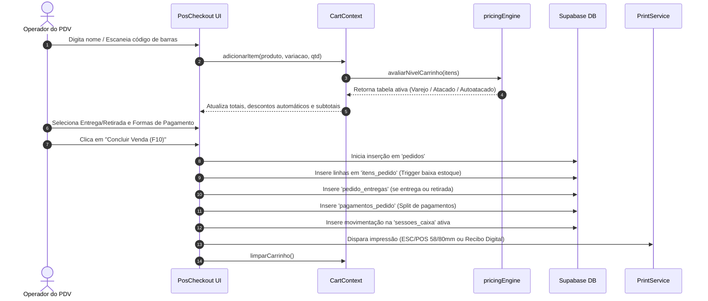

# 📘 DOCUMENTAÇÃO TÉCNICA E ARQUITETURAL DO SISTEMA HUBI

> **Versão do Documento:** 1.7.0  
> **Data de Atualização:** 22/10/2026  
> **Classificação:** Documento Técnico de Arquitetura, Engenharia e Operações  
> **Público-alvo:** Desenvolvedores, Engenheiros de Software, Arquitetos e Agentes de IA

---

## 📑 SUMÁRIO
1. [Visão Geral do Sistema e Stack Tecnológica](#1-visão-geral-do-sistema-e-stack-tecnológica)
   - [1.1 Propósito e Objetivos do Produto](#11-propósito-e-objetivos-do-produto)
   - [1.2 Módulos Principais](#12-módulos-principais)
   - [1.3 Stack do Front-end](#13-stack-do-front-end)
   - [1.4 Stack do Back-end, BaaS e Infraestrutura](#14-stack-do-back-end-baas-e-infraestrutura)
2. [Arquitetura e Diretrizes Estabelecidas (Skills & Google Mantis)](#2-arquitetura-e-diretrizes-estabelecidas-skills--google-mantis)
   - [2.1 Prontidão e Framework de Segurança Google Mantis](#21-prontidão-e-framework-de-segurança-google-mantis)
   - [2.2 Padrões de Escrita de Código e Modularidade](#22-padrões-de-escrita-de-código-e-modularidade)
   - [2.3 Políticas Rígidas de Banco de Dados: Proibição de Metadados JSONB Genéricos](#23-políticas-rígidas-de-banco-de-dados-proibição-de-metadados-jsonb-genéricos)
   - [2.4 Padrões de Nomenclatura e Localização (pt-BR)](#24-padrões-de-nomenclatura-e-localização-pt-br)
3. [Modelagem Atual do Banco de Dados (Supabase / PostgreSQL)](#3-modelagem-atual-do-banco-de-dados-supabase--postgresql)
   - [3.1 Visão Relacional Geral](#31-visão-relacional-geral)
   - [3.2 Dicionário Completo de Dados das Tabelas Críticas](#32-dicionário-completo-de-dados-das-tabelas-críticas)
   - [3.3 Triggers, Automações e Segurança no Banco (RLS)](#33-triggers-automações-e-segurança-no-banco-rls)
4. [Módulos e Fluxos Operacionais Existentes](#4-módulos-e-fluxos-operacionais-existentes)
   - [4.1 Fluxo do PDV (Frente de Caixa e Fechamento)](#41-fluxo-do-pdv-frente-de-caixa-e-fechamento)
   - [4.2 Fluxo de Edição de Pedidos Pendentes](#42-fluxo-de-edição-de-pedidos-pendentes)
   - [4.3 Fluxo do Catálogo Online Integrado](#43-fluxo-do-catálogo-online-integrado)
   - [4.4 Sistema de Autenticação e Isolamento Multi-tenant](#44-sistema-de-autenticação-e-isolamento-multi-tenant)
   - [4.5 Fluxo de Despacho Manual e Rastreamento dos Correios (PAC e SEDEX)](#45-fluxo-de-despacho-manual-e-rastreamento-dos-correios-pac-e-sedex)
   - [4.6 Arquitetura de Despacho Manual e Rastreamento Multimodal](#46-arquitetura-de-despacho-manual-e-rastreamento-multimodal)
   - [4.7 Módulo Cockpit Executivo F1 & Gestão de Metas da Loja](#47-módulo-cockpit-executivo-f1--gestão-de-metas-da-loja)
   - [4.8 Módulo Área do Cliente e Onboarding no Catálogo Online](#48-módulo-área-do-cliente-e-onboarding-no-catálogo-online)
   - [4.9 Fluxo Idempotente de Controle e Movimentação de Estoque (Fase 3)](#49-fluxo-idempotente-de-controle-e-movimentação-de-estoque-fase-3)
   - [4.10 Central Unificada de Importação e Exportação (Planilhas XLSX e Feeds)](#410-central-unificada-de-importação-e-exportação-planilhas-xlsx-e-feeds)
   - [4.11 Módulo de Parâmetros Globais da Plataforma e Painel Super Admin](#411-módulo-de-parâmetros-globais-da-plataforma-e-painel-super-admin)
   - [4.12 Integração Nativa com Mercado Livre (OAuth 2.0, Estoque Local, Vínculo GDM e Expedição)](#412-integração-nativa-com-mercado-livre-oauth-20-estoque-local-vínculo-gdm-e-expedição)
   - [4.13 Módulo Caderneta de Mercadinho (Conta Corrente, Ciclo Mensal e Coexistência com Fiado)](#413-módulo-caderneta-de-mercadinho-conta-corrente-ciclo-mensal-e-coexistência-com-fiado)
   - [4.14 Importação de Clientes em Lote (WhatsApp, Google Contatos e CSV) com Guia Passo a Passo](#414-importação-de-clientes-em-lote-whatsapp-google-contatos-e-csv-com-guia-passo-a-passo)
5. [Serviços e Utilitários Globais](#5-serviços-e-utilitários-globais)
   - [5.1 Supabase Client e Camada de Acesso a Dados](#51-supabase-client-e-camada-de-acesso-a-dados)
   - [5.2 Orquestrador e Serviços de Logística (Uber Direct, Melhor Envio e Despachos Manuais)](#52-orquestrador-e-serviços-de-logística-uber-direct-melhor-envio-e-despachos-manuais)
   - [5.3 Motor de Impressão Híbrido (ESC/POS Bluetooth, A4 PDF e Recibo Digital)](#53-motor-de-impressão-híbrido-escpos-bluetooth-a4-pdf-e-recibo-digital)
   - [5.4 Motor de Precificação Dinâmica (Pricing Engine)](#54-motor-de-precificação-dinâmica-pricing-engine)
   - [5.5 Gestão Transacional de Sessões de Caixa](#55-gestão-transacional-de-sessões-de-caixa)
   - [5.6 Componentes Globais e Formatação Centralizada](#56-componentes-globais-e-formatação-centralizada)
   - [5.7 Ciclo de Vida PWA, Persistência Resiliente e Padrão Visual Mobile](#57-ciclo-de-vida-pwa-persistência-resiliente-e-padrão-visual-mobile)
   - [5.8 Motor de Validação e Rastreamento Oficial dos Correios (`correiosValidator.ts` & `ModalRastreioPedido.tsx`)](#58-motor-de-validação-e-rastreamento-oficial-dos-correios-correiosvalidatorts--modalrastreiopedidotsx)
   - [5.9 Motor de Inteligência Calibrada System One (TypeSafe AI / Jev)](#59-motor-de-inteligência-calibrada-system-one-typesafe-ai--jev)
   - [5.10 Suíte Especializada de Micro-serviços Jev / TypeSafe AI](#510-suíte-especializada-de-micro-serviços-jev--typesafe-ai)
   - [5.11 Gerenciamento de Pilha de Overlays e Histórico Mobile (`overlayStackService.ts` & `useRegisterOverlay.ts`)](#511-gerenciamento-de-pilha-de-overlays-e-histórico-mobile-overlaystackservicets--useregisteroverlayts)
   - [5.12 Roteamento Híbrido da Rubi IA e Base de Conhecimento Local (`rubiRouterService.ts`)](#512-roteamento-híbrido-da-rubi-ia-e-base-de-conhecimento-local-rubirouterservicets)
   - [5.13 Infraestrutura de Monetização SaaS, Multi-Lojas e Mercado Pago](#513-infraestrutura-de-monetização-saas-multi-lojas-e-mercado-pago)
   - [5.14 Observabilidade Centralizada, Idempotência e Arquitetura de Dados Mestres (GDM)](#514-observabilidade-centralizada-idempotência-e-arquitetura-de-dados-mestres-gdm)
   - [5.15 Integração Nativa com Mercado Livre: Serviços Frontend e Edge Functions](#515-integração-nativa-com-mercado-livre-serviços-frontend-e-edge-functions)
   - [5.16 Gestão de Configurações da Plataforma e Assinaturas (`configuracoesPlataformaService.ts` & `useAssinaturaStatus.ts`)](#516-gestão-de-configurações-da-plataforma-e-assinaturas-configuracoesplataformaservicets--useassinaturastatusts)
   - [5.17 Motor e Ledger da Caderneta de Mercadinho (`cadernetaService.ts`)](#517-motor-e-ledger-da-caderneta-de-mercadinho-cadernetaservicets)
   - [5.18 Higienização Telefônica Brasileira e Parser Multi-Origem (`clientImportExportService.ts`)](#518-higienização-telefônica-brasileira-e-parser-multi-origem-clientimportexportservicets)
   - [5.19 Carteira Pré-Paga (Wallet) e Motor Híbrido de Notificações WhatsApp (`whatsappWalletService.ts`)](#519-carteira-pré-paga-wallet-e-motor-híbrido-de-notificações-whatsapp-whatsappwalletservicets)
   - [5.20 Fluxo Parametrizável de Pedidos com Itens por Quilo / Pesagem Posterior](#520-fluxo-parametrizável-de-pedidos-com-itens-por-quilo--pesagem-posterior)

---

## 1. VISÃO GERAL DO SISTEMA E STACK TECNOLÓGICA

### 1.1 Propósito e Objetivos do Produto
O **HUBI** é uma solução completa de Enterprise Resource Planning (ERP), Ponto de Venda (PDV) e E-commerce Omnichannel, desenhada especificamente para pequenos e médios varejistas, atacadistas e prestadores de serviços autônomos. A plataforma opera como uma aplicação web progressiva (PWA) de alta velocidade, capaz de funcionar com fluidez em desktop, tablets e smartphones, com suporte a operação híbrida (online e tolerância à desconexão offline temporária).

### 1.2 Módulos Principais
1. **PDV Multiplataforma (Frente de Caixa):**
   - Venda ágil com leitura ótica de código de barras (câmera ou scanner laser USB/Bluetooth).
   - Busca preditiva por nome, SKU, variação ou categoria.
   - Aplicação dinâmica de tabelas de preço com base no volume adicionado ao carrinho.
   - Múltiplas formas de pagamento em uma única venda (Split de pagamento: Dinheiro, PIX, Cartão Débito/Crédito, Fiado com limite de crédito).
2. **Catálogo Online Integrado (Vitrine Virtual PWA):**
   - Vitrine pública para o cliente final acessível por URL amigável (`/catalog/:slug`).
   - Cotação instantânea de frete via integrações com Uber Direct e Melhor Envio (Jadlog, Correios, etc.) ou opção de Retirada na Loja.
   - Finalização com pedido direto no WhatsApp do lojista e geração de PIX dinâmico (Mercado Pago / Asaas).
3. **Gestão de Pedidos e Andamento em Tempo Real:**
   - Kanban e tabela operacional de pedidos com atualização via Supabase Realtime.
   - Edição bidirecional completa de pedidos pendentes com recálculo automático de estoque e financeiro.
   - Rastreamento público do status do pedido para o cliente final (`/order-tracking/:id`).
4. **Catálogo de Produtos, Variações e Grade de Estoque:**
   - Controle de produtos simples, kits/combos e produtos com grade de até 2 eixos de variação (ex: Cor x Tamanho).
   - Códigos de barras e estoques individuais por variação.
   - Tabelas de preço progressivas por volume: Varejo, Atacado, Autoatacado e Preço Promocional temporário.
5. **Gestão de Clientes e Controle de Fiado (Crediário Próprio):**
   - Cadastro completo de clientes com histórico de compras e múltiplos endereços.
   - Controle de limite de crédito, saldo devedor e quitações parciais de fiado com abatimento de saldo e comprovantes digitais.
6. **Finanças, Sessões de Caixa e DRE de Lucro Real:**
   - Controle rigoroso de sessões de caixa (abertura com fundo de troco, suprimentos, sangrias, conferência cega e fechamento com apuração de quebra/sobra).
   - Contas a pagar e a receber com suporte a despesas fixas recorrentes e alerta preventivo de vencimento.
   - Apuração do Lucro Líquido Real deduzindo CMV (Custo das Mercadorias Vendidas) e taxas contratuais de maquininhas de cartão.
7. **Assistente Inteligente Rubi IA & Chat:**
   - Inteligência Artificial conversacional conectada aos dados da loja para insights analíticos, giro de estoque, identificação de produtos parados e sugestões comerciais.

### 1.3 Stack do Front-end
- **Linguagem:** TypeScript 5.7+ em modo estrito (`strict: true`).
- **Framework Principal:** React 18.3+ (Hooks, Context API, Memoização).
- **Bundler & Build Tool:** Vite 6.1+ com configurações otimizadas para PWA (`vite-plugin-pwa`).
- **Roteamento:** React Router DOM 6.29+ com controle de rotas protegidas por RBAC.
- **Estilização e Design System:** TailwindCSS 3.4+ com tema escuro nativo (*Dark Slate* com destaques em *Emerald* `#10B981`), utilitários de contraste e animações fluidas.
- **Biblioteca de Ícones:** Lucide React (0.475+).
- **Manipulação de Datas:** `date-fns` (4.1+) com localização para `pt-BR`.
- **Geração de Documentos:** `jspdf` (2.5+) para geração client-side de orçamentos e recibos A4.
- **Leitura e Exportação de Planilhas:** `xlsx` (SheetJS 0.18+) para importação/exportação de catálogo, clientes e pedidos.
- **Renderização de QR Codes:** `qrcode.react` para pagamento instantâneo PIX na tela.
- **Áudio do Sistema:** Web Audio API nativa para sinfonias de bipe, feedback de checkout e alertas sonoros de novos pedidos.
- **Comunicação de Hardware:** Web Bluetooth API para impressão térmica direta sem drivers intermediários em impressoras ESC/POS (58mm e 80mm).

### 1.4 Stack do Back-end, BaaS e Infraestrutura
- **Backend as a Service (BaaS):** Supabase Cloud / Self-Hosted.
- **Banco de Dados Relacional:** PostgreSQL 15 com extensões `uuid-ossp` e `pgcrypto`.
- **Segurança de Acesso:** Row Level Security (RLS) mandatória em todas as tabelas públicas com isolamento por `loja_id` e verificação de `auth.uid()`.
- **Sincronização em Tempo Real:** Supabase Realtime (WebSockets) nos canais de `pedidos`, `itens_pedido`, `pedido_entregas` e `caixas`.
- **Serverless Edge Functions:** Deno runtime no Supabase Functions para integrações protegidas que requerem chaves de API restritas e execução server-side:
  - `buscar-fotos-serpapi`: Busca automatizada de imagens de produtos.
  - `uber-dispatch` & `uber-webhook`: Despacho e rastreio de entregas expressas ponto a ponto.
  - `melhor-envio-despacho`: Cotação e emissão de etiquetas multi-transportadoras / Correios.
  - `typesafe-eval`: Proxy blindado para avaliações e julgamentos com o modelo **Jev (TypeSafe AI / System One)**.
- **APIs e Gateways Externos:**
  - *Uber Direct REST API v1*: Cotação de entrega expressa ponto a ponto e despacho de entregadores.
  - *Melhor Envio API v2*: Cotação de fretes multisedex (Correios, Jadlog, Loggi, Latam Cargo) e emissão de etiquetas.
  - *SerpApi Google Images Engine*: Enriquecimento de catálogo com busca automática de fotos de produtos via código de barras ou nome.
  - *TypeSafe AI System One (Jev)*: Avaliação preditiva, classificação calibrada de intenções, confirmações de atendimento e pontuações comportamentais sem alucinação de texto.

---

## 2. ARQUITETURA E DIRETRIZES ESTABELECIDAS (SKILLS & GOOGLE MANTIS)

### 2.1 Prontidão e Framework de Segurança Google Mantis
O repositório opera sob a governança contínua da suíte de auditoria e segurança **Google Mantis**. Qualquer alteração arquitetural, refatoração de infraestrutura ou correção de rotas deve aderir rigorosamente aos seguintes princípios:
1. **Modelagem Contínua de Ameaças (`mantis-threat-model`):**
   - Mapear claramente as fronteiras de confiança (*Trust Boundaries*). No HUBI, a fronteira mais sensível é a segregação entre o **Catálogo Público** (acesso anônimo via slug) e o **Painel Operacional do PDV/ERP** (acesso restrito por login do lojista e RLS).
   - Proteger estritamente rotas de mutação direta para que parâmetros de preço, estoque ou status de pagamento não possam ser fraudados pelo cliente final.
2. **Auditoria Estática Defensiva (`mantis-researcher` & `mantis-review`):**
   - Proibição de injeção direta de strings em consultas SQL. Uso exclusivo do query builder tipado do Supabase ou de stored procedures parametrizadas.
   - Validação exaustiva de tipos e sanitização de payloads de entrada antes de envio para persistência.
3. **Patching Seguro com Isolamento Transacional (`mantis-patch`):**
   - Alterações no banco de dados devem ser executadas em transações atômicas com migrações versionadas idempotentes (`ADD COLUMN IF NOT EXISTS`, `CREATE TABLE IF NOT EXISTS`).
4. **Validação de Produção sem Armadilhas de Debug (`mantis-critic`):**
   - Não basear fluxos de negócios ou validações críticas em instruções `assert` ou logs de depuração que sejam descartados em compilações de produção.

### 2.2 Padrões de Escrita de Código e Modularidade
- **Tipagem Estrita (TypeScript):**
  - Proibição do uso arbitrário de `any`. Todas as estruturas de dados de entrada e saída devem possuir interfaces ou types declarados em `src/types.ts` ou subpastas de tipo (ex: `src/types/shipping.ts`).
  - Casts como `as any` só são tolerados em contextos transitórios de compatibilidade de bibliotecas externas e devem conter documentação explicativa.
- **Imports Estruturados:**
  - Agrupamento padronizado: (1) React e bibliotecas externas, (2) Tipos e interfaces, (3) Contextos e hooks, (4) Serviços e utilitários, (5) Componentes UI e ícones.
- **Estrutura de Pastas Coesa:**
  ```text
  src/
  ├── components/       # Componentes de interface e telas principais
  │   ├── layout/       # Componentes de casca, navegação e drawers
  │   └── shipping/     # Módulo dedicado de logística, frete e endereços
  ├── contexts/         # Context API (Auth, Cart, DataOperacao, Feedback, Theme)
  ├── hooks/            # Hooks customizados (usePermissions, useNetworkStatus)
  ├── lib/              # Singletons e clientes de infraestrutura (supabase.ts)
  ├── services/         # Camada de lógica de negócios, integrações e orquestradores
  ├── types/            # Definições de tipos TypeScript
  └── utils/            # Formatadores, cálculos matemáticos e helpers puros
  ```

### 2.3 Políticas Rígidas de Banco de Dados: Proibição de Metadados JSONB Genéricos
Historicamente, o sistema utilizava uma coluna genérica `metadados JSONB` na tabela `pedidos` para armazenar dados como entrega, rastreio, contato e dados fiscais. **Esta abordagem foi formalmente descontinuada e banida da arquitetura do HUBI.**
- **Diretriz de Modelagem Relacional Pura:**
  - Todas as entidades e atributos necessários para regras de negócio, relatórios, fechamento financeiro ou auditoria **devem obrigatoriamente possuir colunas relacionais nativas** ou tabelas filhas normalizadas.
  - *Exemplo 1 (Logística):* Em vez de salvar JSON dentro do pedido, foi criada a tabela filha `pedido_entregas` e a tabela `cliente_enderecos`.
  - *Exemplo 2 (Fechamento Financeiro):* A tabela `pedidos` possui colunas explícitas: `subtotal_produtos NUMERIC(10,2)`, `valor_desconto NUMERIC(10,2)`, `valor_frete NUMERIC(10,2)` e `valor_total NUMERIC(10,2)`.
  - *Exemplo 3 (Auditoria de Pedidos):* Foi criada a tabela relacional `historico_pedidos` para auditar alterações de status e edições com carimbo de data, operador e motivo.
- O campo `configuracoes_extras` na tabela `lojas` é a única exceção permitida, servindo estritamente para preferências cosméticas e flags de interface do usuário, nunca para integridade referencial ou fechamento contábil.

### 2.4 Padrões de Nomenclatura e Localização (pt-BR)
- Todas as tabelas, colunas, procedures, mensagens de validação, logs informativos e commits adotam o **Português do Brasil (pt-BR)**.
- Tabelas e colunas utilizam rigorosamente o padrão `snake_case` no plural para tabelas (`pedidos`, `produtos`, `formas_pagamento`) e no singular claro para colunas (`preco_venda_varejo`, `quantidade_estoque`).
- Valores monetários são formatados como `NUMERIC(12,2)` ou `NUMERIC(10,2)` e exibidos no padrão `R$ 0,00`.

---

## 3. MODELAGEM ATUAL DO BANCO DE DADOS (SUPABASE / POSTGRESQL)

### 3.1 Visão Relacional Geral
O modelo relacional do HUBI é multitenant estrito, indexado em torno da entidade central `lojas`. A grande maioria das tabelas possui chave estrangeira `loja_id` com deleção em cascata (`ON DELETE CASCADE`).

```mermaid
erDiagram
    lojas ||--o{ usuarios_loja : possui
    lojas ||--o{ produtos : cataloga
    lojas ||--o{ categorias : organiza
    lojas ||--o{ fornecedores : gerencia
    lojas ||--o{ clientes : atende
    lojas ||--o{ formas_pagamento : aceita
    lojas ||--o{ pedidos : transaciona
    lojas ||--o{ caixas : abre_fecha
    lojas ||--o{ sessoes_caixa : audita
    lojas ||--o{ loja_shipping_configs : configura
    lojas ||--o| loja_metas : define_metas
    lojas ||--o{ movimentacoes_estoque : audita_estoque
    
    produtos ||--o{ variacoes_produto : grade
    produtos ||--o{ itens_combo : compoe
    produtos ||--o{ movimentacoes_estoque : registra_movimentacao
    
    clientes ||--o{ cliente_enderecos : reside
    clientes ||--o{ movimentacoes_saldo_cliente : fiado_historico
    clientes ||--o{ cliente_carrinho_itens : persiste_sacola
    clientes ||--o{ cliente_favoritos : favorita
    clientes ||--o{ cliente_notificacoes : recebe_avisos
    
    pedidos ||--o{ itens_pedido : contem
    pedidos ||--o{ pagamentos_pedido : liquida
    pedidos ||--o{ pedidos_pagamentos_previstos : planeja
    pedidos ||--o| pedido_entregas : despacha
    pedidos ||--o{ historico_pedidos : registra_log
    
    sessoes_caixa ||--o{ movimentacoes_caixa : movimenta
```



### 3.2 Dicionário Completo de Dados das Tabelas Críticas

#### 1. Tabela `lojas` (Raiz Multi-tenant)
| Coluna | Tipo | Restrições | Descrição |
| :--- | :--- | :--- | :--- |
| `id` | UUID | PK, DEFAULT gen_random_uuid() | Identificador exclusivo da empresa/loja |
| `nome_fantasia` | VARCHAR(150) | NOT NULL | Nome comercial exibido no PDV e catálogo |
| `razao_social` | VARCHAR(200) | NULL | Razão social jurídica |
| `tipo_documento` | VARCHAR(4) | CHECK in ('CPF', 'CNPJ') | Tipo de documento fiscal do estabelecimento |
| `numero_documento` | VARCHAR(20) | NULL | Número do CPF ou CNPJ |
| `telefone` | VARCHAR(20) | NULL | Telefone fixo de contato |
| `whatsapp` | VARCHAR(20) | NOT NULL | WhatsApp para onde os pedidos do catálogo são direcionados |
| `email` | VARCHAR(150) | NOT NULL | E-mail corporativo do lojista |
| `slug_catalogo` | VARCHAR(80) | UNIQUE, NOT NULL | Identificador público na URL do catálogo virtual |
| `cor_primaria` | VARCHAR(10) | DEFAULT '#10B981' | Cor de destaque da identidade visual |
| `moeda` | VARCHAR(5) | DEFAULT 'BRL' | Moeda padrão |
| `aceita_pedidos_online` | BOOLEAN | DEFAULT TRUE | Habilita recebimento de pedidos no catálogo |
| `valor_minimo_pedido` | NUMERIC(12,2) | DEFAULT 0.00 | Valor mínimo para checkout no catálogo |
| `endereco_logradouro` | VARCHAR(200) | NULL | Rua do estabelecimento |
| `endereco_numero` | VARCHAR(30) | NULL | Número |
| `endereco_complemento` | VARCHAR(100) | NULL | Complemento |
| `endereco_bairro` | VARCHAR(100) | NULL | Bairro |
| `endereco_cidade` | VARCHAR(100) | NULL | Cidade |
| `endereco_estado` | VARCHAR(2) | NULL | UF (ex: PE, SP) |
| `endereco_cep` | VARCHAR(10) | NULL | CEP da loja física |
| `organizacao_id` | UUID | NULL, FK -> organizacoes(id) ON DELETE RESTRICT | Vínculo hierárquico ao Conglomerado / Holding |
| `status_assinatura` | VARCHAR(20) | DEFAULT 'trial', CHECK ('trial', 'ativo', 'atrasado', 'bloqueado') | Ciclo de vida da assinatura individual da unidade |
| `trial_fim_em` | TIMESTAMPTZ | DEFAULT NOW() + 7 days | Término do período de degustação de 7 dias |
| `assinatura_fim_em` | TIMESTAMPTZ | NULL | Vencimento da anuidade de 12 meses da loja |
| `mp_preference_id` | TEXT | NULL | Identificador da preferência ativa de pagamento no Mercado Pago |
| `serpapi_key` | TEXT | NULL | Chave SerpApi BYOK do lojista para busca de fotos |
| `status_em_separacao` | BOOLEAN | DEFAULT FALSE | Habilita status intermediário 'em_separacao' no kanban |
| `status_em_expedicao` | BOOLEAN | DEFAULT FALSE | Habilita status intermediário 'em_expedicao' no kanban |
| `status_aguardando_envio` | BOOLEAN | DEFAULT FALSE | Habilita status intermediário 'aguardando_envio' no kanban |
| `status_enviado` | BOOLEAN | DEFAULT FALSE | Habilita status intermediário 'enviado' no kanban |
| `status_entregue` | BOOLEAN | DEFAULT FALSE | Habilita status final 'entregue' no fluxo operacional |
| `status_pronto_para_retirar` | BOOLEAN | DEFAULT FALSE | Habilita status 'pronto_para_retirar' para retiradas na loja |
| `caderneta_ativa` | BOOLEAN | DEFAULT FALSE | Feature toggle para habilitar o módulo de Caderneta de Mercadinho |
| `dia_vencimento_padrao_caderneta` | INTEGER | DEFAULT 10, CHECK (dia >= 1 AND dia <= 31) | Dia padrão de fechamento/acerto da caderneta na loja |
| `tipos_venda` | JSONB | DEFAULT '{"varejo":true,"atacado":true,"distribuidor":true}' | Flags de tipos de venda habilitados no PDV |
| `configuracoes_extras` | JSONB | DEFAULT '{}' | Preferências de layout, recibo e interface |
| `criado_em` / `atualizado_em` | TIMESTAMPTZ | DEFAULT NOW() | Carimbos de auditoria temporal |

#### 2. Tabela `usuarios_loja` (Controle de Acesso RBAC)
| Coluna | Tipo | Restrições | Descrição |
| :--- | :--- | :--- | :--- |
| `id` | UUID | PK, DEFAULT gen_random_uuid() | ID do perfil na loja |
| `loja_id` | UUID | FK -> lojas(id) ON DELETE CASCADE | Vínculo tenant |
| `usuario_auth_id` | UUID | FK -> auth.users(id) ON DELETE CASCADE | Vínculo com usuário autenticado Supabase |
| `nome_completo` | VARCHAR(150) | NOT NULL | Nome do operador/vendedor |
| `email` | VARCHAR(150) | NOT NULL | E-mail de login |
| `perfil` | VARCHAR(20) | CHECK in ('admin', 'gerente', 'vendedor') | Nível hierárquico de acesso |
| `tela_inicial` | VARCHAR(50) | DEFAULT 'dashboard' | Rota/tela de pouso padrão após login do operador |
| `pode_ver_preco_custo` | BOOLEAN | DEFAULT FALSE | Permissão para visualizar custo e margens de lucro |
| `pode_exportar_relatorios` | BOOLEAN | DEFAULT FALSE | Permissão para exportar dados para planilhas |
| `pode_editar_vendas_passadas` | BOOLEAN | DEFAULT FALSE | Permissão de edição em vendas já concluídas |
| `pode_abrir_fechar_caixa` | BOOLEAN | DEFAULT FALSE | Permissão para gerenciar abertura e turno de caixa |
| `ativo` | BOOLEAN | DEFAULT TRUE | Status do usuário na loja |

#### 3. Tabela `produtos` (Catálogo Mestre e Tabelas de Preço por Volume)
| Coluna | Tipo | Restrições | Descrição |
| :--- | :--- | :--- | :--- |
| `id` | UUID | PK, DEFAULT gen_random_uuid() | ID do produto |
| `loja_id` | UUID | FK -> lojas(id) ON DELETE CASCADE | Vínculo tenant |
| `categoria_id` | UUID | FK -> categorias(id) ON DELETE SET NULL | Categoria do produto |
| `fornecedor_id` | UUID | FK -> fornecedores(id) ON DELETE SET NULL | Fornecedor de origem |
| `nome` | VARCHAR(200) | NOT NULL | Nome comercial do produto |
| `codigo_interno` | VARCHAR(50) | NULL | Código de referência interna do lojista |
| `codigo_barras` | VARCHAR(50) | NULL | Código EAN/GTIN para leitura por leitor ótico |
| `descricao` | TEXT | NULL | Descrição detalhada do produto |
| `fotos_urls` | JSONB | DEFAULT '[]' | Lista de URLs de fotos hospedadas |
| `tipo_unidade` | VARCHAR(10) | DEFAULT 'un' | Unidade (un, kg, l, m) |
| `tipo_item` | VARCHAR(20) | CHECK in ('produto', 'servico') | Diferenciação entre produto físico e serviço |
| `preco_custo` | NUMERIC(12,2) | DEFAULT 0.00 | Preço de custo unitário |
| `preco_venda_varejo` | NUMERIC(12,2) | NOT NULL DEFAULT 0.00 | Preço base unitário de varejo |
| `preco_venda_atacado` | NUMERIC(12,2) | NULL | Preço unitário no atacado |
| `qtd_minima_atacado` | NUMERIC(12,3) | DEFAULT 6 | Quantidade mínima para ativar preço de atacado |
| `preco_venda_autoatacado` | NUMERIC(12,2) | NULL | Preço unitário no autoatacado (caixa fechada) |
| `qtd_minima_autoatacado` | NUMERIC(12,3) | DEFAULT 24 | Quantidade mínima para ativar autoatacado |
| `preco_promocional` | NUMERIC(12,2) | NULL | Preço promocional temporário |
| `promocao_ativa` | BOOLEAN | DEFAULT FALSE | Flag de ativação da promoção |
| `quantidade_estoque` | NUMERIC(12,3) | DEFAULT 0 | Saldo físico atual em estoque |
| `estoque_minimo_alerta` | NUMERIC(12,3) | DEFAULT 0 | Nível de alerta para reposição |
| `tem_variacoes` | BOOLEAN | DEFAULT FALSE | Indica se o produto possui grade de variações |
| `rotulo_variacao_1` | VARCHAR(50) | NULL | Ex: 'Tamanho', 'Voltagem', 'Sabor' |
| `rotulo_variacao_2` | VARCHAR(50) | NULL | Ex: 'Cor', 'Fragrância' |
| `eh_combo` | BOOLEAN | DEFAULT FALSE | Indica se o item é composto por produtos filhos |
| `exibir_catalogo` | BOOLEAN | DEFAULT TRUE | Visibilidade no catálogo virtual |
| `destaque` | BOOLEAN | DEFAULT FALSE | Fixado no carrossel de destaques da vitrine |
| `ativo` | BOOLEAN | DEFAULT TRUE | Status geral de ativação do produto |

#### 4. Tabela `variacoes_produto` (Grade de Variações em até 2 Eixos)
| Coluna | Tipo | Restrições | Descrição |
| :--- | :--- | :--- | :--- |
| `id` | UUID | PK, DEFAULT gen_random_uuid() | ID exclusivo da variação |
| `loja_id` | UUID | FK -> lojas(id) ON DELETE CASCADE | Vínculo tenant |
| `produto_id` | UUID | FK -> produtos(id) ON DELETE CASCADE | Produto pai ao qual pertence |
| `valor_variacao_1` | VARCHAR(80) | NOT NULL | Ex: 'P', 'M', 'G', '110V' |
| `valor_variacao_2` | VARCHAR(80) | NULL | Ex: 'Preto', 'Vermelho', 'Morango' |
| `sku` | VARCHAR(50) | NULL | SKU próprio da variação |
| `codigo_barras` | VARCHAR(50) | NULL | Código de barras exclusivo da variação |
| `preco_custo` | NUMERIC(12,2) | NULL | Custo individual (se diferente do pai) |
| `preco_venda_varejo` | NUMERIC(12,2) | NOT NULL DEFAULT 0.00 | Preço de varejo da variação |
| `preco_venda_atacado` | NUMERIC(12,2) | NULL | Preço atacado da variação |
| `preco_venda_autoatacado` | NUMERIC(12,2) | NULL | Preço autoatacado da variação |
| `preco_promocional` | NUMERIC(12,2) | NULL | Preço promocional da variação |
| `quantidade_estoque` | NUMERIC(12,3) | DEFAULT 0 | Saldo físico individual desta variação |
| `estoque_minimo_alerta` | NUMERIC(12,3) | DEFAULT 0 | Alerta de estoque desta variação |
| `ativo` | BOOLEAN | DEFAULT TRUE | Ativação da variação |

#### 5. Tabela `pedidos` (Pedidos do PDV e Catálogo)
| Coluna | Tipo | Restrições | Descrição |
| :--- | :--- | :--- | :--- |
| `id` | UUID | PK, DEFAULT gen_random_uuid() | ID do pedido |
| `loja_id` | UUID | FK -> lojas(id) ON DELETE CASCADE | Vínculo tenant |
| `numero_pedido` | BIGSERIAL | NOT NULL | Número sequencial legível para operador e cliente |
| `cliente_id` | UUID | FK -> clientes(id) ON DELETE SET NULL | Cliente associado (se identificado) |
| `vendedor_id` | UUID | FK -> usuarios_loja(id) ON DELETE SET NULL | Operador responsável pela emissão |
| `origem` | VARCHAR(20) | CHECK in ('pdv_mobile', 'pdv_desktop', 'catalogo_online') | Canal gerador do pedido |
| `tabela_preco_aplicada` | VARCHAR(20) | DEFAULT 'varejo' | Tabela de precificação adotada na venda |
| `status` | VARCHAR(50) | CHECK in ('pendente', 'confirmado', 'em_separacao', 'em_producao', 'em_expedicao', 'saiu_para_entrega', 'pronto_para_retirar', 'entregue', 'concluido', 'cancelado', 'vencido') | Estado do fluxo operacional |
| `status_pagamento` | VARCHAR(30) | DEFAULT 'aguardando_pagamento' | Estado da quitação financeira |
| `estoque_baixado` | BOOLEAN | DEFAULT FALSE | Flag de controle idempotente indicando se os itens já tiveram saída física realizada |
| `subtotal_produtos` | NUMERIC(10,2) | NOT NULL DEFAULT 0.00 | Soma dos produtos puros (sem taxas ou frete) |
| `subtotal` | NUMERIC(12,2) | NOT NULL DEFAULT 0.00 | Subtotal de compatibilidade |
| `valor_desconto` | NUMERIC(10,2) | DEFAULT 0.00 | Desconto total concedido |
| `desconto_percentual` | NUMERIC(5,2) | DEFAULT 0.00 | Percentual correspondente do desconto |
| `valor_frete` | NUMERIC(10,2) | DEFAULT 0.00 | Valor cobrado pelo transporte/entrega |
| `valor_total` | NUMERIC(10,2) | NOT NULL DEFAULT 0.00 | Total final (Produtos - Desconto + Frete) |
| `valor_pago` | NUMERIC(12,2) | DEFAULT 0.00 | Soma dos valores já quitados |
| `saldo_devedor` | NUMERIC(12,2) | DEFAULT 0.00 | Valor pendente (em casos de fiado ou parcial) |
| `fiado_quitado` | BOOLEAN | DEFAULT FALSE | Flag de liquidação total do débito fiado |
| `data_vencimento_fiado` | DATE | NULL | Data de vencimento do saldo fiado |
| `eh_caderneta` | BOOLEAN | DEFAULT FALSE | Indica se a venda foi lançada na Caderneta de Mercadinho |
| `dia_vencimento_caderneta` | INTEGER | NULL | Dia de acerto no mês definido para o cliente |
| `ciclo_referencia_caderneta` | VARCHAR(7) | NULL | Mês de competência da fatura (ex: '2026-11') |
| `forma_entrega_id` | UUID | FK -> formas_entrega(id) ON DELETE SET NULL | Modalidade selecionada |
| `endereco_entrega` | TEXT | NULL | Endereço descritivo (fallback para entregas rápidas) |
| `troco_para` | NUMERIC(12,2) | NULL | Valor em espécie entregue pelo cliente para troco |
| `cupom_codigo` | VARCHAR(50) | NULL | Código do cupom aplicado na venda |
| `valor_desconto_cupom` | NUMERIC(12,2) | DEFAULT 0.00 | Valor do desconto provido pelo cupom |
| `cliente_nome_avulso` | VARCHAR(150) | NULL | Nome do cliente avulso (quando não cadastrado) |
| `cliente_telefone_avulso`| VARCHAR(20) | NULL | Telefone do cliente avulso |
| `cliente_documento_avulso`| VARCHAR(20) | NULL | CPF/CNPJ informado na hora da compra |
| `cliente_email_avulso` | VARCHAR(100) | NULL | E-mail do cliente avulso |
| `atualizado_por` | UUID | FK -> usuarios_loja(id) ON DELETE SET NULL | Último operador que editou o pedido |
| `observacoes` | TEXT | NULL | Notas internas e observações de entrega |
| `data_venda` | TIMESTAMPTZ | DEFAULT NOW() | Data contábil/operacional da venda |
| `motivo_cancelamento` | TEXT | NULL | Justificativa em caso de cancelamento |

#### 6. Tabela `pedido_entregas` (Módulo Dedicado de Logística e Frete)
| Coluna | Tipo | Restrições | Descrição |
| :--- | :--- | :--- | :--- |
| `id` | UUID | PK, DEFAULT gen_random_uuid() | ID do despacho de entrega |
| `pedido_id` | UUID | UNIQUE, NOT NULL, FK -> pedidos(id) ON DELETE CASCADE | Vínculo 1:1 com o pedido |
| `tipo_atendimento` | VARCHAR(20) | CHECK in ('retirada', 'entrega') | Modo de atendimento do pedido |
| `cliente_endereco_id` | UUID | FK -> cliente_enderecos(id) ON DELETE SET NULL | Endereço cadastrado selecionado |
| `destino_cep` | VARCHAR(9) | NULL | CEP de entrega congelado no fechamento |
| `destino_logradouro` | VARCHAR(255) | NULL | Rua de entrega congelada |
| `destino_numero` | VARCHAR(20) | NULL | Número de entrega |
| `destino_complemento` | VARCHAR(100) | NULL | Complemento |
| `destino_bairro` | VARCHAR(100) | NULL | Bairro |
| `destino_cidade` | VARCHAR(100) | NULL | Cidade |
| `destino_uf` | VARCHAR(2) | NULL | Estado (UF) |
| `destino_latitude` / `destino_longitude` | NUMERIC | NULL | Coordenadas para geolocalização e rotas |
| `provedor` | VARCHAR(30) | NULL | Provedor logístico responsável ('uber', 'melhor_envio', 'correios', 'frete_proprio', 'retirada_loja') |
| `cotacao_id` | TEXT | NULL | Identificador do token de cotação da transportadora (ex: dqt_ da Uber Direct) |
| `transportadora_nome` | VARCHAR(100) | NULL | Ex: 'Uber Direct', 'Correios', 'Jadlog' |
| `servico_codigo` | VARCHAR(100) | NULL | Código da rota/serviço no provedor |
| `servico_correios` | VARCHAR(20) | NULL | Subserviço dos Correios ('PAC' ou 'SEDEX') |
| `tipo_operacao` | VARCHAR(30) | NULL | Modalidade operacional ('correios', 'uber', 'melhor_envio') |
| `valor_frete` | NUMERIC(10,2) | NOT NULL DEFAULT 0.00 | Valor exato cobrado do cliente |
| `prazo_estimado_texto` | VARCHAR(100) | NULL | Ex: '30 a 60 min', '1 a 3 dias úteis' |
| `codigo_rastreio` | VARCHAR(100) | NULL | Código oficial de rastreamento (SRO 13 caracteres) |
| `link_rastreio` | TEXT | NULL | URL direta para acompanhamento no portal oficial |
| `status_envio` | VARCHAR(50) | NOT NULL DEFAULT 'pendente' | Estado do frete ('pendente', 'despachado', 'em_transito', 'saiu_para_entrega', 'entregue', 'cancelado') |
| `despachado_em` | TIMESTAMPTZ | NULL | Carimbo de data/hora do despacho ou postagem |
| `despachado_por` | UUID | FK -> usuarios_loja(id) ON DELETE SET NULL | Operador que realizou o despacho |

#### 7. Tabela `itens_pedido` (Linhas do Pedido com Snapshot Imutável)
| Coluna | Tipo | Restrições | Descrição |
| :--- | :--- | :--- | :--- |
| `id` | UUID | PK, DEFAULT gen_random_uuid() | ID do item |
| `loja_id` | UUID | FK -> lojas(id) ON DELETE CASCADE | Vínculo tenant |
| `pedido_id` | UUID | FK -> pedidos(id) ON DELETE CASCADE | Pedido ao qual o item pertence |
| `produto_id` | UUID | FK -> produtos(id) ON DELETE RESTRICT | Produto de referência |
| `variacao_id` | UUID | FK -> variacoes_produto(id) ON DELETE SET NULL | Variação específica (se houver) |
| `tabela_preco_utilizada` | VARCHAR(20) | DEFAULT 'varejo' | Tabela utilizada no momento da venda |
| `nome_produto` | VARCHAR(200) | NOT NULL | Nome imutável congelado na hora da venda |
| `rotulo_variacao` | VARCHAR(150) | NULL | Rótulo congelado (ex: 'Vermelho / G') |
| `preco_custo_unitario` | NUMERIC(12,2) | DEFAULT 0.00 | Custo do item no momento da venda |
| `preco_venda_unitario` | NUMERIC(12,2) | NOT NULL DEFAULT 0.00 | Preço praticado por unidade |
| `quantidade` | NUMERIC(12,3) | NOT NULL DEFAULT 1 | Quantidade de itens adquiridos |
| `subtotal` | NUMERIC(12,2) | NOT NULL DEFAULT 0.00 | `preco_venda_unitario * quantidade` |
| `observacoes` | VARCHAR(255) | NULL | Observação individual do item |

#### 8. Tabela `historico_pedidos` (Trilha de Auditoria Relacional)
| Coluna | Tipo | Restrições | Descrição |
| :--- | :--- | :--- | :--- |
| `id` | UUID | PK, DEFAULT gen_random_uuid() | ID do evento |
| `loja_id` | UUID | FK -> lojas(id) ON DELETE CASCADE | Vínculo tenant |
| `pedido_id` | UUID | FK -> pedidos(id) ON DELETE CASCADE | Pedido auditado |
| `usuario_id` | UUID | FK -> usuarios_loja(id) ON DELETE SET NULL | Usuário que executou a ação |
| `tipo_evento` | VARCHAR(50) | NOT NULL | 'status_alterado', 'pedido_editado', 'criacao', 'pagamento_recebido', 'cancelado' |
| `status_anterior` | VARCHAR(50) | NULL | Status em que o pedido estava |
| `status_novo` | VARCHAR(50) | NULL | Novo status atribuído |
| `motivo` | TEXT | NULL | Justificativa ou motivo registrado pelo operador/sistema |
| `descricao` | TEXT | NULL | Descrição detalhada da ação em linguagem natural |
| `criado_em` | TIMESTAMPTZ | DEFAULT NOW() | Carimbo de data/hora do evento |

#### 9. Tabela `sessoes_caixa` (Controle de Turnos e Terminais de Caixa)
| Coluna | Tipo | Restrições | Descrição |
| :--- | :--- | :--- | :--- |
| `id` | UUID | PK, DEFAULT gen_random_uuid() | ID da sessão |
| `loja_id` | UUID | FK -> lojas(id) ON DELETE CASCADE | Vínculo tenant |
| `terminal_id` | VARCHAR(50) | DEFAULT 'PDV-01' | Identificador do terminal físico/máquina |
| `aberto_por_usuario_id` | UUID | FK -> usuarios_loja(id) ON DELETE RESTRICT | Usuário que abriu o caixa |
| `fechado_por_usuario_id`| UUID | FK -> usuarios_loja(id) ON DELETE RESTRICT | Usuário que fechou e declarou valores |
| `aberto_em` | TIMESTAMPTZ | NOT NULL DEFAULT NOW() | Momento da abertura |
| `fechado_em` | TIMESTAMPTZ | NULL | Momento do fechamento |
| `fundo_inicial` | NUMERIC(12,2) | NOT NULL DEFAULT 0.00 | Saldo em espécie do fundo de troco inicial |
| `status` | VARCHAR(20) | CHECK in ('ABERTO', 'FECHADO') | Estado da sessão |
| `total_entradas_sistema` | NUMERIC(12,2) | DEFAULT 0.00 | Entradas apuradas pelo sistema |
| `total_saidas_sistema` | NUMERIC(12,2) | DEFAULT 0.00 | Saídas e sangrias do sistema |
| `saldo_esperado_dinheiro`| NUMERIC(12,2) | DEFAULT 0.00 | Saldo calculado em dinheiro |
| `saldo_declarado_dinheiro`| NUMERIC(12,2)| NULL | Valor contado fisicamente na gaveta |
| `diferenca_dinheiro` | NUMERIC(12,2) | NULL | Quebra ou sobra de caixa (`declarado - esperado`) |

#### 10. Tabela `loja_shipping_configs` (Configurações de Logística, Frete Grátis e Retirada)
| Coluna | Tipo | Restrições | Descrição |
| :--- | :--- | :--- | :--- |
| `id` | UUID | PK, DEFAULT gen_random_uuid() | ID do registro de configurações logísticas |
| `loja_id` | UUID | UNIQUE, NOT NULL, FK -> lojas(id) ON DELETE CASCADE | Vínculo 1:1 com a loja |
| `uber_ativo` | BOOLEAN | DEFAULT FALSE | Ativação do módulo de cotação Uber Direct |
| `uber_client_id` | TEXT | NULL | Client ID do app da Uber Direct (BYOK) |
| `uber_client_secret` | TEXT | NULL | Client Secret da Uber Direct |
| `uber_customer_id` | TEXT | NULL | Customer ID da conta Uber Direct |
| `melhor_envio_ativo` | BOOLEAN | DEFAULT FALSE | Ativação do módulo de cotação Melhor Envio |
| `melhor_envio_token` | TEXT | NULL | Token Bearer de acesso da API do Melhor Envio |
| `melhor_envio_sandbox` | BOOLEAN | DEFAULT FALSE | Flag de ambiente sandbox/testes do Melhor Envio |
| `retirada_balcao_ativa` | BOOLEAN | DEFAULT TRUE | Habilita opção de retirada presencial no balcão da loja |
| `retirada_loja_ativa` | BOOLEAN | DEFAULT TRUE | Flag relacional equivalente para controle de retirada |
| `permite_retirada_loja` | BOOLEAN | DEFAULT TRUE | Coluna de compatibilidade operacional |
| `frete_gratis_ativo` | BOOLEAN | DEFAULT FALSE | Ativa benefício de frete grátis por valor mínimo |
| `frete_gratis_valor_minimo`| NUMERIC(12,2)| DEFAULT 0.00 | Valor mínimo do subtotal de compras para gratuidade |
| `origem_cep` | VARCHAR(9) | NOT NULL | CEP da loja física de onde saem os despachos |
| `origem_logradouro` | VARCHAR(255) | NULL | Rua de coleta para transportadoras |
| `origem_numero` | VARCHAR(20) | NULL | Número |
| `origem_complemento` | VARCHAR(100) | NULL | Complemento |
| `origem_bairro` | VARCHAR(100) | NULL | Bairro |
| `origem_cidade` | VARCHAR(100) | NULL | Cidade |
| `origem_uf` | VARCHAR(2) | NULL | Estado (UF) |
| `origem_latitude` | NUMERIC | NULL | Latitude de origem para cálculo de rotas |
| `origem_longitude` | NUMERIC | NULL | Longitude de origem para cálculo de rotas |
| `dias_preparacao` | INTEGER | DEFAULT 0 | Dias extras adicionados ao prazo da transportadora |
| `taxa_adicional_frete`| NUMERIC(10,2) | DEFAULT 0.00 | Sobretaxa ou margem adicionada ao valor cotado |

#### 11. Tabela `cliente_enderecos` (Múltiplos Endereços do Cliente e Geolocalização)
| Coluna | Tipo | Restrições | Descrição |
| :--- | :--- | :--- | :--- |
| `id` | UUID | PK, DEFAULT gen_random_uuid() | Identificador exclusivo do endereço |
| `cliente_id` | UUID | NOT NULL, FK -> clientes(id) ON DELETE CASCADE | Cliente proprietário do endereço |
| `identificador` | VARCHAR(50) | DEFAULT 'Outro' | Rótulo amigável (ex: 'Principal', 'Casa', 'Trabalho') |
| `cep` | VARCHAR(9) | NOT NULL | CEP do endereço (formato 00000-000 ou 8 dígitos) |
| `logradouro` | VARCHAR(255) | NOT NULL | Rua, avenida, travessa |
| `numero` | VARCHAR(20) | NOT NULL | Número residencial/comercial ou 'S/N' |
| `complemento` | VARCHAR(100) | NULL | Apartamento, bloco, sala, ponto de referência |
| `bairro` | VARCHAR(100) | NOT NULL | Bairro |
| `cidade` | VARCHAR(100) | NOT NULL | Município |
| `uf` | VARCHAR(2) | NOT NULL | Estado (sigla com 2 caracteres, ex: CE, PE, SP) |
| `latitude` | NUMERIC | NULL | Latitude obtida via geocodificação ou GPS |
| `longitude` | NUMERIC | NULL | Longitude obtida via geocodificação ou GPS |
| `is_principal` | BOOLEAN | DEFAULT FALSE | Flag indicadora se é o endereço padrão de entrega |
| `criado_em` | TIMESTAMPTZ | DEFAULT NOW() | Carimbo de inclusão do endereço |

#### 12. Tabela `pedido_entregas` (Despachos, Rastreamento e Snapshots Logísticos)
| Coluna | Tipo | Restrições | Descrição |
| :--- | :--- | :--- | :--- |
| `id` | UUID | PK, DEFAULT gen_random_uuid() | ID do despacho de entrega |
| `pedido_id` | UUID | NOT NULL, FK -> pedidos(id) ON DELETE CASCADE | Pedido associado |
| `forma_entrega_id` | UUID | NULL, FK -> formas_entrega(id) ON DELETE SET NULL | Modalidade relacional cadastrada |
| `forma_entrega_nome` | VARCHAR(150) | NULL | Nome imutável congelado no momento do pedido |
| `tipo_entrega` | VARCHAR(50) | DEFAULT 'proprio' | 'retirada', 'proprio', 'transportadora', 'manual' |
| `tipo_operacao` | VARCHAR(50) | NULL | 'correios', 'app_entrega', 'transportadora', 'frota_propria' |
| `tipo_atendimento` | VARCHAR(30) | NOT NULL DEFAULT 'entrega' | 'entrega' ou 'retirada' |
| `cliente_endereco_id` | UUID | NULL, FK -> cliente_enderecos(id) ON DELETE SET NULL | Endereço do cliente |
| `destino_cep` | VARCHAR(10) | NULL | CEP do destinatário |
| `destino_logradouro` | VARCHAR(255) | NULL | Rua do destinatário |
| `destino_numero` | VARCHAR(30) | NULL | Número |
| `destino_complemento` | VARCHAR(100) | NULL | Complemento |
| `destino_bairro` | VARCHAR(100) | NULL | Bairro |
| `destino_cidade` | VARCHAR(100) | NULL | Cidade |
| `destino_uf` | VARCHAR(2) | NULL | UF de destino |
| `destino_latitude` | NUMERIC | NULL | Coordenadas para roteamento |
| `destino_longitude` | NUMERIC | NULL | Coordenadas para roteamento |
| `provedor` | VARCHAR(50) | DEFAULT 'frete_proprio' | 'uber', 'melhor_envio', 'frete_proprio', 'retirada_loja' |
| `transportadora_nome` | VARCHAR(150) | NULL | Nome da transportadora/operador |
| `servico_codigo` | VARCHAR(50) | NULL | Código técnico do serviço |
| `valor_frete` | NUMERIC(10,2) | NOT NULL DEFAULT 0.00 | Valor final cobrado |
| `valor_original` | NUMERIC(10,2) | NULL | Valor original antes de subsídio |
| `valor_subsidio` | NUMERIC(10,2) | DEFAULT 0.00 | Desconto/subsídio concedido |
| `is_frete_gratis` | BOOLEAN | DEFAULT FALSE | Flag de gratuidade |
| `prazo_estimado_texto` | VARCHAR(100) | NULL | Texto amigável de prazo |
| `codigo_rastreio` | VARCHAR(100) | NULL | Código de rastreio SRO/CTE |
| `link_rastreio` | TEXT | NULL | Link público de acompanhamento |
| `link_etiqueta` | TEXT | NULL | Link do PDF da etiqueta |
| `pin_entrega` | VARCHAR(10) | NULL | PIN legado / código de entrega |
| `entregador_nome` | VARCHAR(150) | NULL | Nome do motoboy/entregador próprio |
| `contato_entregador` | VARCHAR(50) | NULL | Telefone/WhatsApp do entregador |
| `nome_app` | VARCHAR(100) | NULL | Nome do app de entrega |
| `app_entrega_id` | UUID | NULL, FK -> apps_entrega(id) ON DELETE SET NULL | App de corrida vinculado |
| `codigo_corrida` | VARCHAR(100) | NULL | Identificador alfanumérico da corrida no app |
| `servico_correios` | VARCHAR(20) | NULL | 'PAC' ou 'SEDEX' |
| `transportadora_id` | UUID | NULL, FK -> transportadoras(id) ON DELETE SET NULL | Transportadora privada cadastrada |
| `nome_transportadora` | VARCHAR(150) | NULL | Nome cadastral da transportadora |
| `despachado_em` | TIMESTAMPTZ | NULL | Momento formal do despacho |
| `despachado_por` | UUID | NULL, FK -> usuarios_loja(id) ON DELETE SET NULL | Operador que realizou o despacho |
| `status_envio` | VARCHAR(50) | DEFAULT 'pendente' | 'pendente', 'despachado', 'em_transito', 'saiu_para_entrega', 'entregue' |
| `peso_kg` | NUMERIC(8,3) | NULL | Peso total do pacote |
| `largura_cm` | NUMERIC(8,2) | NULL | Largura do pacote |
| `altura_cm` | NUMERIC(8,2) | NULL | Altura do pacote |
| `comprimento_cm` | NUMERIC(8,2) | NULL | Comprimento do pacote |
| `quantidade_volumes` | INTEGER | DEFAULT 1 | Total de volumes despachados |
| `criado_em` / `atualizado_em` | TIMESTAMPTZ | DEFAULT NOW() | Carimbos temporais de auditoria |

#### 13. Tabela `apps_entrega` (Cadastro Multi-tenant de Aplicativos de Corrida)
| Coluna | Tipo | Restrições | Descrição |
| :--- | :--- | :--- | :--- |
| `id` | UUID | PK, DEFAULT gen_random_uuid() | ID do aplicativo de corrida |
| `loja_id` | UUID | NOT NULL, FK -> lojas(id) ON DELETE CASCADE | Vínculo tenant obrigatório |
| `nome` | VARCHAR(100) | NOT NULL | Nome do aplicativo (ex: Uber Flash, 99 Entregas, Lalamove) |
| `icone` | VARCHAR(50) | DEFAULT 'Navigation' | Identificador do ícone Lucide |
| `padrao` | BOOLEAN | DEFAULT FALSE | Flag de opção padrão nos selects |
| `ativo` | BOOLEAN | DEFAULT TRUE | Ativação do aplicativo na loja |
| `criado_em` / `atualizado_em` | TIMESTAMPTZ | DEFAULT NOW() | Carimbos de auditoria |

#### 14. Tabela `transportadoras` (Cadastro Multi-tenant de Transportadoras Privadas e Cargas)
| Coluna | Tipo | Restrições | Descrição |
| :--- | :--- | :--- | :--- |
| `id` | UUID | PK, DEFAULT gen_random_uuid() | ID da transportadora |
| `loja_id` | UUID | NOT NULL, FK -> lojas(id) ON DELETE CASCADE | Vínculo tenant obrigatório |
| `nome` | VARCHAR(150) | NOT NULL | Razão social ou nome fantasia (ex: Jadlog, Total Express, Braspress) |
| `site` | VARCHAR(255) | NULL | URL do site institucional |
| `url_rastreio` | VARCHAR(500) | NULL | URL de tracking com placeholder `{{codigo}}` para interpolação dinâmica |
| `telefone` | VARCHAR(30) | NULL | Telefone da central de atendimento |
| `whatsapp` | VARCHAR(30) | NULL | WhatsApp comercial/suporte da transportadora |
| `padrao` | BOOLEAN | DEFAULT FALSE | Flag de opção padrão nos selects |
| `ativo` | BOOLEAN | DEFAULT TRUE | Ativação da transportadora na loja |
| `criado_em` / `atualizado_em` | TIMESTAMPTZ | DEFAULT NOW() | Carimbos de auditoria |

#### 15. Tabela `loja_metas` (Cockpit Executivo F1 e Metas Operacionais)
| Coluna | Tipo | Restrições | Descrição |
| :--- | :--- | :--- | :--- |
| `id` | UUID | PK, DEFAULT gen_random_uuid() | ID do registro de metas |
| `loja_id` | UUID | UNIQUE, NOT NULL, FK -> lojas(id) ON DELETE CASCADE | Vínculo 1:1 com a loja |
| `meta_faturamento` | NUMERIC(12,2) | NOT NULL DEFAULT 0.00 | Meta de faturamento bruto do período |
| `meta_pedidos` | INTEGER | NOT NULL DEFAULT 0 | Meta de volume de pedidos finalizados |
| `meta_lucro_liquido` | NUMERIC(12,2) | NOT NULL DEFAULT 0.00 | Meta de lucro líquido real (deduzindo CMV e despesas) |
| `meta_ticket_medio` | NUMERIC(10,2) | NOT NULL DEFAULT 0.00 | Meta de valor médio gasto por venda |
| `meta_despesas_maximas` | NUMERIC(12,2) | NOT NULL DEFAULT 0.00 | Teto orçamentário mensal para despesas/sangrias |
| `meta_inadimplencia_maxima`| NUMERIC(5,2) | NOT NULL DEFAULT 0.00 | Teto percentual tolerado de fiado atrasado |
| `meta_giro_estoque` | NUMERIC(5,2) | NOT NULL DEFAULT 0.00 | Percentual alvo de giro e renovação de estoque |
| `meta_saude_estoque_max_ruptura` | NUMERIC(8,2) | NOT NULL DEFAULT 0.00 | Quantidade máxima tolerada de itens em ruptura de estoque |
| `criado_em` / `atualizado_em` | TIMESTAMPTZ | NOT NULL DEFAULT NOW() | Carimbos de controle temporal |

> **Blindagem RLS & RPC:** Protegida por RLS com `GRANT ALL` para `authenticated`, políticas de isolamento via `public.usuario_pertence_loja(loja_id)` e persistência atômica via RPC `public.salvar_loja_metas_seguro`.

#### 16. Tabela `movimentacoes_estoque` (Auditoria e Log Físico de Estoque)
| Coluna | Tipo | Restrições | Descrição |
| :--- | :--- | :--- | :--- |
| `id` | UUID | PK, DEFAULT gen_random_uuid() | ID da movimentação física |
| `loja_id` | UUID | NOT NULL, FK -> lojas(id) ON DELETE CASCADE | Vínculo tenant obrigatório |
| `produto_id` | UUID | NOT NULL, FK -> produtos(id) ON DELETE CASCADE | Produto movimentado |
| `variacao_id` | UUID | NULL, FK -> variacoes_produto(id) ON DELETE SET NULL | Variação específica (se aplicável) |
| `pedido_id` | UUID | NULL, FK -> pedidos(id) ON DELETE SET NULL | Pedido originador (em saídas ou estornos) |
| `usuario_id` | UUID | NULL, FK -> usuarios_loja(id) ON DELETE SET NULL | Operador responsável pelo lançamento |
| `tipo_movimentacao` | VARCHAR(50) | NOT NULL | 'saida_venda', 'entrada_estorno_cancelamento', 'entrada_compra', 'baixa_perda', 'ajuste_inventario' |
| `quantidade` | NUMERIC(12,3) | NOT NULL | Quantidade movimentada |
| `saldo_anterior` | NUMERIC(12,3) | NULL | Saldo físico antes da operação |
| `saldo_posterior` | NUMERIC(12,3) | NULL | Saldo físico após a operação |
| `motivo` | TEXT | NULL | Justificativa ou documento de referência |
| `criado_em` | TIMESTAMPTZ | NOT NULL DEFAULT NOW() | Carimbo temporal do registro |

#### 17. Tabela `cliente_carrinho_itens` (Persistência Relacional do Carrinho PWA)
| Coluna | Tipo | Restrições | Descrição |
| :--- | :--- | :--- | :--- |
| `id` | UUID | PK, DEFAULT gen_random_uuid() | ID da linha da sacola |
| `cliente_id` | UUID | NOT NULL, FK -> clientes(id) ON DELETE CASCADE | Cliente proprietário do carrinho |
| `loja_id` | UUID | NOT NULL, FK -> lojas(id) ON DELETE CASCADE | Vínculo tenant |
| `produto_id` | UUID | NOT NULL, FK -> produtos(id) ON DELETE CASCADE | Produto adicionado |
| `variacao_id` | UUID | NULL, FK -> variacoes_produto(id) ON DELETE CASCADE | Variação selecionada |
| `quantidade` | NUMERIC(12,3) | NOT NULL DEFAULT 1 | Quantidade de itens no carrinho |
| `criado_em` / `atualizado_em` | TIMESTAMPTZ | NOT NULL DEFAULT NOW() | Carimbos de auditoria temporal |

#### 18. Tabela `cliente_favoritos` (Produtos Salvos pelo Cliente)
| Coluna | Tipo | Restrições | Descrição |
| :--- | :--- | :--- | :--- |
| `id` | UUID | PK, DEFAULT gen_random_uuid() | ID do item favoritado |
| `cliente_id` | UUID | NOT NULL, FK -> clientes(id) ON DELETE CASCADE | Cliente que favoritou |
| `produto_id` | UUID | NOT NULL, FK -> produtos(id) ON DELETE CASCADE | Produto salvo na lista |
| `loja_id` | UUID | NOT NULL, FK -> lojas(id) ON DELETE CASCADE | Vínculo tenant |
| `criado_em` | TIMESTAMPTZ | NOT NULL DEFAULT NOW() | Data/hora do favoritamento |

#### 19. Tabela `cliente_notificacoes` (Central de Mensagens do Cliente)
| Coluna | Tipo | Restrições | Descrição |
| :--- | :--- | :--- | :--- |
| `id` | UUID | PK, DEFAULT gen_random_uuid() | ID da notificação |
| `cliente_id` | UUID | NOT NULL, FK -> clientes(id) ON DELETE CASCADE | Destinatário da notificação |
| `loja_id` | UUID | NOT NULL, FK -> lojas(id) ON DELETE CASCADE | Vínculo tenant |
| `titulo` | VARCHAR(200) | NOT NULL | Título da mensagem |
| `mensagem` | TEXT | NOT NULL | Corpo descritivo do comunicado |
| `lida` | BOOLEAN | NOT NULL DEFAULT FALSE | Status de visualização pelo cliente |
| `link_acao` | VARCHAR(500) | NULL | URL ou rota interna para ação rápida |
| `criado_em` | TIMESTAMPTZ | NOT NULL DEFAULT NOW() | Carimbo temporal da emissão |

#### 20. Tabela `organizacoes` (Camada Conglomerado / Multi-lojas)
| Coluna | Tipo | Restrições | Descrição |
| :--- | :--- | :--- | :--- |
| `id` | UUID | PK, DEFAULT gen_random_uuid() | Identificador exclusivo da Organização / Grupo |
| `nome` | VARCHAR(150) | NOT NULL | Nome comercial da holding ou grupo empresarial |
| `dono_usuario_id` | UUID | NULL, FK -> auth.users(id) ON DELETE SET NULL | Usuário proprietário do conglomerado |
| `email_principal` | VARCHAR(150) | NULL | E-mail principal de contato do gestor |
| `criado_em` / `atualizado_em` | TIMESTAMPTZ | DEFAULT NOW() | Carimbos de auditoria temporal |

#### 21. Tabela `hubi_assinaturas_pagamentos` (Histórico Relacional de Faturas e Vigência de Lojas)
| Coluna | Tipo | Restrições | Descrição |
| :--- | :--- | :--- | :--- |
| `id` | UUID | PK, DEFAULT gen_random_uuid() | Identificador exclusivo do pagamento de assinatura |
| `loja_id` | UUID | NOT NULL, FK -> lojas(id) ON DELETE CASCADE | Loja / Filial à qual a licença pertence |
| `organizacao_id` | UUID | NOT NULL, FK -> organizacoes(id) ON DELETE CASCADE | Conglomerado proprietário da unidade |
| `mp_preference_id` | TEXT | NOT NULL | ID da preferência criada no Mercado Pago |
| `mp_payment_id` | TEXT | UNIQUE, NULL | ID do pagamento aprovado no Mercado Pago |
| `mp_collection_id` | TEXT | NULL | Collection ID retornado pelo webhook |
| `status_pagamento` | VARCHAR(30) | NOT NULL DEFAULT 'pendente' | Estado financeiro da licença anual |
| `meio_pagamento` | VARCHAR(50) | NULL | Meio utilizado (ex: 'pix', 'credit_card', 'debit_card') |
| `bandeira_metodo` | VARCHAR(50) | NULL | Bandeira do cartão ou método (ex: 'visa', 'master', 'pix') |
| `valor_total` | NUMERIC(10,2) | NOT NULL DEFAULT 598.80 | Valor total anual contratado |
| `valor_mensal_referencia` | NUMERIC(10,2) | NOT NULL DEFAULT 49.90 | Valor de referência mensal (R$ 49,90) |
| `parcelas` | INTEGER | NOT NULL DEFAULT 1 | Quantidade de parcelas escolhida no MP (até 12x) |
| `ciclo_meses` | INTEGER | NOT NULL DEFAULT 12 | Vigência do ciclo (12 meses) |
| `periodo_inicio_em` | TIMESTAMPTZ | NULL | Início da vigência anual da loja |
| `periodo_fim_em` | TIMESTAMPTZ | NULL | Fim da vigência anual da loja (+365 dias) |
| `link_checkout` | TEXT | NULL | URL do Checkout Pro gerada no Mercado Pago |
| `aprovado_em` | TIMESTAMPTZ | NULL | Data/hora de confirmação pelo webhook |
| `criado_em` / `atualizado_em` | TIMESTAMPTZ | DEFAULT NOW() | Carimbos de auditoria |

#### 22. Tabela `sistema_logs` (Observabilidade, Auditoria de Erros e LGPD)
| Coluna | Tipo | Restrições | Descrição |
| :--- | :--- | :--- | :--- |
| `id` | UUID | PK, DEFAULT gen_random_uuid() | ID único da ocorrência de log |
| `loja_id` | UUID | NULL, FK -> lojas(id) ON DELETE CASCADE | Vínculo tenant (se autenticado/contextualizado) |
| `organizacao_id` | UUID | NULL, FK -> organizacoes(id) ON DELETE SET NULL | Conglomerado proprietário da loja |
| `usuario_id` | UUID | NULL, FK -> usuarios_loja(id) ON DELETE SET NULL | Operador logado no momento da ocorrência |
| `nivel` | VARCHAR(15) | NOT NULL, CHECK in ('ERROR', 'WARN', 'FATAL', 'INFO') | Severidade do evento de log |
| `origem` | VARCHAR(60) | NOT NULL | Componente/serviço originador (ex: 'PosCheckout', 'ErrorBoundary') |
| `contexto` | VARCHAR(120) | NOT NULL | Ação operacional em execução (ex: 'gravarVendaSupabase') |
| `mensagem` | TEXT | NOT NULL | Mensagem sanitizada livre de dados pessoais (LGPD) |
| `codigo_erro` | VARCHAR(50) | NULL | Código da exceção ou SQLSTATE |
| `stack_trace` | TEXT | NULL | Rastreamento de pilha de chamadas (sanitizado) |
| `rota_url` | VARCHAR(255) | NULL | URL / Rota ativa no momento do erro |
| `dispositivo_info` | VARCHAR(255) | NULL | User-Agent do navegador / dispositivo |
| `criado_em` | TIMESTAMPTZ | NOT NULL DEFAULT NOW() | Carimbo temporal da ocorrência (expurgo em 30 dias) |

#### 23. Tabela `configuracoes_plataforma` (Parâmetros Globais HUBI e Super Admin)
Tabela singleton de governança do ecossistema HUBI (`id = 1`), permitindo ao Super Admin parametrizar dinamicamente regras comerciais, prazos de trial e suporte sem necessidade de redeploy de código.
| Coluna | Tipo | Restrições | Descrição |
| :--- | :--- | :--- | :--- |
| `id` | INTEGER | PK, CHECK (id = 1) | Identificador singleton único da plataforma |
| `dias_trial` | INTEGER | NOT NULL DEFAULT 7 | Dias de cortesia para novas filiais criadas |
| `valor_mensal_base` | NUMERIC(10,2) | NOT NULL DEFAULT 49.90 | Valor de referência do plano mensal (R$) |
| `valor_anual_base` | NUMERIC(10,2) | NOT NULL DEFAULT 598.80 | Valor da anuidade cobrada no Mercado Pago (R$) |
| `email_super_admin` | VARCHAR(255) | NOT NULL DEFAULT 'laaccioly@hotmail.com' | E-mail mestre com acesso irrestrito ao painel de parâmetros |
| `whatsapp_suporte` | VARCHAR(50) | NULL | WhatsApp oficial de atendimento e suporte aos lojistas |
| `modo_manutencao` | BOOLEAN | NOT NULL DEFAULT FALSE | Flag de bloqueio temporário global para manutenções |
| `mensagem_manutencao` | TEXT | NULL | Aviso informativo exibido em modo de manutenção |
| `atualizado_em` | TIMESTAMPTZ | NOT NULL DEFAULT NOW() | Carimbo de auditoria da última alteração de parâmetros |
| `atualizado_por` | UUID | NULL, FK -> auth.users(id) | Usuário autenticado que efetuou a alteração |

> **Políticas de RLS da Tabela:**
> - `SELECT`: Permitido para qualquer usuário autenticado (`auth.role() = 'authenticated'`).
> - `UPDATE` / `INSERT`: Restrito estritamente a administradores globais autorizados via função `public.eh_super_admin_plataforma()`.

#### 24. Tabela `marketplace_contas` (Conexões OAuth e Credenciais de Marketplaces)
Gerencia os vínculos OAuth 2.0 multi-lojas com marketplaces externos (Mercado Livre), armazenando tokens de acesso, refresh tokens e flags de automação por filial.
| Coluna | Tipo | Restrições | Descrição |
| :--- | :--- | :--- | :--- |
| `id` | UUID | PK, DEFAULT gen_random_uuid() | Identificador exclusivo do vínculo |
| `loja_id` | UUID | NOT NULL, FK -> lojas(id) ON DELETE CASCADE | Filial proprietária da conexão |
| `provedor` | VARCHAR(50) | NOT NULL DEFAULT 'mercadolivre' | Identificador do marketplace parceiro |
| `ml_user_id` | VARCHAR(100) | NOT NULL, UNIQUE | ID numérico do lojista no Mercado Livre |
| `ml_nickname` | VARCHAR(100) | NULL | Apelido / usuário oficial no Mercado Livre |
| `ml_email` | VARCHAR(255) | NULL | E-mail da conta do Mercado Livre |
| `ml_site_id` | VARCHAR(20) | NOT NULL DEFAULT 'MLB' | País da conta (MLB = Brasil) |
| `access_token` | TEXT | NOT NULL | Token JWT de acesso às APIs do Mercado Livre |
| `refresh_token` | TEXT | NOT NULL | Token de renovação de credenciais |
| `token_expira_em` | TIMESTAMPTZ | NOT NULL | Data e hora de expiração do access token atual |
| `sincronizar_estoque_auto` | BOOLEAN | NOT NULL DEFAULT TRUE | Habilita push automático de saldo ao alterar estoque local |
| `importar_pedidos_auto` | BOOLEAN | NOT NULL DEFAULT TRUE | Habilita ingestão instantânea via webhooks de venda |
| `status_conexao` | VARCHAR(30) | NOT NULL DEFAULT 'conectado' | Estado da sessão ('conectado', 'expirado', 'desconectado', 'erro') |
| `ultimo_erro` | TEXT | NULL | Mensagem de erro capturada na última sincronização |
| `criado_em` / `atualizado_em` | TIMESTAMPTZ | DEFAULT NOW() | Carimbos de auditoria |

> **Restrições de Unicidade e RLS:**
> - Constraint `UNIQUE (loja_id, provedor)` garantindo uma conta ativa por marketplace por filial.
> - RLS blindado aplicando `public.usuario_pertence_loja(loja_id)` para operações de leitura e manutenção da loja.

#### 25. Tabela `marketplace_anuncios` (Mapeamento de Anúncios e Vínculos de Estoque GDM)
Tabela relacional que vincula anúncios ativos do Mercado Livre (simples ou com variação) aos produtos e variações nativas do catálogo do HUBI.
| Coluna | Tipo | Restrições | Descrição |
| :--- | :--- | :--- | :--- |
| `id` | UUID | PK, DEFAULT gen_random_uuid() | ID do mapeamento |
| `loja_id` | UUID | NOT NULL, FK -> lojas(id) ON DELETE CASCADE | Filial operadora do anúncio |
| `conta_id` | UUID | NOT NULL, FK -> marketplace_contas(id) ON DELETE CASCADE | Vínculo com a credencial OAuth ativa |
| `ml_item_id` | VARCHAR(100) | NOT NULL | Código do anúncio no ML (ex: 'MLB1234567890') |
| `ml_variation_id` | VARCHAR(100) | NOT NULL DEFAULT '' | ID da variação no ML (ou vazio para produtos simples) |
| `ml_titulo` | TEXT | NOT NULL | Título cadastrado no anúncio do Mercado Livre |
| `ml_permalink` | TEXT | NULL | Link público direto do produto no Mercado Livre |
| `ml_status` | VARCHAR(50) | NOT NULL DEFAULT 'active' | Status no ML ('active', 'paused', 'closed') |
| `ml_preco` | NUMERIC(10,2) | NOT NULL DEFAULT 0 | Preço praticado no Mercado Livre |
| `ml_estoque_disponivel` | INTEGER | NOT NULL DEFAULT 0 | Último saldo de estoque reportado no ML |
| `produto_id` | UUID | NULL, FK -> produtos(id) ON DELETE SET NULL | Produto físico pai no estoque do HUBI |
| `variacao_id` | UUID | NULL, FK -> variacoes_produto(id) ON DELETE SET NULL | Variação específica no estoque (se aplicável) |
| `sincronizacao_ativa` | BOOLEAN | NOT NULL DEFAULT TRUE | Se deve propagar alterações de estoque local para o ML |
| `ultima_sincronizacao_em` | TIMESTAMPTZ | NULL | Carimbo da última sincronização bem-sucedida |
| `ultimo_status_sync` | VARCHAR(50) | NULL | Status da última operação ('sucesso', 'erro') |
| `ultimo_erro_sync` | TEXT | NULL | Detalhes em caso de inconsistência na API do ML |
| `criado_em` / `atualizado_em` | TIMESTAMPTZ | DEFAULT NOW() | Carimbos de auditoria |

> **Unicidade:** `UNIQUE (conta_id, ml_item_id, ml_variation_id)` evitando duplicidade de vínculos.

#### 26. Tabela `marketplace_pedidos_webhook` (Auditoria, Webhooks e Fila de Ingestão ML)
Armazena as notificações brutas de webhooks disparadas pelo Mercado Livre (`orders_v2`), assegurando processamento assíncrono idempotente e rastreabilidade total.
| Coluna | Tipo | Restrições | Descrição |
| :--- | :--- | :--- | :--- |
| `id` | UUID | PK, DEFAULT gen_random_uuid() | ID único da notificação |
| `loja_id` | UUID | NOT NULL, FK -> lojas(id) ON DELETE CASCADE | Filial de destino |
| `conta_id` | UUID | NOT NULL, FK -> marketplace_contas(id) ON DELETE CASCADE | Conta conectada receptora |
| `provedor` | VARCHAR(50) | NOT NULL DEFAULT 'mercadolivre' | Identificador do canal emissor |
| `topico` | VARCHAR(100) | NOT NULL | Tópico da notificação (ex: 'orders_v2') |
| `resource` | TEXT | NOT NULL | URI do recurso no ML (ex: '/orders/2000001234567890') |
| `ml_order_id` | VARCHAR(100) | NOT NULL | Identificador do pedido no Mercado Livre |
| `payload_bruto` | JSONB | NULL | Payload completo de metadados recebido da notificação |
| `status_processamento` | VARCHAR(30) | NOT NULL DEFAULT 'pendente' | Estado ('pendente', 'processado', 'ignorado', 'falha') |
| `tentativas` | INTEGER | NOT NULL DEFAULT 0 | Contador de re-tentativas de ingestão |
| `erro_mensagem` | TEXT | NULL | Mensagem de erro em caso de falha de processamento |
| `pedido_id` | UUID | NULL, FK -> pedidos(id) ON DELETE SET NULL | Pedido local criado no HUBI |
| `processado_em` | TIMESTAMPTZ | NULL | Momento da conversão em pedido nativo do HUBI |
| `criado_em` | TIMESTAMPTZ | NOT NULL DEFAULT NOW() | Carimbo temporal de chegada do webhook |

#### 27. Tabela `clientes` (Base Geral de Clientes, Crediário Fiado e Caderneta)
Centraliza o cadastro unificado de clientes do estabelecimento, limites de crédito tradicionais e as configurações de conta corrente da Caderneta de Mercadinho.
| Coluna | Tipo | Restrições | Descrição |
| :--- | :--- | :--- | :--- |
| `id` | UUID | PK, DEFAULT gen_random_uuid() | Identificador único do cliente |
| `loja_id` | UUID | NOT NULL, FK -> lojas(id) ON DELETE CASCADE | Vínculo multi-tenant com a loja |
| `nome` | VARCHAR(150) | NOT NULL | Nome completo ou razão social |
| `telefone` | VARCHAR(25) | NULL | Telefone fixo ou celular secundário |
| `whatsapp` | VARCHAR(25) | NULL | WhatsApp higienizado (chave para catálogo e cobrança) |
| `email` | VARCHAR(150) | NULL | E-mail do cliente |
| `numero_documento` | VARCHAR(25) | NULL | CPF ou CNPJ |
| `tabela_preco_padrao` | VARCHAR(20) | DEFAULT 'varejo' | Tabela de preço padrão vinculada (varejo, atacado, autoatacado) |
| `permite_fiado` | BOOLEAN | DEFAULT TRUE | Habilita compras na modalidade tradicional de fiado |
| `limite_credito` | NUMERIC(12,2) | DEFAULT 0.00 | Limite máximo de crédito para fiado individual |
| `saldo_devedor_fiado` | NUMERIC(12,2) | DEFAULT 0.00 | Saldo em aberto acumulado de fiado tradicional |
| `permite_caderneta` | BOOLEAN | DEFAULT FALSE | Habilita compras no módulo Caderneta de Mercadinho |
| `limite_caderneta` | NUMERIC(12,2) | DEFAULT 0.00 | Limite de crédito rotativo para a caderneta |
| `saldo_devedor_caderneta`| NUMERIC(12,2) | DEFAULT 0.00 | Saldo devedor total acumulado no ciclo corrente da caderneta |
| `dia_vencimento_caderneta`| INTEGER | DEFAULT 10, CHECK (dia >= 1 AND dia <= 31) | Dia fixo de acerto/fechamento mensal da caderneta |
| `endereco_cep` | VARCHAR(10) | NULL | CEP residencial ou comercial |
| `endereco_logradouro` | VARCHAR(200) | NULL | Logradouro / Rua |
| `endereco_numero` | VARCHAR(20) | NULL | Número |
| `endereco_complemento` | VARCHAR(100) | NULL | Complemento |
| `endereco_bairro` | VARCHAR(100) | NULL | Bairro |
| `endereco_cidade` | VARCHAR(100) | NULL | Município |
| `endereco_estado` | VARCHAR(2) | NULL | Estado (UF) |
| `endereco_principal` | TEXT | NULL | Endereço completo concatenado para exibição rápida |
| `data_aniversario` | DATE | NULL | Data de nascimento do cliente |
| `observacoes` | TEXT | NULL | Notas e histórico interno do lojista |
| `ativo` | BOOLEAN | DEFAULT TRUE | Status ativo/inativo |
| `criado_em` / `atualizado_em` | TIMESTAMPTZ | DEFAULT NOW() | Carimbos de auditoria temporal |

#### 28. Tabela `caderneta_lancamentos` (Ledger Contábil da Caderneta de Mercadinho)
Registra de forma normalizada, auditada e imutável todas as movimentações financeiras da Caderneta de Mercadinho (compras, pagamentos parciais, liquidações totais e estornos).
| Coluna | Tipo | Restrições | Descrição |
| :--- | :--- | :--- | :--- |
| `id` | UUID | PK, DEFAULT gen_random_uuid() | ID exclusivo do lançamento no ledger |
| `loja_id` | UUID | NOT NULL, FK -> lojas(id) ON DELETE CASCADE | Vínculo multi-tenant estrito |
| `cliente_id` | UUID | NOT NULL, FK -> clientes(id) ON DELETE CASCADE | Cliente associado à caderneta |
| `pedido_id` | UUID | NULL, FK -> pedidos(id) ON DELETE SET NULL | Pedido originador (quando for compra ou estorno) |
| `usuario_id` | UUID | NULL, FK -> usuarios_loja(id) ON DELETE SET NULL | Operador responsável pelo lançamento |
| `tipo` | VARCHAR(20) | NOT NULL, CHECK ('compra', 'pagamento', 'estorno') | Tipo do lançamento contábil |
| `valor` | NUMERIC(12,2) | NOT NULL | Valor transacionado |
| `saldo_anterior` | NUMERIC(12,2) | NOT NULL DEFAULT 0.00 | Saldo devedor do cliente imediatamente antes da operação |
| `saldo_posterior` | NUMERIC(12,2) | NOT NULL DEFAULT 0.00 | Saldo devedor resultante após a operação |
| `ciclo_referencia` | VARCHAR(7) | NOT NULL | Mês/Ano de competência contábil (formato YYYY-MM) |
| `data_vencimento` | DATE | NOT NULL | Data calculada do próximo acerto mensal da fatura |
| `pago` | BOOLEAN | NOT NULL DEFAULT FALSE | Status de quitação da fatura/compra individual |
| `data_pagamento` | TIMESTAMPTZ | NULL | Carimbo do momento em que o acerto foi efetuado |
| `forma_pagamento_id` | UUID | NULL, FK -> formas_pagamento(id) ON DELETE SET NULL | Meio financeiro utilizado no pagamento (Pix, Dinheiro, Débito) |
| `observacoes` | TEXT | NULL | Histórico e notas complementares do lançamento |
| `criado_em` | TIMESTAMPTZ | NOT NULL DEFAULT NOW() | Momento da gravação do lançamento no ledger |

### 3.3 Triggers, Automações e Segurança no Banco (RLS)
1. **Baixa e Reajuste Automático de Estoque (`fn_atualizar_estoque_pedido`):**
   - Disparado em `AFTER INSERT` na tabela `itens_pedido`.
   - Se o item possuir `variacao_id`, deduz automaticamente de `variacoes_produto`.
   - Se o item for simples, deduz de `produtos`.
   - Se o produto for um kit/combo (`eh_combo = true`), consulta `itens_combo` e deduz o estoque dos produtos filhos proporcionalmente.
2. **Estorno de Estoque em Cancelamento (`trg_cancelar_pedido_estornar_estoque`):**
   - Disparado em `AFTER UPDATE` na tabela `pedidos` quando `status` muda para `cancelado`. Estorna instantaneamente as quantidades dos itens de volta aos seus respectivos produtos ou variações.
3. **Auditoria Automática de Transição de Status (`fn_auditar_transicao_status_pedidos`):**
   - Disparado em `AFTER UPDATE` na tabela `pedidos` quando `OLD.status IS DISTINCT FROM NEW.status`.
   - Previne duplicidade com janela de idempotência defensiva (3 segundos).
   - Registra automaticamente o evento na tabela `historico_pedidos` contendo `status_anterior`, `status_novo`, `motivo`, transportadora/app envolvido e descrição humana detalhada.
4. **Cálculo RPC de Métricas do Cockpit Executivo F1 (`obter_metricas_cockpit_f1`):**
   - Stored procedure otimizada para consolidar faturamento bruto, CMV real, taxas de cartões, volume de pedidos, ticket médio e contas a pagar em uma única chamada de alta performance.
5. **Funções Security Definer:**
   - `public.usuario_pertence_loja(p_loja_id UUID)`: Valida em tempo real se `auth.uid()` possui vínculo ativo com a loja solicitada.
   - `public.eh_gerente_ou_admin(p_loja_id UUID)`: Valida se o usuário tem privilégio gerencial para visualizar relatórios ou alterar parâmetros globais.

---

## 4. MÓDULOS E FLUXOS OPERACIONAIS EXISTENTES

### 4.1 Fluxo do PDV (Frente de Caixa e Fechamento)
O fluxo de frente de caixa é orquestrado por `PosCheckout.tsx` em sincronia direta com `CartContext.tsx` e `pricingEngine.ts`:



1. **Adição de Itens:** Os itens são adicionados por código de barras ou seleção rápida. Se o produto possuir variações, abre o seletor modal com os saldos individuais de cada variação.
2. **Motor de Precificação Dinâmica:** O `CartContext` submete os itens ao `pricingEngine.ts`. Se a quantidade somada atingir as regras de atacado (ex: 6+ un) ou autoatacado (ex: 24+ un), os preços unitários são rebaixados instantaneamente para a respectiva tabela, notificando o operador na tela.
3. **Entrega e Logística no PDV:** O componente `ShippingFulfillmentSelector` permite selecionar Retirada no Balcão ou Entrega (cotando Uber Direct ou Melhor Envio caso o lojista utilize entregadores externos).
4. **Finalização e Split de Pagamentos:** O operador pode dividir o pagamento entre múltiplas formas (ex: R$ 50,00 no PIX e R$ 100,00 no Cartão de Crédito). Se houver fiado, o sistema valida se o cliente possui crédito disponível (`limite_credito - saldo_devedor_fiado`).
5. **Persistência Transacional:** O PDV salva os registros em `pedidos`, `itens_pedido`, `pagamentos_pedido` e `pedido_entregas`, atualizando o caixa aberto e disparando o modal de impressão.

### 4.2 Fluxo de Edição de Pedidos Pendentes
A edição de pedidos pendentes permite corrigir quantidades, trocar variações, alterar o endereço de entrega, renegociar descontos ou modificar a forma de pagamento sem precisar cancelar o pedido original:
1. **Ponto de Entrada:** Na tela de Gestão de Pedidos (`PedidosLista.tsx` ou `PedidosListaMobile.tsx`), ao selecionar um pedido com status editável (`pendente`, `confirmado`, etc.), o operador clica em **"Editar Pedido"**.
2. **Carga no Estado Global:** O método `carregarPedidoParaEdicao(pedido)` do `CartContext` busca os dados completos do pedido no Supabase (incluindo seus itens, pagamentos previstos e dados de entrega em `pedido_entregas`).
3. **Modo Edição no PDV:** O operador é redirecionado para o PDV (`/pos`), que entra visualmente em modo de edição com um banner superior informativo. Os itens do pedido aparecem no carrinho com suas respectivas tabelas e descontos originais.
4. **Ajustes e Recálculo:** O operador pode adicionar novos produtos, remover itens, alterar quantidades ou renegociar o frete.
5. **Persistência e Histórico:** Ao salvar:
   - Os itens antigos são comparados e sincronizados na tabela `itens_pedido` (com o trigger do banco ajustando o saldo de estoque com base na diferença delta).
   - O registro do pedido na tabela `pedidos` é atualizado com os novos totais (`subtotal_produtos`, `valor_frete`, `valor_total`, `atualizado_por`).
   - A tabela `pedido_entregas` é atualizada com o novo endereço e frete.
   - Um evento do tipo `pedido_editado` é gravado na tabela `historico_pedidos`.

### 4.3 Fluxo do Catálogo Online Integrado
O catálogo online (`CatalogoPublico.tsx`) é a frente de vendas digital pública:
1. **Identificação da Loja:** A aplicação lê o parâmetro da rota (`/catalog/:slug`) e realiza a busca pública na tabela `lojas` filtrando por `slug_catalogo` e `aceita_pedidos_online = true`. Carrega as configurações logísticas relacionais (`loja_shipping_configs`) contendo as flags `retirada_balcao_ativa`, `frete_gratis_ativo` e `frete_gratis_valor_minimo`.
2. **Navegação e Filtros:** Os produtos com `exibir_catalogo = true` e `ativo = true` são carregados. O cliente final pode navegar por categorias, pesquisar termos ou abrir os detalhes do produto para ver fotos e variações.
3. **Carrinho Persistente e Termômetro de Frete Grátis:**
   - Os itens do carrinho são sincronizados no `sessionStorage` do navegador para garantir que o cliente não perca suas escolhas em caso de recarregamento.
   - Na gaveta lateral (`CartDrawer.tsx`), se `frete_gratis_ativo = true` e `frete_gratis_valor_minimo > 0`, é renderizada a barra de progresso dinâmica em tempo real:
     - Enquanto o subtotal for inferior à meta, exibe a barra percentual e o saldo faltante (*"Faltam R$ XX,XX para você ganhar Frete Grátis"*).
     - Ao atingir ou superar a meta, exibe o selo comemorativo *"Parabéns! Você ganhou Frete Grátis!"* com a barra preenchida em 100%.
4. **Cálculo de Frete e Seleção de Modalidade (`ShippingFulfillmentSelector.tsx`):**
   - **Respeito à Flag de Retirada na Loja:** A opção/aba "Retirar na Loja" só é renderizada se `retirada_balcao_ativa` (ou `retirada_loja_ativa`) for `true`. Se a loja desativar essa opção nas configurações, a interface oculta a aba e força o atendimento estritamente como "Entrega a Domicílio".
   - **Aplicação e Exibição do Frete Grátis:**
     - Ao atingir a meta, a opção mais econômica cotada (ex: PAC, Jadlog econômico ou Uber Direct local) **é mantida na lista e convertida em opção gratuita** com valor `R$ 0,00`, exibindo o valor original riscado e badge verde destacada: `~~R$ 21,50~~ GRÁTIS`.
     - As demais modalidades mais rápidas (ex: Sedex) recebem um desconto de upgrade igual ao valor da modalidade econômica subsidiada pela loja.
     - A opção gratuita vem pré-selecionada por padrão.
   - **Múltiplos Endereços Secundários e Validação de Duplicidade:**
     - O cliente pode gerenciar seus endereços de entrega via `ModalEscolherOutroEndereco.tsx`.
     - O cliente pode cadastrar quantos endereços secundários distintos desejar (armazenados via `INSERT` relacional puro na tabela `cliente_enderecos`).
     - **Validação contra duplicidade:** O sistema impede cadastros redundantes se já houver um endereço na lista com o mesmo CEP e Número (e complemento se existente), emitindo aviso claro: *"Este endereço já está cadastrado na sua lista."*.
     - Ao cadastrar um novo endereço, o modal confirma a seleção, fecha automaticamente e dispara o recálculo imediato de cotação para o novo destino, sem reverter para o endereço principal ao re-renderizar.
5. **Identificação do Cliente:** Modal simples com validação de telefone (WhatsApp), nome completo e endereço de entrega.
6. **Gravação e Notificação:**
   - O pedido é gravado na tabela `pedidos` com `origem = 'catalogo_online'`, `status = 'pendente'` e seus itens em `itens_pedido`.
   - Um registro é gravado em `pedido_entregas` com o snapshot do endereço e a transportadora escolhida.
   - Uma mensagem formatada com todos os itens, valores e link de acompanhamento é montada e o cliente é redirecionado via `https://wa.me/...` para enviar o pedido diretamente no WhatsApp do lojista.
   - Em lojas com integração de pagamentos digitais ativa (Mercado Pago / Asaas), é gerado na tela um QR Code PIX com confirmação via webhook.

### 4.4 Sistema de Autenticação e Isolamento Multi-tenant
1. **Sessão do Usuário:** O `AuthContext.tsx` gerencia a conexão com o Supabase Auth (`auth.users`). Ao efetuar login, o sistema busca na tabela `usuarios_loja` quais são as lojas vinculadas àquele e-mail ou UID.
2. **Seleção e Troca de Loja:** Em estabelecimentos com múltiplos operadores ou lojistas com filiais, o sistema permite alternar a loja ativa. O ID da loja selecionada é persistido em `localStorage` (`hubi_active_loja_id`).
3. **Validação Mandatória:** Em 100% das chamadas e hooks do sistema, toda operação de busca (`select`), inserção (`insert`), atualização (`update`) ou exclusão (`delete`) inclui explicitamente a cláusula `.eq('loja_id', loja.id)`.
4. **Proteção no Banco via Row Level Security (RLS):** Mesmo que um cliente web mal-intencionado altere o código no navegador, as políticas de segurança do PostgreSQL barram qualquer leitura ou mutação em registros cujo `loja_id` não corresponda às permissões validadas pela função `usuario_pertence_loja()`.

### 4.5 Fluxo de Despacho Manual e Rastreamento dos Correios (PAC e SEDEX)
Nos casos em que a postagem da encomenda é realizada diretamente no balcão de uma agência dos Correios (fora da emissão de etiquetas pelo Melhor Envio):
1. **Modal de Despacho de Pedido (`ModalDespacharPedido.tsx`):**
   - Ao selecionar a opção **Correios**, a interface exige a seleção explícita do serviço correspondente: **PAC** ou **SEDEX**.
   - **Crítica e Validação Estrita de Código SRO:** O botão de confirmação (*"Confirmar e Concluir"*) permanece bloqueado/desabilitado até que o operador digite um código de rastreamento válido no formato padrão dos Correios (13 caracteres: 2 letras de serviço + 9 dígitos com dígito verificador ponderado módulo 11 + sufixo de país `BR`).
   - O sistema valida a compatibilidade entre o serviço escolhido e os prefixos homologados dos Correios (ex: `PB`, `PM`, `AP`, `PE`, `PL` para PAC; `SB`, `SI`, `SP`, `SM`, `SX`, `SL`, `SZ` para SEDEX), exibindo dicas contextuais em tempo real e mensagens de erro específicas em `pt-BR`.
2. **Nomenclatura Padronizada:**
   - Toda referência ao frete na gestão de pedidos (`PedidosLista.tsx`, `PedidosListaMobile.tsx`), no modal de detalhes do pedido, no modal de recibo (`ReciboPedidoModal.tsx`) e na impressão térmica/digital (`printService.ts`) adota a nomenclatura oficial unificada: `Correios (PAC)` ou `Correios (SEDEX)`.
3. **Isolamento de Botões de Ação por Modalidade:**
   - No card de Logística e Despacho dos detalhes do pedido, botões exclusivos de entregas sob demanda (*"Acompanhar motorista no mapa ao vivo"* ou *"Copiar link de acompanhamento Uber"*) são suprimidos quando o envio for Correios.
   - É exibido com destaque o botão dedicado **"Rastrear Envio nos Correios"**.
4. **Modal de Rastreamento Avançado (`ModalRastreioPedido.tsx`):**
   - Apresenta stepper progressivo com todas as etapas operacionais (Pedido Confirmado, Etiqueta Emitida, Objeto Postado, Em Trânsito, Saiu para Entrega e Objeto Entregue).
   - Renderiza o **Histórico Detalhado de Movimentações**, listando cronologicamente os eventos reais dos Correios com carimbo de data/hora, cidades de origem/destino e unidades operacionais.
   - Fornece botão de acesso direto ao Portal Oficial dos Correios e compartilhamento formatado para o WhatsApp do cliente.

### 4.6 Arquitetura de Despacho Manual e Rastreamento Multimodal
Para atender a cenários onde a operação logística é executada manualmente pelo lojista ou equipe de expedição, o sistema conta com suporte a 4 modalidades estritas de despacho manual:

1. **Quatro Modalidades Estritas Homologadas:**
   - **Correios (PAC e SEDEX):** Validação estrita do código de rastreamento oficial de 13 dígitos com crítica de prefixo cruzada e dígito verificador ponderado.
   - **Aplicativo de Corrida (`app_entrega`):** Select dinâmico conectado à tabela relacional `apps_entrega` (ex: Uber Flash, 99 Entregas, Lalamove, Borzo). Entrada para o **Código da Corrida** e Link de Acompanhamento ao Vivo (sem exigência restritiva de PIN numérico).
   - **Transportadora Privada (`transportadora`):** Select dinâmico conectado à tabela relacional `transportadoras` (ex: Jadlog, Total Express, Braspress, Loggi Cargas), campo para Código de Rastreio/CTE e Valor do Frete.
   - **Frete Próprio (`frota_propria` / `motoboy`):** Informações do entregador responsável (nome completo) e canal de contato (telefone/WhatsApp).

2. **Governança Estrita de Botões de Rastreio (`ModalRastreioPedido.tsx`):**
   - **Exclusividade do Melhor Rastreio:** O botão `[ Melhor Rastreio ]` **só é exibido se `pedido_entregas.provedor === 'melhor_envio'`**.
   - **Transportadoras Cadastradas:**
     - Quando o pedido for despachado via transportadora manual (`transportadora_id`), o modal interpola dinamicamente o código de rastreio informado no placeholder `{{codigo}}` da coluna `url_rastreio` cadastrada, gerando o botão `[ Rastrear na {Nome da Transportadora} ]`.
     - Caso não haja código ou URL de rastreio mas a transportadora possua site institucional (`site`), disponibiliza o botão `[ Site da Transportadora ]`.
     - Se houver WhatsApp de suporte da transportadora (`whatsapp`), exibe atalho direto para atendimento.
     - **Nunca exibe o botão do Melhor Rastreio** para transportadoras manuais.
   - **Correios Manual (Balcão):** Exibe exclusivamente o botão `[ Ver no Portal dos Correios ]`.
   - **Uber Direct e Apps de Corrida:** Exibe exclusivamente botões nativos para o link da corrida ao vivo (`[ Acompanhar Motorista Uber ]` ou `[ Acompanhar Corrida ]`).

3. **Gerenciamento em Configurações de Frete (`ShippingSettingsScreen.tsx`):**
   - **Seção 7 (Aplicativos de Corrida):** CRUD completo da tabela `apps_entrega` (listagem, inclusão, edição, exclusão e toggle de status ativo/inativo).
   - **Seção 8 (Transportadoras Privadas & Cargas):** CRUD completo da tabela `transportadoras` (listagem, inclusão com suporte ao placeholder `{{codigo}}` na URL de rastreio, edição, exclusão e toggle de ativação).
   - **Eliminação de Redundâncias:** A antiga opção duplicada *"Trabalho com entregas"* na tela `ConfiguracoesLoja.tsx` foi removida em favor da centralização unificada em `ShippingSettingsScreen.tsx`.

### 4.7 Módulo Cockpit Executivo F1 & Gestão de Metas da Loja
O Cockpit Executivo F1 é o centro de comando analítico da loja, projetado para oferecer telemetria em tempo real com visual inspirado em painéis esportivos de alta precisão (*Cockpit F1*):
1. **Velocímetros Analógicos de Alta Precisão (`CockpitGaugeF1.tsx`):**
   - Renderização vetorial dinâmica em SVG com agulha indicadora, arcos coloridos por faixa de tolerância (Vermelho para crítico, Amarelo para atenção e Esmeralda para meta atingida) e valor absoluto central.
   - 6 Métricas Vitais Monitoradas:
     1. **Faturamento Bruto:** Receita total acumulada no período selecionado vs. meta financeira.
     2. **Volume de Pedidos:** Quantidade total de vendas finalizadas vs. meta de operações.
     3. **Lucro Líquido Real:** Lucro apurado após dedução exata de CMV (Custo das Mercadorias Vendidas), taxas contratuais de cartões/gateways e despesas operacionais lançadas.
     4. **Ticket Médio:** Valor médio por venda vs. alvo comercial da loja.
     5. **Inadimplência Máxima:** Percentual de débitos fiado em atraso vs. teto tolerado de risco.
     6. **Giro de Estoque:** Velocidade de renovação do catálogo físico vs. índice ótimo.
2. **Drawer Analítico Profundo (`CockpitMetricDrawer.tsx`):**
   - Ao clicar em qualquer velocímetro, abre-se uma gaveta lateral com decomposição multidimensional:
     - *Por Canal:* Divisão de receita entre PDV Desktop, PDV Mobile e Catálogo Online.
     - *Por Meio de Pagamento:* Participação relativa de Dinheiro, PIX, Cartão de Crédito/Débito e Fiado.
     - *Por Faixa Horária:* Identificação dos horários de pico (madrugada, manhã, tarde, noite) para otimização de escalas de atendentes.
     - *DRE de Lucro Real:* Detalhamento em cascata (Faturamento - CMV - Taxas - Despesas = Lucro Real).
     - *Diagnóstico Jev / System One:* Análise textual sem alucinação gerada pelo serviço `dashboardJevService.ts` com alertas de gargalos e recomendações de ação.
3. **Parametrização de Metas (`ConfiguracoesMetas.tsx` & `loja_metas`):**
   - Interface gerencial para os gestores configurarem suas metas mensais/semanais. Caso a loja não tenha metas cadastradas, o sistema adota as constantes `METAS_PADRAO_LOJA` do `dashboardService.ts` com valores zerados (0.00).
   - *Experiência de Edição Fluida:* Inputs numéricos com suporte a campo vazio (`""`) para digitação natural com Backspace/Delete sem travamento forçado de zeros, auto-seleção no foco e coerção numérica sanitizada no `onBlur` e no submit.
   - *Persistência Resiliente:* Salvamento atômico prioritário via RPC `salvar_loja_metas_seguro` com verificação de segurança `public.usuario_pertence_loja`, eliminando erros 401 de PostgREST.

### 4.8 Módulo Área do Cliente e Onboarding no Catálogo Online
O Catálogo Virtual PWA conta com uma camada completa de fidelização e autoatendimento para o cliente final:
1. **Onboarding e Autenticação Criptográfica (`ModalOnboardingCliente.tsx` & `clienteCatalogoService.ts`):**
   - O cliente se identifica informando seu WhatsApp (telefone) e uma senha pessoal.
   - A senha é criptografada no próprio navegador utilizando a **Web Crypto API** nativa (`crypto.subtle.digest('SHA-256')`) com salt determinístico escopado por `loja_id`, garantindo que senhas em texto puro jamais transitem ou sejam gravadas desprotegidas no banco.
2. **Persistência Relacional da Sacola (`cliente_carrinho_itens`):**
   - Ao efetuar login, os itens selecionados na vitrine deixam de depender apenas do navegador local e são sincronizados na tabela `cliente_carrinho_itens` com índice único `(cliente_id, produto_id, variacao_id)`.
   - Se o cliente iniciar a compra no celular e depois abrir o catálogo no computador, seus produtos e quantidades são recuperados instantaneamente.
3. **Painel do Cliente e Histórico de Pedidos (`ModalPedidosCliente.tsx`):**
   - Exibe a lista completa de compras passadas com status em tempo real, transportadora utilizada e valor total.
   - Fornece botão de **"Comprar Novamente"** (adiciona todos os itens ao carrinho em 1 clique).
4. **Produtos Favoritos e Notificações (`cliente_favoritos` & `cliente_notificacoes`):**
   - O cliente pode salvar produtos com o ícone de coração (`ModalFavoritosCliente.tsx`), armazenando as escolhas na tabela relacional `cliente_favoritos`.
   - Central de notificações (`ModalNotificacoesCliente.tsx`) para receber avisos sobre status de entrega, promoções relâmpago e mensagens do lojista.

### 4.9 Fluxo Idempotente de Controle e Movimentação de Estoque (Fase 3)
A arquitetura de estoque do HUBI adota controle estritamente idempotente para prevenir saídas duplicadas ou furos de estoque em ambientes de alta concorrência:
1. **Flag de Baixa Idempotente (`pedidos.estoque_baixado`):**
   - A coluna booleana `estoque_baixado` atua como trava definitiva de estado.
   - O serviço centralizador `EstoquePedidoService.ts` inspeciona o estado atômico no banco:
     - Apenas quando o pedido transita para status que consomem estoque (`confirmado`, `em_separacao`, `enviado`, `concluido`) e `estoque_baixado === false`, é efetuada a saída física e a flag é alternada para `true`.
     - Caso uma chamada concorrente ou re-tentativa ocorra, a operação é imediatamente ignorada sem duplo decremento.
2. **Estorno Seguro em Cancelamentos:**
   - Ao cancelar um pedido, o estorno só é aplicado se `estoque_baixado === true`. Pedidos cancelados antes de terem estoque consumido não provocam acréscimo indevido de saldo.
3. **Ajuste Delta em Edições de Pedidos:**
   - Em alterações de quantidades de pedidos em andamento, o serviço calcula a diferença líquida ($\Delta = \text{qtd\_nova} - \text{qtd\_antiga}$), debitando ou creditando estritamente a variação.
4. **Auditoria Contínua (`movimentacoes_estoque`):**
   - Cada evento físico de saída, estorno, entrada de compra ou inventário gera uma linha imutável com `saldo_anterior`, `saldo_posterior`, `quantidade`, `tipo_movimentacao`, `motivo`, `pedido_id` e operador responsável.

### 4.10 Central Unificada de Importação e Exportação (Planilhas XLSX e Feeds)
Para facilitar migrações de sistemas legados e integrações com canais externos de marketing:
1. **Hub Centralizado (`CentralImportarExportar.tsx`):**
   - Interface unificada com abas especializadas para Catálogo de Produtos, Clientes, Histórico de Pedidos e Financeiro.
2. **Processamento em Lote com SheetJS (`xlsx`):**
   - **Produtos (`ImportarExportarProdutos.tsx` & `productImportExportService.ts`):** Suporte a produtos simples e variações com grade de 2 eixos, preços de atacado, código EAN e links de fotos.
   - **Clientes (`ImportarClientes.tsx` & `clientImportExportService.ts`):** Higienização automática de CPFs/telefones com DDD e importação com saldos de crediário fiado.
   - **Pedidos e Finanças (`financeExportService.ts` & `orderImportExportService.ts`):** Exportação de relatórios contábeis para conferência tributária.
3. **Geração de Feeds para Marketplaces (`feedExportService.ts`):**
   - Geração dinâmica de catálogo estruturado em formato compatível com **Google Shopping** (XML/RSS) e **Meta Catalog** (Facebook/Instagram Shops CSV), permitindo campanhas de anúncios sincronizadas com os preços e estoques da loja.

### 4.11 Módulo de Parâmetros Globais da Plataforma e Painel Super Admin
Para conferir flexibilidade operacional aos mantenedores da plataforma sem necessidade de constantes deploys de código ou migrations DDL:
1. **Tabela Singleton de Governança (`public.configuracoes_plataforma`):**
   - Registro exclusivo com `id = 1` centralizando a parametrização de negócio do HUBI.
   - Parâmetros administráveis: `dias_trial` (dias de degustação para novas lojas cadastradas), `valor_mensal_base` (R$ 49,90), `valor_anual_base` (R$ 598,80), `email_super_admin`, `whatsapp_suporte`, `modo_manutencao` e `mensagem_manutencao`.
2. **Camada de Autorização Super Admin:**
   - E-mail mestre global definido como `laaccioly@hotmail.com`.
   - Validação a nível de banco de dados via função de segurança `public.eh_super_admin_plataforma()`, que inspeciona o e-mail do usuário autenticado (`auth.jwt() ->> 'email'`).
   - Validação na camada de UI através de `usePermissions.ts` expondo a flag booleana `ehSuperAdmin`.
3. **Painel de Gestão `CardParametrosHubiAdmin.tsx`:**
   - Embutido na aba "Geral" da tela `ConfiguracoesLoja.tsx`.
   - Renderização condicional restrita exclusivamente ao Super Admin autenticado.
   - Interface com formulário reativo para edição dos parâmetros comerciais, status de manutenção e WhatsApp de suporte, persistindo as alterações com validação de tipagem via `configuracoesPlataformaService.ts`.
4. **Propagação Dinâmica no Ecossistema:**
   - **Trial de Degustação:** O hook `useAssinaturaStatus.ts` consome `dias_trial` do banco de dados, calculando a vigência de cortesia com precisão a partir de `loja.criado_em` + dias de trial configurados.
   - **Tarja de Degustação (`BannerAssinaturaTop.tsx`):** Exibe contagem regressiva em tempo real ("Restam X dias"), layout centralizado horizontalmente com fundo vermelho sólido e tipografia 100% branca pura, exibindo os valores parametrizados e o botão de conversão rápida.
   - **Checkout do Mercado Pago:** A Edge Function `hubi-criar-assinatura-mp` consulta os valores de anuidade diretamente da tabela singleton antes de emitir preferências de pagamento.

### 4.12 Integração Nativa com Mercado Livre (OAuth 2.0, Estoque Local, Vínculo GDM e Expedição)
O HUBI oferece integração nativa e em tempo real com o ecossistema do **Mercado Livre**, unificando o controle de estoque físico e online, mapeamento de variações de grade e automação de expedição:
1. **Arquitetura de Conexão OAuth 2.0 Multi-Loja:**
   - **Iniciação de Vínculo (`CardConexaoMercadoLivre.tsx` & `mercadoLivreService.ts`):** O lojista clica em "Conectar com Mercado Livre". O sistema verifica a persistência da sessão no Supabase Auth com fallback via `supabase.auth.refreshSession()` e requisita uma URL de autorização à Edge Function `ml-oauth?action=authorize_url`.
   - **Segurança HMAC anti-CSRF:** A URL gerada inclui um token `state` criptograficamente assinado com HMAC-SHA256 (`ML_STATE_HMAC_SECRET`) contendo o `loja_id` e um timestamp de expiração (15 minutos).
   - **Callback Transacional Resiliente (`ml-oauth`):**
     - O Mercado Livre redireciona o lojista via `GET` com os parâmetros `code` e `state` na URL.
     - A Edge Function `ml-oauth` opera com `verify_jwt = false` e trata a rota de callback como PRIMEIRA prioridade sem exigir header `Authorization`.
     - Valida a autenticidade da assinatura HMAC e a vigência do `state`.
     - Executa a troca do `code` por `access_token` e `refresh_token` na API oficial (`POST https://api.mercadolibre.com/oauth/token`).
     - Consulta os dados do vendedor via `GET https://api.mercadolibre.com/users/me` para capturar `id`, `nickname` e `email`.
     - Persiste as credenciais em `public.marketplace_contas` utilizando `SUPABASE_SERVICE_ROLE_KEY` através de uma rotina defensiva à prova de concorrência (busca prévia por `loja_id`/`ml_user_id` seguida de `UPDATE` ou `INSERT`), contornando limitações de conflito de índices parciais.
     - Redireciona o lojista via HTTP 302 de volta para a aplicação em produção (`https://hubi-studio.ai.studio/config?ml_status=success`).
2. **Mapeamento de Anúncios e Vínculo de Estoque GDM (`ModalVincularAnuncioMl.tsx`):**
   - Permite consultar e listar anúncios ativos da conta conectada no Mercado Livre.
   - O lojista pode associar cada anúncio (`MLB...`) e sua respectiva variação a um produto simples ou variação de grade nativa do estoque do HUBI, gravando o mapeamento na tabela `public.marketplace_anuncios`.
3. **Sincronização de Estoque Push e Pull:**
   - **Push Local -> Mercado Livre (`ml-estoque-sync`):** Sempre que o estoque local sofre movimentação (venda no PDV físico, entrada de mercadorias ou inventário), a Edge Function `ml-estoque-sync` atualiza a quantidade disponível (`available_quantity`) no Mercado Livre via API REST, prevenindo rupturas ou vendas sem estoque.
4. **Ingestão Automatizada de Vendas e Baixa Atômica:**
   - **Fila de Webhooks (`ml-webhook` & `marketplace_pedidos_webhook`):** Notificações de novos pedidos (`orders_v2`) enviadas pelo Mercado Livre são enfileiradas na tabela de auditoria.
   - **RPC Atômica no PostgreSQL (`processar_pedido_mercado_livre_atomico`):**
     - Cria o pedido em `public.pedidos` com canal de venda `'mercadolivre'`.
     - Associa ou cadastra o cliente comprador com endereço de entrega.
     - Insere os itens vinculados em `public.itens_pedido`.
     - Decrementa o saldo físico com a trava idempotente `estoque_baixado = true`.
     - Registra a movimentação no histórico imutável de `public.movimentacoes_estoque`.
5. **Expedição e Emissão de Etiquetas de Envio:**
   - **Identificação Visual (`PedidosLista.tsx`):** Pedidos gerados pelo Mercado Livre recebem badge em amarelo e preto com a marca do marketplace e número do pedido externo.
   - **Impressão de Etiquetas Oficiais (`ml-etiquetas`):** Botão direto na listagem de pedidos que aciona a Edge Function `ml-etiquetas`. A função realiza proxy autenticado na API de Shipments do Mercado Livre (`/shipment_labels`) e entrega o PDF/ZPL pronto para impressão em impressoras térmicas (Zebra, Elgin) ou folhas A4 com etiquetas adesivas.

### 4.13 Módulo Caderneta de Mercadinho (Conta Corrente, Ciclo Mensal e Coexistência com Fiado)
O HUBI introduz a modalidade **Caderneta de Mercadinho**, desenhada especificamente para comércios de vizinhança e compras recorrentes, operando no modelo de conta corrente contínua com ciclo de fechamento mensal:
1. **Coexistência com o Fiado Tradicional:**
   - O Fiado clássico (com vencimento determinado a cada venda avulsa, ex: 15 ou 30 dias após a data da compra) permanece 100% ativo e independente.
   - A Caderneta opera em paralelo: cada compra adiciona saldo devedor a uma fatura única mensal acumulada, sem que cada item tenha vencimento próprio.
2. **Ciclo de Fechamento e Vencimento Mensal:**
   - O cliente possui um **Dia Fixo de Acerto/Vencimento** no mês (ex: todo dia 10, dia 20 ou dia 30).
   - O serviço contábil `cadernetaService.ts` calcula automaticamente o ciclo de competência (`YYYY-MM`) e a data exata do próximo acerto, inclusive tratando viradas de mês e meses com 28/29/30 dias.
3. **Controle Hierárquico e Limite de Crédito:**
   - **Toggle Global da Loja:** Controlado em `lojas.caderneta_ativa` e configurável na tela de Parâmetros Gerais da Loja.
   - **Habilitação por Cliente:** O lojista define individualmente no cadastro do cliente se ele está apto (`permite_caderneta`), estipulando seu `limite_caderneta` (R$) e o `dia_vencimento_caderneta`.
4. **Ledger Contábil Normalizado (`caderneta_lancamentos`):**
   - Todas as transações são registradas com saldo anterior, valor e saldo posterior, garantindo auditoria estrita sem uso de colunas genéricas JSONB.
   - Tipos de lançamento: `'compra'` (origem PDV), `'pagamento'` (amortização/quitação parcial ou total) e `'estorno'` (cancelamento de venda).
5. **Experiência no PDV (Frente de Caixa):**
   - Na etapa de fechamento de pagamento (`PosCheckout.tsx`), caso o cliente tenha caderneta ativa, é exibida a forma de pagamento **Caderneta** acompanhada de card analítico com o limite total, saldo devedor atual e saldo disponível.
   - Validação preventiva: caso a compra exceda o limite disponível, o botão de finalização é bloqueado com alerta amigável.
6. **Experiência no Catálogo Online (Cliente Autenticado):**
   - Se a loja tiver o módulo ativo e o cliente logado tiver permissão ou débitos pendentes, é exibido o botão **"Caderneta"** na barra superior do catálogo (`CatalogoPublico.tsx`).
   - O cliente abre o modal [`ModalCadernetaClienteCatalogo.tsx`](file:///c:/Users/User/Documents/HUBI/src/components/ModalCadernetaClienteCatalogo.tsx) para consultar de forma transparente seu extrato cronológico de compras, pagamentos, total devido e limite disponível, além de botão direto para contato via WhatsApp.
7. **Painel do Lojista e Amortizações (`ModalExtratoCadernetaCliente.tsx` & `ClientesFiado.tsx`):**
   - Card analítico dedicado de topo na tela de Clientes com o total consolidado de débitos em caderneta.
   - Coluna de acesso rápido e filtro exclusivo `Caderneta`.
   - Modal com timeline de transações, filtros por status e submodal para registrar quitação parcial ou total com baixa na conta e envio de comprovante via WhatsApp.

### 4.14 Importação de Clientes em Lote (WhatsApp, Google Contatos e CSV) com Guia Passo a Passo
Módulo universal acessível diretamente na tela de Clientes (`ClientesFiado.tsx`) e na Central de Importação (`ImportarClientes.tsx`), permitindo ao lojista carregar instantaneamente centenas de contatos:
1. **Parser Polimórfico Multi-Origem (SheetJS / XLSX):**
   - Leitura client-side sem envio de arquivos para servidores terceiros, compatível com `.csv`, `.xlsx` e `.xls`.
   - Mapeamento inteligente de colunas nativas do **Google Contacts CSV** (`Given Name`, `Family Name`, `Phone 1 - Value`, `Address 1 - Formatted`), extensões do **WhatsApp Web** (`Saved Name`, `Public Name`, `Display Name`, `Phone`, `Number`, `wa_id`, `Label`) e o modelo oficial do **HUBI**.
   - Tratamento de nomes em branco quando houver telefone válido (`Cliente (XX) 9XXXX-XXXX`), evitando perda de contatos.
2. **Motor de Higienização Telefônica Brasileira (`sanitizarTelefoneBrasileiro`):**
   - Desmembramento de números múltiplos concatenados por `:::` ou `/`.
   - Limpeza de caracteres não numéricos e sufixos de mensageria (`@c.us`, `@s.whatsapp.net`).
   - Remoção automática de DDI nacional `+55` para contatos de 12 ou 13 dígitos.
   - **Injeção Automática do DDD da Loja:** Quando o número for salvo no celular com 8 ou 9 dígitos (sem DDD), o motor insere automaticamente o DDD da loja (extraído do WhatsApp/telefone cadastrado).
   - **Normalização do 9º Dígito (Celulares Anatel):** Identifica se o primeiro dígito local após o DDD é `6, 7, 8 ou 9`. Caso tenha 10 dígitos, insere automaticamente o `9`, padronizando para `(DD) 9XXXX-XXXX`. Números fixos (`2, 3, 4, 5`) são mantidos em 10 dígitos `(DD) XXXX-XXXX`.
3. **Deduplicação Inteligente em Dois Níveis:**
   - Geração da **Chave Canônica** (`DDD + 8 últimos dígitos`), impedindo duplicidade por diferença de máscara ou presença/ausência do nono dígito.
   - **Intra-Arquivo:** Identifica números repetidos dentro da mesma planilha.
   - **Contra o Banco da Loja:** Cruzamento com os clientes já cadastrados.
   - **Diretriz Configurável pelo Lojista:**
     - Modo `Ignorar Duplicados` (Padrão): Não altera clientes existentes e cadastra apenas novos.
     - Modo `Atualizar Dados`: Atualiza telefones, endereços e configurações em lote, preservando intactos os saldos devedores de fiado e caderneta.
4. **Facilitador de Adoção da Caderneta em Lote:**
   - Durante o fluxo de importação, o lojista pode acionar o switch para ativar a Caderneta de Mercadinho para toda a lista importada, definindo o limite de crédito padrão e o dia fixo de vencimento com 1 clique.
5. **Gravação em Chunks (Batch Processing) e RLS:**
   - Inserção de novos cadastros em lotes de **50 registros** (`supabase.from('clientes').insert(loteNovos)`), reduzindo o tempo de processamento de minutos para poucos segundos, com fallback individual linha por linha caso haja restrição de schema.
   - Governança RLS total com cláusula explícita `.eq('loja_id', lojaId)`.
6. **Guia Didático Passo a Passo (`ModalGuiaExportacaoWhatsApp.tsx`):**
   - Modal com 3 abas ilustradas orientando o lojista sobre como extrair contatos do **Google Contatos** (`contacts.google.com`), do **WhatsApp Web/Business** (via extensões do Chrome) e disponibilizando download direto da **Planilha Modelo Simplificada** (Nome, WhatsApp, Endereço e Observações) em `.xlsx` e `.csv`.

---

## 5. SERVIÇOS E UTILITÁRIOS GLOBAIS

### 5.1 Supabase Client e Camada de Acesso a Dados
- Arquivo central: `src/lib/supabase.ts`.
- Exporta uma instância singleton do cliente Supabase configurada com persistência de sessão e taxa de eventos em tempo real (`eventsPerSecond: 10`).
- Chamadas a APIs e tabelas são centralizadas em serviços especializados (`syncService.ts`, `caixaService.ts`, `shippingOrchestrator.ts`, etc.) para garantir reuso, tratamento unificado de erros e desacoplamento da interface com a camada de dados.

### 5.2 Orquestrador e Serviços de Logística (Uber Direct, Melhor Envio e Despachos Manuais)
- **`shippingOrchestrator.ts`:**
  - Ponto de entrada unificado para cotações, persistência de entrega e governança de endereços de clientes.
  - **`listarAppsEntrega(lojaId)` / `criarAppEntrega(lojaId, dados)` / `atualizarAppEntrega(...)` / `excluirAppEntrega(...)`:** Gerenciamento multi-tenant completo da tabela `apps_entrega`.
  - **`listarTransportadoras(lojaId)` / `buscarTransportadora(id, lojaId)` / `criarTransportadora(...)` / `atualizarTransportadora(...)` / `excluirTransportadora(...)`:** Gerenciamento multi-tenant completo da tabela `transportadoras`.
  - **`despacharEntregaManual(pedidoId, lojaId, dados, usuarioId)`:** Persiste o snapshot do despacho manual preenchendo as colunas relacionais `app_entrega_id`, `codigo_corrida`, `transportadora_id`, `servico_correios` e `valor_frete` diretamente em `pedido_entregas`, sem uso de metadados genéricos JSONB.
  - **`cotarOpcoesFrete(req)`:** Recebe a lista de produtos (pesos e dimensões), CEPs e logradouro de origem/destino. Dispara consultas paralelas e assíncronas ao `uberDirectService.ts` e `melhorEnvioService.ts`, agrupando as cotações em `OpcaoFreteCotada[]`.
  - **`verificarMesmaRegiaoMetropolitana(origem, destino)`:** Algoritmo de proximidade geográfica que valida se o destino do cliente está contido no mesmo município ou raio de atendimento metropolitano da loja, filtrando rotas inviáveis da Uber Direct para outras cidades/estados.
  - **`aplicarSubsidioFreteGratis(opcoes, config, subtotal)`:** Analisa o subtotal de compras em relação a `frete_gratis_valor_minimo`. Identifica a opção cotada mais econômica, transforma seu valor em `R$ 0,00` (`is_frete_gratis: true`), grava o `valor_original` e aplica o subsídio proporcional nas opções de frete expresso/premium (`is_upgrade_subsidio: true`).
  - **`listarEnderecosCliente(clienteId)`:** Consulta a tabela `cliente_enderecos` com ordenação `is_principal DESC, criado_em DESC`. Caso o cliente só possua endereço gravado na tabela legada `clientes`, sintetiza defensivamente o registro principal garantindo disponibilidade imediata no seletor.
  - **`salvarNovoEnderecoCliente(clienteId, input)`:** Valida regras contra duplicidade estrita (`cep` + `numero` + `complemento`) e efetua inserção relacional pura (`INSERT INTO cliente_enderecos`) preservando o isolamento e permitindo número ilimitado de endereços secundários.
  - **`salvarPedidoEntrega(entrega)`:** Persiste o snapshot completo do despacho na tabela `pedido_entregas` com tratamento defensivo de FKs e integridade referencial.
- **`uberDirectService.ts`:**
  - Gerencia autenticação OAuth2 (Client Credentials) com a API da Uber Direct.
  - Cota entregas expressas ponto a ponto retornando estimativas em minutos.
- **`melhorEnvioService.ts`:**
  - Cota pacotes com Correios (SEDEX, PAC) e Jadlog (.Package, .Com).
  - Trata cubagem, dimensões mínimas e declaração de valor segurado.

### 5.3 Motor de Impressão Híbrido (ESC/POS Bluetooth, A4 PDF e Recibo Digital)
- Arquivo central: `src/services/printService.ts`.
- **Bobinas Térmicas (58mm e 80mm):**
  - Conexão direta via Web Bluetooth API com dispositivos seriais térmicos.
  - Conversão do layout do recibo em bytes de comando ESC/POS padrão de mercado (alinhamentos, negrito, cortes e quebras).
  - Fallback para impressão via diálogo do navegador com CSS `@media print` perfeitamente ajustado para larguras de bobina de 58mm (`200px`) e 80mm (`280px`).
- **Relatórios e Orçamentos em Folha A4:**
  - Renderização vetorial profissional via `jspdf` com cabeçalho da loja, tabela zebrada de produtos, dados do cliente, totais e bloco de assinatura.
- **Recibo Digital Formatado para WhatsApp:**
  - Geração de texto puro monoespaçado e estruturado com emojis para compartilhamento em um clique via API do WhatsApp.

### 5.4 Motor de Precificação Dinâmica (Pricing Engine)
- Arquivo central: `src/services/pricingEngine.ts`.
- Avalia o carrinho em tempo real para conceder automaticamente o melhor preço por volume (Varejo, Atacado com mínimo de 6 unidades ou Autoatacado com mínimo de 24 unidades).
- Respeita regras individuais de produtos (produtos que possuem atacado próprio) e promoções com data de validade ativa.

### 5.5 Gestão Transacional de Sessões de Caixa
- Arquivo central: `src/services/caixaService.ts`.
- Provê métodos com isolamento concorrente para:
  - `abrirSessaoCaixa(lojaId, usuarioId, fundoInicial, terminalId)`
  - `registrarMovimentacao(sessaoId, tipo, metodo, valor, descricao)`
  - `fecharSessaoCaixa(sessaoId, fechadoPor, saldoDeclarado, declaradoPorMetodo, observacoes)`
  - Apuração automática de quebra ou sobra de caixa com detalhamento por método (Dinheiro, PIX, Cartões).

### 5.6 Componentes Globais e Formatação Centralizada
- **Formatadores (`src/utils/formatters.ts`):**
  - `formatarMoeda(valor)`: Formata números para o padrão monetário brasileiro (`R$ 1.250,50`).
  - `formatarDocumento(doc)`: Máscara dinâmica para CPF (`000.000.000-00`) e CNPJ (`00.000.000/0000-00`).
  - `formatarTelefone(tel)`: Máscara para números de 8 e 9 dígitos com DDD (`(81) 99999-9999`).
  - `extrairObservacaoLimpa(obs)`: Higienizador de strings para eliminar resíduos de tags legadas de metadados.
- **Controle de Datas e Simulação de Operação (`src/utils/dataOperacao.ts` & `DataOperacaoContext.tsx`):**
  - Permite aos gestores simular operações em datas passadas ou futuras para fins de treinamento, conferência de lotes e testes contábeis, mantendo a integridade do banco de dados.
- **Feedback Auditivo (`src/services/audioService.ts`):**
  - Emite tons sintetizados nativamente via Web Audio API para confirmação de leitura de código de barras, adição de item ao carrinho, erro operacional e conclusão de venda.

### 5.7 Ciclo de Vida PWA, Persistência Resiliente e Padrão Visual Mobile
- **Prevenção de Perda de Dados por Gesto (*Pull-to-Refresh*):**
  - Aplicado `overscroll-behavior-y: contain` nas tags raiz (`html, body, #root`) para desabilitar o recarregamento acidental ao arrastar a tela no navegador mobile.
- **Detecção e Atualização Controlada do PWA:**
  - Configurado `registerType: 'prompt'` no plugin `vite-plugin-pwa`. Atualizações em segundo plano geram um toast discreto (`src/components/pwa/ReloadPrompt.tsx`): *"Nova versão disponível! Clique para atualizar"*, disparando a ativação apenas quando o operador clica no botão.
- **Persistência de Rascunho no PDV (`CartContext.tsx`):**
  - O estado do carrinho (itens, cliente selecionado, tabelas de preço, descontos, dados de entrega e frete) é sincronizado defensivamente em `localStorage` sob a chave `hubi_pos_cart_draft_${lojaId}`, resistindo a recarregamento de página, trocas de aba ou atualizações do PWA sem perda de itens. O rascunho é expurgado ao limpar o carrinho ou concluir a venda.
- **Padronização Visual no Tema Claro Mobile:**
  - Telas e modais do ciclo de checkout e logística (`ModalAtualizarEnderecoCliente`, `ModalEscolherOutroEndereco`, `ShippingFulfillmentSelector`, `modalFechamento` e wrapper de fulfillment em `PosCheckout`) utilizam o padrão visual mobile claro: fundo branco e cinza suave (`slate-50`/`slate-100`), textos de alto contraste (`slate-800`/`slate-900`) e elementos de ação e sucesso destacados em Verde Esmeralda (`#10B981`), eliminando tons residuais em azul/índigo.
- **Ajuste Financeiro e Discriminação de Frete no Fechamento:**
  - O modal de fechamento discrimina formalmente Subtotal dos Produtos, Descontos aplicados, Valor do Frete (com identificação da transportadora ou retirada presencial) e Total Geral da Venda ($\text{Total} = \text{Subtotal} - \text{Descontos} + \text{Frete}$), garantindo que a conferência (100%) dos múltiplos meios de pagamento considere o valor consolidado incluindo o frete.

### 5.8 Motor de Validação e Rastreamento Oficial dos Correios (`correiosValidator.ts` & `ModalRastreioPedido.tsx`)
O subsistema de suporte e integração com os Correios atua em duas frentes fundamentais: validação sintática estrita no client-side e sincronização resiliente de rastreamento com agregação de eventos históricos.

1. **Validador Estrutural de Códigos SRO (`src/utils/correiosValidator.ts`):**
   - **Formato Canônico:** Valida o padrão oficial de 13 caracteres: `^[A-Z]{2}\d{9}[A-Z]{2}$` (duas letras iniciais, 8 dígitos de número de série, 1 dígito verificador e a terminação de país `BR`).
   - **Algoritmo do Dígito Verificador (Módulo 11 Ponderado):**
     Calcula o 9º dígito numérico através da multiplicação ponderada pelos pesos `[8, 6, 4, 2, 3, 5, 9, 7]`. Aplica as regras de exceção dos Correios:
     $$\text{Soma} = \sum_{i=0}^{7} d_i \times w_i, \quad \text{Resto} = \text{Soma} \pmod{11}$$
     Se $\text{Resto} = 0 \implies \text{DV} = 5$; se $\text{Resto} = 1 \implies \text{DV} = 0$; caso contrário $\text{DV} = 11 - \text{Resto}$.
   - **Mapeamento de Prefixos Oficiais:**
     - **PAC:** `PB`, `PC`, `PD`, `PI`, `PJ`, `PK`, `PL`, `PN`, `PM`, `PE`, `AP`.
     - **SEDEX:** `SB`, `SC`, `SE`, `SF`, `SG`, `SI`, `SJ`, `SK`, `SL`, `SM`, `SN`, `SO`, `SP`, `SQ`, `SR`, `SS`, `ST`, `SU`, `SV`, `SW`, `SX`, `SY`, `SZ`, `DM`, `DJ`, `DN`, `DU`, `OA`, `OB`, `OC`.
   - **Funções Exportadas:**
     - `validarCodigoCorreios(codigo, servicoEsperado)`: Validação com retorno estruturado `{ valido: boolean; servicoDetectado?: 'PAC' | 'SEDEX' | 'OUTRO'; erro?: string }`.
     - `detectarServicoPorCodigo(codigo)`: Identifica automaticamente se um código informado pertence à modalidade PAC ou SEDEX.
     - `formatarCodigoCorreios(codigo)`: Higieniza e formata o código em caixa alta e remove espaços ou caracteres espúrios.

2. **Edge Function Resiliente (`melhor-envio-despacho/index.ts`):**
   - **Roteamento Inteligente de Rastreio:** Ao receber `acao = 'sincronizar_rastreio'`, verifica se o envio é Correios ou se o código é SRO (`isCorreios`).
   - **Blindagem contra Contaminação de Ordens:** Evita consultar ordens antigas ou sandbox do Melhor Envio para encomendas despachadas fisicamente no balcão dos Correios.
   - **Integração GraphQL com Melhor Rastreio:** Consulta `findByTrackingCode` para obter movimentações em tempo real.
   - **Preservação de Integridade:** Se o pacote já se encontra com status `entregue` no banco ou no histórico de movimentações, o status é mantido como definitivo, impedindo regressão indevida para "despachado". Atualiza `pedidos.status = 'entregue'` quando o pedido se encontrava como `enviado`.

3. **Interface do Modal de Rastreamento (`ModalRastreioPedido.tsx`):**
   - **Stepper Integrado:** Exibe o progresso macro com marcos de tempo baseados nos eventos reais:
     - *Pedido Realizado & Confirmado*
     - *Etiqueta Emitida & Despachado*
     - *Objeto Postado na Agência*
     - *Em Trânsito*
     - *Saiu para Entrega*
     - *Objeto Entregue* (com destaque visual esmeralda e data/hora oficial).
   - **Histórico Cronológico Detalhado:** Apresenta cada movimentação registrada (unidades de tratamento, agências, centros de distribuição, cidade/UF e descrições do carteiro).
   - **Ações Rápidas:** Acesso direto ao Portal dos Correios, Melhor Rastreio e envio de mensagem formatada para o WhatsApp do cliente.

### 5.9 Motor de Inteligência Calibrada System One (TypeSafe AI / Jev)
O HUBI integra a tecnologia **TypeSafe AI (modelo Jev)** para tomada de decisões semânticas rápidas, estruturadas e calibradas por probabilidades, sem o custo, lentidão ou risco de alucinação de texto de LLMs gerativos tradicionais.

1. **Blindagem e Governança de Segredos (`supabase-rls-guard` & `pii-leak-detector`):**
   - A chave de autenticação do TypeSafe (`TYPESAFE_API_KEY`) é mantida estritamente no cofre de segredos do servidor (*Supabase Secrets / Vault*), nunca exposta no bundle do front-end (`VITE_*`).
   - Todas as requisições do navegador são mediadas pela Edge Function oficial.

2. **Supabase Edge Function (`supabase/functions/typesafe-eval/index.ts`):**
   - **Endpoint:** `POST https://<project-ref>.supabase.co/functions/v1/typesafe-eval`
   - **Deploy:** `npx supabase functions deploy typesafe-eval --no-verify-jwt`
   - **Mapeamento de Entrada:**
     - `state`: String ou objeto JSON estruturado contendo o contexto a ser julgado (ex: mensagem do cliente, itens da sacola, histórico recente).
     - `questions`: Dicionário contendo perguntas com suas respectivas primitivas, instruções e critérios.
     - `model`: Modelo alvo (padrão: `jev-latest`).
   - **Comunicação:** Dispara requisições autenticadas diretamente para `https://api.typesafe.ai/v1/systemone`.
   - **Sanitização de Exceções:** Converte códigos de erro da API TypeSafe (401, 429, 422) em retornos padronizados em `pt-BR`, sem expor chaves ou rastros internos.

3. **Camada de Consumo Front-end (`src/services/typesafeService.ts`):**
   - Provê interface estrita e utilitários tipados em TypeScript para o ecossistema React:
     - `typesafeService.avaliar(estado, perguntas, modelo?)`: Despacha a avaliação via `supabase.functions.invoke('typesafe-eval')`.
     - `typesafeService.criarChoice(instrucoes, criterios)`: Primitiva para seleção exclusiva entre opções concorrentes com distribuição de probabilidade e nível de confiança.
     - `typesafeService.criarNoul(instrucoes, criterios?)`: Primitiva para avaliação booleana (sim/não) retornando a probabilidade de verdade (0.0 a 1.0).
     - `typesafeService.criarScore(instrucoes, niveis)`: Primitiva para avaliação ordinal com níveis descritivos ordenados.
   - **Padrões de Uso no HUBI:**
     - Triagem de intenção e urgência em mensagens recebidas via WhatsApp.
     - Classificação automática de dúvidas comerciais vs. operacionais no atendimento do Catálogo Online.
     - Detecção inteligente de comandos de sacola e pedidos de atacado por volume.

### 5.10 Suíte Especializada de Micro-serviços Jev / TypeSafe AI
Para evitar LLMs generalistas lentos e custosos nas operações transacionais diárias, o HUBI dispõe de uma suíte de micro-serviços construídos com julgamentos calibrados do modelo **Jev (System One)**:
1. **`addressParserJevService.ts` (Parser de Endereços):**
   - Transforma mensagens de texto livre enviadas por clientes em WhatsApp em objetos estruturados de endereço (`logradouro`, `numero`, `bairro`, `cidade`, `uf`, `cep`), contornando abreviações ou falta de pontuação.
2. **`cashAuditJevService.ts` (Auditoria Inteligente de Caixa):**
   - Analisa discrepâncias entre saldo esperado e saldo declarado em fechamentos de turno, identificando se a quebra/sobra decorre de erro operacional isolado, taxa de cartão não lançada ou padrão recorrente que demande atenção do gerente.
3. **`creditRiskJevService.ts` (Risco de Crédito no Fiado):**
   - Avalia o perfil de pontualidade, histórico de quitações e limite comprometido do cliente para sugerir aprovação, redução ou bloqueio preventivo de novas vendas a prazo.
4. **`orderGuardJevService.ts` (Guardião de Integridade de Pedidos):**
   - Analisa pedidos antes do despacho para alertar contra inconsistências de cubagem, divergências entre modalidade de frete e CEP de destino ou tentativas de fraude de valores.
5. **`dashboardJevService.ts` (Diagnósticos do Cockpit F1):**
   - Gera diagnósticos operacionais sintéticos baseados nos dados das metas da loja (ex: alertando sobre queda de ticket médio ou aumento de CMV) sem alucinações.
6. **`rubiCatalogoJevService.ts` & `catalogJevService.ts` (Atendimento Virtual na Vitrine):**
   - Atua na vitrine auxiliando o consumidor a escolher variações compatíveis, sugerindo produtos complementares e tirando dúvidas comerciais instantaneamente.

### 5.11 Gerenciamento de Pilha de Overlays e Histórico Mobile (`overlayStackService.ts` & `useRegisterOverlay.ts`)
Para garantir uma experiência de navegação nativa e fluida em dispositivos móveis e navegadores:
1. **Pilha LIFO de Modais (`overlayStackService.ts`):**
   - Mantém uma lista ordenada em memória de todas as caixas de diálogo, gavetas (*drawers*) e modais abertos no aplicativo.
2. **Sincronização com o Botão Voltar do Dispositivo (`popstate`):**
   - A cada abertura de overlay, registra um estado leve no histórico do navegador (`window.history.pushState({ hubiOverlayId })`).
   - Quando o operador pressiona o botão físico ou gesto de "Voltar" do celular, o serviço intercepta o evento `popstate`, desempilha exclusivamente o modal superior (`onClose()`) e cancela a navegação, impedindo que a aplicação saia da tela do PDV ou descarregue o carrinho.
3. **Interceptação da Tecla ESC:**
   - No computador desktop, a tecla ESC fecha progressivamente os modais de trás para frente, garantindo descarte ordenado.
4. **Hook Reativo `useRegisterOverlay`:**
   - Permite que qualquer componente registre e desregistre seus modais na pilha com uma única linha de código e descarte automático ao desmontar o componente.

### 5.12 Roteamento Híbrido da Rubi IA e Base de Conhecimento Local (`rubiRouterService.ts`)
O assistente da loja opera sob uma arquitetura de 3 estágios que prioriza velocidade de resposta e economia de recursos:
1. **Orçamento Rígido de Latência (< 800ms):**
   - O usuário não aguarda carregamentos sequenciais pesados de todo o banco de dados.
2. **Estágio 1 — Classificação Instantânea com Jev (~250ms):**
   - A pergunta do operador é classificada pelo modelo Jev em categorias estritas: `CONSULTA_CAIXA`, `GIRO_ESTOQUE`, `VENDAS_PERIODO`, `CREDITO_FIADO`, `TUTORIAL_SISTEMA` ou `CONVERSA_GERAL`.
3. **Estágio 2 — Execução Direcionada sob Demanda:**
   - **Tutoriais e Dúvidas de Sistema:** Atendidos instantaneamente via base de conhecimento local compilada em `tutoriaisHubiService.ts`, sem custo de chamada externa.
   - **Consultas Operacionais:** Apenas a tabela necessária é consultada com filtros estritos (ex: se o usuário perguntou sobre o caixa, busca apenas a sessão de caixa ativa).
4. **Estágio 3 — Motor Gerativo (`geminiService.ts`):**
   - Acionado apenas quando a pergunta envolver conselhos criativos abertos, estratégias de marketing ou análise textual aprofundada, recebendo o contexto já sintetizado e seguro.

#### 5.12.1 Centralização e Governança da Chave Gemini (BYOK Seguro)
Para garantir governança absoluta, segurança operacional e transparência para o lojista:
1. **Ponto Único e Obrigatório de Configuração (`ConfiguracoesLoja.tsx`):**
   - Campo obrigatório **"Chave de API do Google Gemini (Obrigatório)"** em *Configurações > Dados da Loja / IA*.
   - Validação bloqueante: a loja não pode ser salva sem o preenchimento da chave. Caso o lojista tente salvar em branco, a submissão é bloqueada, a aba de Dados da Loja é focalizada e um alerta claro em pt-BR é disparado.
   - Modal didático ilustrado `ModalComoObterGeminiApiKey.tsx` integrado com botão `[ Como obter a chave ]`, instruindo a criação gratuita de credencial no Google AI Studio em 4 passos.
2. **Persistência Relacional Pura:**
   - A credencial é armazenada na coluna relacional `gemini_api_key TEXT NOT NULL` da tabela `public.lojas` e sincronizada com `configuracoes_extras.ia.gemini_api_key`.
   - Proibição absoluta de armazenamento de segredos e chaves de API em `localStorage` ou variáveis desprotegidas no navegador.
3. **Erradicação de Modais e Solicitações Secundárias:**
   - Extintos todos os modais, botões flutuantes e prompts secundários de chave em `ProdutoCadastro.tsx` e `ProdutosMobile.tsx`.
   - Consumo transparente: a chave cadastrada na loja é injetada automaticamente para geração de títulos, descrições, assistente Rubi e catálogo online sem que operadores ou clientes finais precisem digitar qualquer chave.

### 5.13 Infraestrutura de Monetização SaaS, Multi-Lojas e Mercado Pago
A monetização do HUBI adota arquitetura de licença anual autônoma por unidade (`loja_id`), vinculada à camada de organização/conglomerado (`organizacoes`), eliminando qualquer risco de inadimplência cruzada:
1. **Ciclo de Vida Autônomo por Unidade:**
   - **Trial de Degustação (7 dias):** Toda nova filial cadastrada recebe automaticamente 7 dias corridos de acesso integral e irrestrito.
   - **Anuidade HUBI (12 meses):** Licença faturada em R$ 598,80 (equivalente a R$ 49,90/mês, parcelável em até 12x no Cartão de Crédito ou Pix à vista no Mercado Pago).
   - **Régua de Alerta de 7 Dias:** Nos últimos 7 dias da vigência de uma filial, o sistema ativa um banner informativo no topo da aplicação convocando o gestor para renovação antecipada. A renovação soma +365 dias ao vencimento atual, sem perda de dias restantes.
   - **Isolamento de Inadimplência:** Se uma filial expirar sem pagamento, o bloqueio operacional aplica-se estritamente à filial devedora (`TelaBloqueioAssinatura.tsx`), permitindo alternar a operação para outras filiais ativas do conglomerado sem interrupção.
2. **Edge Function `hubi-criar-assinatura-mp`:**
   - Gera a preferência de pagamento oficial no Mercado Pago com `external_reference = loja.id`, `installments = 12` e `unit_price = 598.80`.
   - Registra auditoria com status `pendente` na tabela `public.hubi_assinaturas_pagamentos` e armazena `mp_preference_id` na loja.
3. **Edge Function `hubi-webhook-mp` & Desbloqueio Realtime:**
   - Recebe as notificações de `payment` do Mercado Pago e valida a autenticidade diretamente na API REST do gateway.
   - Quando o status é `approved`, atualiza a loja para `status_assinatura = 'ativo'`, calcula a nova vigência (`assinatura_fim_em`), conclui a auditoria em `hubi_assinaturas_pagamentos` e propaga o evento instantaneamente para o front-end via `Supabase Realtime`, eliminando a necessidade de recarregamento manual pelo usuário.

### 5.14 Observabilidade Centralizada, Idempotência e Arquitetura de Dados Mestres (GDM)
1. **Infraestrutura Centralizada de Logs (`loggerService.ts` / `public.sistema_logs`):**
   - Tabela relacional normalizada com isolamento RLS multi-tenant (`loja_id`, `organizacao_id`, `usuario_id`, `nivel`, `origem`, `contexto`, `mensagem`, `codigo_erro`, `stack_trace`, `rota_url`, `dispositivo_info`).
   - Fila assíncrona não-bloqueante (buffer em lote a cada 4 segundos ou 10 entradas) garantindo zero impacto na experiência do PDV.
   - Sanitizador nativo de PII em conformidade estrita com LGPD (mascaramento automático de CPF, CNPJ, WhatsApp, e-mail e tokens de API).
   - Função nativa de expurgo automático de retenção de 30 dias (`public.expurgar_sistema_logs_antigos()`).
2. **Idempotência Operacional no Fechamento de Vendas (`VendaService`):**
   - Transmissão de `clientRequestId` exclusivo por tentativa de checkout.
   - Verificação preventiva em `public.pedidos` evitando duplicidade de vendas em caso de instabilidade de rede ou cliques múltiplos do operador.
   - Tratamento defensivo com cancelamento automático do cabeçalho em falhas parciais de itens ou pagamentos para eliminar pedidos órfãos/fantasmas.
3. **Arquitetura de Dados Mestres GDM (`gdmCatalogService.ts` / `src/types/gdm.ts`):**
   - Padronização de contratos canônicos (`GdmProdutoCanonico`, `GdmVariacaoCanonica`).
   - Mecanismo seguro de clonagem de catálogo mestre entre unidades do mesmo conglomerado, permitindo expansão rápida de filiais com replicação seletiva de categorias, regras de preço e variações de estoque.

### 5.15 Integração Nativa com Mercado Livre: Serviços Frontend e Edge Functions
1. **Camada de Serviços Frontend (`src/services/mercadoLivreService.ts`):**
   - Centraliza todas as interações da interface com o ecossistema Mercado Livre.
   - **Resiliência de Sessão Auth:** Executa `await supabase.auth.refreshSession()` preventivamente caso `supabase.auth.getSession()` retorne nulo, garantindo a recuperação da sessão persistida antes de gerar links de autorização.
   - **Métodos Principais:**
     - `obterUrlAutorizacao(lojaId)`: Invoca a Edge Function `ml-oauth?action=authorize_url` para obter a URL assinada com HMAC.
     - `buscarContaConectada(lojaId)`: Retorna as credenciais e status de conexão da tabela `marketplace_contas`.
     - `desconectarConta(lojaId)`: Revoga e exclui o vínculo de marketplace da loja.
     - `listarAnuncios(lojaId)`: Consulta os anúncios sincronizados e mapeados em `marketplace_anuncios`.
     - `vincularAnuncio(lojaId, dados)`: Cria ou atualiza o vínculo entre anúncio/variação ML e produto/variação HUBI.
     - `baixarEtiquetaEnvio(lojaId, shipmentId)`: Dispara download direto do PDF de envio via Edge Function `ml-etiquetas`.
2. **Suíte de Edge Functions Especializadas:**
   - **`ml-oauth` (`supabase/functions/ml-oauth/index.ts`):**
     - Orquestrador OAuth 2.0 operando com `verify_jwt = false`.
     - Tratamento imediato de preflight CORS (`OPTIONS` retornando status 200).
     - Rota prioritária de callback GET com verificação de assinatura HMAC (`ML_STATE_HMAC_SECRET`).
     - Troca de `code` por tokens oficiais e persistência transacional em `marketplace_contas` com busca defensiva prévia antes de `UPDATE`/`INSERT`.
     - Redirecionamento final HTTP 302 com fallback para a URL de produção (`https://hubi-studio.ai.studio`).
   - **`ml-estoque-sync` (`supabase/functions/ml-estoque-sync/index.ts`):**
     - Sincronização remota de estoque push via API REST (`PUT https://api.mercadolibre.com/items/{item_id}`).
     - Renovação automática de access token expirado utilizando refresh token em caso de erro 401.
   - **`ml-webhook` (`supabase/functions/ml-webhook/index.ts`):**
     - Receptor oficial de webhooks (`orders_v2`). Registra o payload bruto em `marketplace_pedidos_webhook` e invoca a RPC atômica `processar_pedido_mercado_livre_atomico`.
   - **`ml-etiquetas` (`supabase/functions/ml-etiquetas/index.ts`):**
     - Proxy autenticado com a API de Shipments do Mercado Livre (`/shipment_labels`) para entrega direta de etiquetas de despacho em PDF ou ZPL.
3. **Mapeador de Dados Canônicos (`src/utils/gdmMercadoLivreMapper.ts`):**
   - Utilitário que normaliza atributos de anúncios brutos do Mercado Livre para o modelo canônico de catálogo do HUBI (`GdmProdutoCanonico`), facilitando a conversão de variações de cor, tamanho e voltagem.

### 5.16 Gestão de Configurações da Plataforma e Assinaturas (`configuracoesPlataformaService.ts` & `useAssinaturaStatus.ts`)
1. **Serviço de Parâmetros Globais (`src/services/configuracoesPlataformaService.ts`):**
   - Fornece leitura e atualização da tabela singleton `public.configuracoes_plataforma`.
   - Utiliza tipagem estrita `ConfiguracoesPlataformaHubi` (`dias_trial`, `valor_mensal_base`, `valor_anual_base`, `email_super_admin`, `whatsapp_suporte`, `modo_manutencao`, `mensagem_manutencao`).
   - Implementa cache local em memória com expiração para garantir altíssimo desempenho sem sobrecarga de leituras no banco.
2. **Hook de Ciclo de Vida de Assinatura (`src/hooks/useAssinaturaStatus.ts`):**
   - Calcula em tempo real o estado de vigência da filial:
     - Período de cortesia (trial): calculado a partir de `loja.criado_em` + `dias_trial` configurados dinamicamente na plataforma (padrão de 7 dias).
     - Período de anuidade ativa: verificação de `loja.assinatura_fim_em` e flags de status.
   - Expõe valores de referência formatados para apresentação na UI (`valorMensalReferencia`, `valorAnualReferencia`).
3. **Componentes de Apresentação e Administração:**
   - **`CardParametrosHubiAdmin.tsx`:** Painel administrativo interativo integrado na aba "Geral" de `ConfiguracoesLoja.tsx`, renderizado exclusivamente quando o usuário autenticado for o Super Admin (`laaccioly@hotmail.com`).
   - **`BannerAssinaturaTop.tsx`:** Tarja superior de trial com fundo vermelho sólido, tipografia 100% branca pura, texto de dias restantes centralizado horizontalmente e botão de conversão rápida alinhado lado a lado ao valor.

### 5.17 Motor e Ledger da Caderneta de Mercadinho (`cadernetaService.ts`)
1. **Regras de Negócio e Cálculo de Ciclo Temporal:**
   - **`calcularProximoVencimento(diaVencimento, dataBase)`:** Determina com precisão milimétrica a data do próximo acerto da fatura mensal. Caso o dia alvo no mês atual já tenha passado, projeta para o mês subsequente, tratando limites de meses com 28, 29 ou 30 dias (ex: dia 31 em fevereiro converge para o último dia válido do mês).
   - **`obterCicloReferenciaAtual(diaVencimento, dataBase)`:** Retorna a competência fiscal no formato `YYYY-MM`.
2. **Operações Contábeis e Ledger:**
   - **`obterResumoCliente(clienteId, lojaId)`:** Consolida instantaneamente limite contratado, saldo devedor atual, saldo disponível e data do próximo vencimento.
   - **`registrarCompraCaderneta(lojaId, clienteId, pedidoId, valor, usuarioId, observacoes)`:** Grava o débito em `public.caderneta_lancamentos` com snapshot do saldo anterior e posterior, e incrementa atômica e simultaneamente `clientes.saldo_devedor_caderneta`.
   - **`registrarPagamentoCaderneta(lojaId, clienteId, valor, formaPagamentoId, usuarioId, observacoes)`:** Registra a amortização ou liquidação total, decrementando o saldo devedor e vinculando o meio de pagamento financeiro.
   - **`listarExtratoCliente(lojaId, clienteId)`:** Retorna a linha do tempo cronológica com descrição de compras, pedidos vinculados e baixas efetuadas.

### 5.18 Higienização Telefônica Brasileira e Parser Multi-Origem (`clientImportExportService.ts`)
1. **Algoritmo de Normalização e Higienização (`sanitizarTelefoneBrasileiro`):**
   - Limpa ruídos de importação, caracteres não-dígito, sufixos de mensageria (`@c.us`, `@s.whatsapp.net`) e múltiplos telefones concatenados por `:::` ou `/`.
   - Remove o código internacional `55` quando presente em números de 12 ou 13 dígitos.
   - **Injeção de DDD de Fallback:** Extrai o DDD padrão da loja e o insere automaticamente em números locais salvos sem DDD (8 ou 9 dígitos).
   - **Ajuste Automático do Nono Dígito:** Analisa a faixa numérica da Anatel (dígitos `6`, `7`, `8` ou `9` após o DDD). Se o número possuir 10 dígitos, adiciona o nono dígito `9` antes dos 8 dígitos locais, padronizando para `(DD) 9XXXX-XXXX`. Telefones fixos mantêm o padrão de 10 dígitos.
   - **Chave Canônica de Deduplicação:** Gera a chave única `DDD + 8 últimos dígitos` para cruzamento à prova de falhas com a base existente.
2. **Mapeador Polimórfico de Colunas:**
   - Reconhece colunas do **Google Contacts CSV** (`Given Name`, `Family Name`, `Phone 1 - Value`, `Address 1 - Formatted`), extensões do **WhatsApp Web** (`Saved Name`, `Public Name`, `Display Name`, `Phone`, `Number`, `wa_id`, `Label`) e o layout padrão **HUBI**.
3. **Persistência em Chunks e Tolerância a Falhas:**
   - Executa inserções em lotes de 50 registros (`TAMANHO_LOTE = 50`) com fallback linha por linha em caso de restrição de schema, garantindo altíssima performance com isolamento multi-tenant `.eq('loja_id', lojaId)`.
4. **Geradores de Modelos:**
   - `downloadModeloSimplificadoXLSX()` e `downloadModeloSimplificadoCSV()` com as 4 colunas essenciais (*Nome*, *WhatsApp*, *Endereço*, *Observações*).

---

> **Diretriz Final para Desenvolvedores e Agentes de IA:**
> Este documento reflete com exatidão a implementação presente na base de código. Ao criar novos módulos, telas ou funcionalidades, **é obrigatório** seguir a modelagem relacional pura (sem colunas JSON genéricas para dados de negócio), manter o padrão de nomenclatura em `pt-BR`, preservar a segurança multitenant com validação de `loja_id` e respeitar a governança da suíte Google Mantis.


### 5.19 Carteira Pré-Paga (Wallet) e Motor Híbrido de Notificações WhatsApp (`whatsappWalletService.ts`)
1. **Modelagem Relacional e Colunas de Governança (`supabase/migrations/20261025_carteira_whatsapp_e_motor_hibrido.sql`):**
   - **Tabela `public.lojas`:**
     - `whatsapp_auto_ativo BOOLEAN NOT NULL DEFAULT FALSE`: Habilita/desabilita o envio automático de notificações via API oficial.
     - `whatsapp_saldo NUMERIC(12,2) NOT NULL DEFAULT 2.00`: Saldo financeiro pré-pago da loja (inicia com R$ 2,00 de bônus de degustação).
     - `whatsapp_bonus_expira_em TIMESTAMPTZ DEFAULT (NOW() + INTERVAL '7 days')`: Validade do bônus inicial restrita aos 7 primeiros dias de trial da loja.
     - `whatsapp_alerta_saldo_baixo NUMERIC(10,2) NOT NULL DEFAULT 5.00`: Limite para disparo de alerta visual de saldo acabando no topo do painel.
   - **Tabela Singleton `public.configuracoes_plataforma`:**
     - `custo_disparo_whatsapp NUMERIC(10,2) NOT NULL DEFAULT 0.15`: Tarifa cobrada da carteira do lojista por disparo de template ativo fora da janela de 24h.
     - `valor_minimo_recarga_whatsapp NUMERIC(10,2) NOT NULL DEFAULT 10.00`: Valor mínimo permitido para depósito/recarga via Pix.
     - `credito_bonus_trial_whatsapp NUMERIC(10,2) NOT NULL DEFAULT 2.00`: Valor de cortesia concedido na criação da loja.
   - **Tabela `public.clientes`:**
     - `whatsapp_ultima_interacao_cliente_em TIMESTAMPTZ NULL`: Atualizado automaticamente para `NOW()` pela Edge Function `whatsapp-webhook` sempre que o cliente envia uma mensagem para a loja (habilita a janela gratuita de 24h da Meta).
   - **Nova Tabela `public.loja_whatsapp_transacoes` (Ledger Auditável da Carteira com RLS estrito via `public.usuario_pertence_loja(loja_id)`):**
     - Colunas tipadas: `id` (`UUID PK`), `loja_id` (`UUID FK`), `usuario_id` (`UUID NULL FK`), `pedido_id` (`UUID NULL FK`), `cliente_id` (`UUID NULL FK`), `tipo` (`VARCHAR(25)` — `'bonus_inicial'`, `'recarga_pix'`, `'consumo_disparo'`, `'expiracao_bonus'`, `'estorno'`), `evento_gatilho` (`VARCHAR(40)`), `valor` (`NUMERIC(12,2)`), `saldo_anterior` (`NUMERIC(12,2)`), `saldo_posterior` (`NUMERIC(12,2)`), `mp_payment_id` (`TEXT UNIQUE NULL`), `status_pagamento` (`VARCHAR(20)` — `'pendente'`, `'concluido'`, `'cancelado'`), `descricao` (`TEXT`), `criado_em` (`TIMESTAMPTZ`).
2. **Árvore de Decisão do Motor Híbrido (`whatsappWalletService.ts` & Edge Function `whatsapp-outbound-dispatch`):**
   - **Passo 1 — Expiração do Bônus de 7 Dias:** Caso a loja não possua recarga paga (`tipo = 'recarga_pix' AND status_pagamento = 'concluido'`) e `NOW() > loja.whatsapp_bonus_expira_em`, zera o saldo residual de bônus via RPC `debitar_saldo_whatsapp_atomico` (`tipo = 'expiracao_bonus'`).
   - **Passo 2 — Rota 1 (Janela de 24h Aberta — Custo Zero):** Se `clientes.whatsapp_ultima_interacao_cliente_em` ocorreu há menos de 24 horas, dispara a mensagem em segundo plano via Meta Cloud API como mensagem de sessão livre sem debitar saldo (`modoEnvio: 'auto_janela_24h'`).
   - **Passo 3 — Rota 2 (Fora da Janela de 24h com Automação Ativa e Saldo Disponível — Disparo Tarifado):** Se `loja.whatsapp_auto_ativo === true` e `loja.whatsapp_saldo >= custo_disparo_whatsapp`, dispara via Meta Cloud API e executa débito atômico (`SELECT ... FOR UPDATE`) via RPC `debitar_saldo_whatsapp_atomico` (`modoEnvio: 'auto_tarifado'`).
   - **Passo 4 — Rota 3 (Fallback Manual Gratuito):** Se `whatsapp_auto_ativo === false` ou saldo insuficiente, retorna `modoEnvio: 'manual_link'` com a URL pré-formatada `https://api.whatsapp.com/send?phone=...&text=...` para abertura manual gratuita pelo operador.
3. **Recarga Instantânea via Pix Mercado Pago:**
   - **Edge Function `hubi-criar-recarga-whatsapp-mp`:** Valida `valor_recarga >= valor_minimo_recarga_whatsapp`, registra transação pendente em `loja_whatsapp_transacoes` e gera Pix dinâmico na API oficial do Mercado Pago com `external_reference = "whatsapp_wallet:${loja_id}:${transacao_id}"`.
   - **Edge Function `hubi-webhook-mp`:** Detecta notificações com prefixo `whatsapp_wallet:` e, quando `status === 'approved'`, invoca a RPC idempotente `creditar_recarga_whatsapp_atomico`, somando o valor em `lojas.whatsapp_saldo`, ativando `whatsapp_auto_ativo = true` e notificando o front-end via Supabase Realtime.
