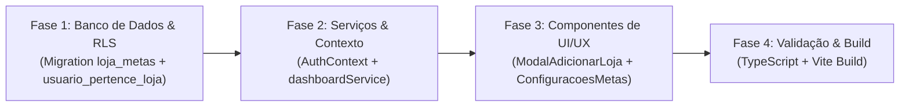

# 📐 PLANO DE IMPLEMENTAÇÃO TÉCNICO E ARQUITETURAL: ENDEREÇO COMPLETO DE NOVA FILIAL & CORREÇÃO DE METAS (RLS 401 E USABILIDADE DE INPUTS)

**Projeto:** HUBI — Sistema de Gestão e Vendas Multiplataforma  
**Data:** 22 de Outubro de 2026  
**Escopo:**  
1. Coleta e persistência de endereço físico completo na criação de nova loja/filial (`ModalAdicionarLoja.tsx` + `AuthContext.tsx`).  
2. Resolução definitiva do erro `401 (Unauthorized)` e refatoração de usabilidade dos inputs numéricos ("zero travado") no módulo de Metas (`ConfiguracoesMetas.tsx` + `dashboardService.ts` + Políticas RLS em `public.loja_metas`).

---

## 1. DIAGNÓSTICO E ANÁLISE DE IMPACTO

### 1.1. Mapeamento dos Problemas e Causas Raiz

#### A. Endereço Incompleto no Cadastro de Nova Loja / Filial
- **Estado Atual:**
  - O componente `src/components/lojas/ModalAdicionarLoja.tsx` coleta apenas `nome`, `whatsapp`, `numeroDocumento`, `cidade` e `estado` (`UF`).
  - O método `adicionarNovaFilial` em `src/contexts/AuthContext.tsx` (linhas 17–23 e 680–800) recebe apenas `{ nome, whatsapp, numero_documento, cidade, estado }` e insere na tabela `public.lojas` deixando nulas as colunas `endereco_cep`, `endereco_logradouro`, `endereco_numero`, `endereco_complemento` e `endereco_bairro`.
- **Impacto no Negócio:**
  - Inviabiliza o cálculo imediato de rotas e cotações de frete (Uber Direct, Melhor Envio/Correios) que dependem de CEP e logradouro de origem da filial.
  - Prejudica a exibição do endereço para **Retirada no Balcão** no Catálogo Online e no cabeçalho de recibos térmicos/A4.

#### B. Erro `401 (Unauthorized)` ao Salvar Metas (`public.loja_metas`)
- **Evidência:** `POST/PUT .../rest/v1/loja_metas?on_conflict=loja_id&select=* 401 (Unauthorized)`.
- **Causa Raiz Combinada (Banco + Sessão/Auth):**
  1. **Ausência de `GRANT` Explícito na Tabela `public.loja_metas`:** Nas migrations `20261002_criar_tabela_loja_metas.sql` e `20261021_ajustar_loja_metas_defaults_zero.sql`, a tabela foi criada com RLS habilitado, porém sem concessão explícita de privilégios (`GRANT SELECT, INSERT, UPDATE, DELETE ON TABLE public.loja_metas TO authenticated, anon, service_role`). Quando o PostgREST tenta executar o `UPSERT`, a ausência de permissão de tabela ou falha na avaliação da policy resulta em rejeição HTTP `401`/`403`.
  2. **Restrição na Função `public.usuario_pertence_loja(loja_id)` em Cenários Multi-Loja / Operador Local:** A função `usuario_pertence_loja` valida estritamente `usuarios_loja.usuario_auth_id = auth.uid()`. Quando um proprietário cria ou alterna para uma filial do mesmo conglomerado (`organizacao_id`) cujo vínculo em `usuarios_loja` ainda não sincronizou o `usuario_auth_id`, ou quando um operador loga via credencial local de `usuarios_loja` sem sessão GoTrue ativa/renovada, `auth.uid()` diverge ou é nulo, bloqueando a escrita na política `WITH CHECK`.
  3. **Propagação/Sincronização de Sessão antes do Upsert (`dashboardService.ts`):** A função `salvarMetasLoja` executa o `.upsert()` diretamente na tabela sem verificar/renovar a sessão ativa (`supabase.auth.getSession()`) ou acionar a autocura de vínculo (`sincronizar_meu_usuario_auth`), nem dispõe de RPC `SECURITY DEFINER` com validação de negócio para contornar divergências de token em operadores locais.

#### C. Usabilidade dos Inputs de Metas com "Zero Travado" (`ConfiguracoesMetas.tsx`)
- **Estado Atual:**
  - Os estados dos 6 indicadores em `src/components/configuracoes/ConfiguracoesMetas.tsx` são tipados estritamente como `number` e inicializados com `0`.
  - Nos eventos `onChange` (linhas 243, 288, 338, 388, 434, 485), aplica-se coerção imediata `parseFloat(e.target.value) || 0` ou `parseInt(e.target.value, 10) || 0`.
- **Impacto na UX:**
  - Quando o lojista pressiona `Backspace` ou `Delete` para limpar o campo e digitar um novo valor, `e.target.value` torna-se `""` (string vazia). O fallback `|| 0` reinsere instantaneamente o algarismo `0` no input, impedindo a limpeza natural do campo e gerando digitações acidentais (ex: digitar `500` resulta em `0500` ou `5000`).

---

### 1.2. Arquivos Mapeados para Modificação

| Camada | Arquivo | Tipo de Intervenção |
| :--- | :--- | :--- |
| **Banco de Dados (Migration)** | `supabase/migrations/20261022_corrigir_rls_loja_metas_e_endereco_filial.sql` | Nova migration para reforço de `GRANT`, atualização de políticas RLS em `public.loja_metas`, aprimoramento de `public.usuario_pertence_loja` com suporte a conglomerado (`organizacoes`) e RPC segura de persistência de metas. |
| **Contexto de Autenticação** | [`src/contexts/AuthContext.tsx`](file:///c:/Users/User/Documents/HUBI/src/contexts/AuthContext.tsx) | Expansão do contrato `adicionarNovaFilial` para receber e persistir o endereço completo na tabela `public.lojas` e espelhar a configuração inicial em `public.loja_shipping_configs`. |
| **Componente de Filial** | [`src/components/lojas/ModalAdicionarLoja.tsx`](file:///c:/Users/User/Documents/HUBI/src/components/lojas/ModalAdicionarLoja.tsx) | Adição dos campos de endereço completo, integração assíncrona com ViaCEP, máscara de CEP e validação de campos obrigatórios antes do submit. |
| **Serviço de Dashboard/Metas** | [`src/services/dashboardService.ts`](file:///c:/Users/User/Documents/HUBI/src/services/dashboardService.ts) | Verificação/renovação de sessão antes de `salvarMetasLoja`, chamada com cláusula explícita de tenant (`loja_id`), suporte a RPC segura e tratamento sanitizado de erros em `pt-BR`. |
| **Componente de Metas** | [`src/components/configuracoes/ConfiguracoesMetas.tsx`](file:///c:/Users/User/Documents/HUBI/src/components/configuracoes/ConfiguracoesMetas.tsx) | Refatoração do estado dos inputs para aceitar valores em edição (`string | number`), permitindo campo vazio (`""`) durante a digitação e normalizando no `onBlur` e no submit. |

---

## 2. DEFINIÇÃO DE DDL E POLÍTICAS RLS (SUPABASE-RLS-GUARD)

A nova migration seguirá rigorosamente a diretriz **`supabase-rls-guard`** e **`anti-jsonb-linter`**:

### 2.1. Verificação de Colunas Relacionais de Endereço em `public.lojas`
- Garantir idempotentemente que a tabela `public.lojas` contenha todas as colunas nativas e tipadas de endereço:
  - `endereco_cep` (`VARCHAR(10)`)
  - `endereco_logradouro` (`VARCHAR(200)`)
  - `endereco_numero` (`VARCHAR(30)`)
  - `endereco_complemento` (`VARCHAR(100)`)
  - `endereco_bairro` (`VARCHAR(100)`)
  - `endereco_cidade` (`VARCHAR(100)`)
  - `endereco_estado` (`VARCHAR(2)`)

### 2.2. Evolução da Função `public.usuario_pertence_loja(p_loja_id UUID)`
- Aprimorar a verificação `SECURITY DEFINER` para retornar `TRUE` quando o usuário autenticado (`auth.uid()`):
  1. Possuir vínculo ativo direto em `public.usuarios_loja` para `p_loja_id` (`usuario_auth_id = auth.uid() AND ativo = TRUE`); **OU**
  2. For o proprietário da organização/conglomerado à qual a loja pertence (`public.organizacoes.dono_usuario_id = auth.uid()`); **OU**
  3. Possuir vínculo de `owner`/`admin` ativo em outra unidade pertencente ao mesmo `organizacao_id` da loja alvo.
- Isso garante que ao criar uma filial ou gerenciar metas entre lojas do mesmo grupo empresarial, o RLS reconheça imediatamente a legitimidade do operador autenticado.

### 2.3. Políticas RLS e Permissões na Tabela `public.loja_metas`
1. **Habilitação Estrita de RLS:**
   - Reafirmar `ALTER TABLE public.loja_metas ENABLE ROW LEVEL SECURITY;`.
2. **Concessão de Privilégios (`GRANT`):**
   - Conceder explicitamente `SELECT, INSERT, UPDATE, DELETE` na tabela `public.loja_metas` para a role `authenticated` e `service_role` (e leitura controlada quando aplicável), eliminando bloqueios de permissão de tabela no PostgREST que originam o código HTTP `401`.
3. **Políticas Granulares por Operação (`SELECT`, `INSERT`, `UPDATE`, `DELETE`):**
   - **`loja_metas_select_policy` (`FOR SELECT`):** `USING (auth.uid() IS NOT NULL AND public.usuario_pertence_loja(loja_id))`
   - **`loja_metas_insert_policy` (`FOR INSERT`):** `WITH CHECK (auth.uid() IS NOT NULL AND public.usuario_pertence_loja(loja_id))`
   - **`loja_metas_update_policy` (`FOR UPDATE`):** `USING (auth.uid() IS NOT NULL AND public.usuario_pertence_loja(loja_id))` e `WITH CHECK (auth.uid() IS NOT NULL AND public.usuario_pertence_loja(loja_id))`
   - **`loja_metas_delete_policy` (`FOR DELETE`):** `USING (auth.uid() IS NOT NULL AND public.usuario_pertence_loja(loja_id))`
4. **RPC Transacional de Apoio (`public.salvar_loja_metas_seguro`):**
   - Criar função RPC `SECURITY DEFINER` com validação de vínculo da loja (`usuario_pertence_loja(p_loja_id)`) que executa o `INSERT ... ON CONFLICT (loja_id) DO UPDATE` de forma atômica, servindo como camada resiliente caso o PostgREST enfrente latência de sincronização de schema cache no `upsert`.

---

## 3. ESTRATÉGIA DE UI/UX E GERENCIAMENTO DE FORMULÁRIOS

### 3.1. Endereço Completo e Autopreenchimento ViaCEP (`ModalAdicionarLoja.tsx`)

#### A. Novos Estados Locais no Modal
- `cep`: string (com máscara visual `00000-000`)
- `logradouro`: string (Rua, Avenida, etc.)
- `numero`: string (Número do estabelecimento ou `"S/N"`)
- `complemento`: string (Opcional: Sala, Loja, Bloco, Galeria)
- `bairro`: string
- `cidade`: string
- `estado`: string (UF, 2 caracteres)
- `buscandoCep`: boolean (indicador visual de carregamento durante a consulta ao ViaCEP)
- `erroCep`: string | null (feedback não-bloqueante caso o CEP não seja localizado, permitindo preenchimento manual)

#### B. Fluxo de Consulta Automática ViaCEP
1. Ao digitar no campo **CEP**, o valor é higienizado (`replace(/\D/g, '')`) e formatado no padrão `00000-000`.
2. Assim que o CEP atingir exatamente **8 dígitos numéricos** (no `onChange` ou `onBlur`):
   - Ativa `buscandoCep = true` e limpa `erroCep`.
   - Realiza requisição `GET https://viacep.com.br/ws/{cepLimpo}/json/`.
   - **Caso sucesso (`!data.erro`):**
     - Preenche automaticamente `logradouro` (`data.logradouro`), `bairro` (`data.bairro`), `cidade` (`data.localidade`) e `estado` (`data.uf.toUpperCase()`).
     - Move o foco automaticamente para o input de **Número** (`numeroInputRef.current?.focus()`) para agilizar o preenchimento pelo lojista.
   - **Caso CEP inexistente (`data.erro === true`) ou falha de rede:**
     - Exibe aviso discreto: *"CEP não encontrado. Preencha os campos de endereço manualmente."* sem travar o formulário.
   - Finaliza com `buscandoCep = false`.

#### C. Layout e Validação Antes do Submit
- **Organização Visual em Grid Responsivo:**
  - Linha 1: **CEP*** (1 coluna, com spinner `Loader2` integrado quando `buscandoCep` for verdadeiro) + **Logradouro / Rua*** (2 colunas).
  - Linha 2: **Número*** (1 coluna) + **Complemento (Opcional)** (2 colunas).
  - Linha 3: **Bairro*** (1 coluna) + **Cidade*** (1 coluna) + **UF*** (1 coluna).
- **Regras de Validação Obrigatória no `handleSubmit`:**
  - Nome Fantasia preenchido.
  - CEP válido com 8 dígitos numéricos.
  - Logradouro, Número, Bairro, Cidade e UF devidamente preenchidos.
  - Exibição de mensagem clara em `pt-BR` no banner de erro do modal caso algum campo obrigatório esteja ausente.

#### D. Persistência Relacional em `AuthContext.tsx` (`adicionarNovaFilial`)
- Atualizar a assinatura de `adicionarNovaFilial` para receber:
  - `endereco_cep`, `endereco_logradouro`, `endereco_numero`, `endereco_complemento`, `endereco_bairro`, `endereco_cidade`, `endereco_estado` (mantendo retrocompatibilidade com `cidade` e `estado`).
- Gravar todos os campos diretamente nas respectivas colunas nativas da tabela `public.lojas`.

---

### 3.2. Refatoração dos Inputs Numéricos e Persistência na Gestão de Metas (`ConfiguracoesMetas.tsx` & `dashboardService.ts`)

#### A. Solução para o Problema do "Zero Travado" nos Inputs
1. **Estado Híbrido de Edição (`string | number`) ou Estado de Formulário Textual:**
   - Alterar a tipagem dos estados locais dos 6 inputs em `ConfiguracoesMetas.tsx` de `number` estrito para `string` (ou `string | number`), representando o valor bruto exibido no `<input>`:
     - `metaFaturamentoInput`, `metaPedidosInput`, `metaLucroLiquidoInput`, `metaDespesasMaximasInput`, `metaInadimplenciaMaximaInput`, `metaSaudeEstoqueRupturaInput`.
2. **Comportamento Fluido Durante a Digitação (`onChange`):**
   - Se `e.target.value === ''`, o estado recebe `''` (string vazia). O campo fica visualmente limpo, permitindo que o usuário apague tudo com `Backspace` ou `Delete` sem que um `0` seja forçado de volta.
   - Caso contenha dígitos, armazena a string numérica válida (removendo zeros à esquerda desnecessários, ex: `"0500"` -> `"500"`, preservando decimais como `"0.5"`).
3. **Comportamento no `onFocus` (Opcional / Melhoria de UX):**
   - Quando o input estiver com valor `"0"` ou `"0.00"`, selecionar automaticamente o conteúdo (`e.target.select()`) ao receber foco, permitindo sobrescrever o zero imediatamente ao digitar qualquer número.
4. **Sanitização e Coerção no `onBlur` e no `handleSalvar`:**
   - No evento `onBlur`: se o usuário sair do campo deixando-o vazio (`""`) ou inválido (`NaN`), o estado é normalizado para `"0"` e respeita os limites mínimos/máximos (`Math.max(0, ...)`).
   - No `handleSalvar`: converte todos os estados para `number` (`Number(valor) || 0`) antes de montar o objeto `payload: Partial<LojaMetas>`, recalculando inclusive a `meta_ticket_medio` derivada (`metaFaturamento / metaPedidos` quando aplicável) antes de enviar ao `dashboardService.salvarMetasLoja`.

#### B. Fluxo Resiliente de Salvamento em `dashboardService.ts`
1. **Garantia de Sessão e Vínculo Multi-Tenant:**
   - Antes de executar o upsert em `salvarMetasLoja(lojaId, metas)`, verificar a sessão ativa via `supabase.auth.getSession()`.
   - Caso exista sessão autenticada, garantir que o token esteja válido e, em caso de erro de permissão na primeira tentativa, invocar `await supabase.rpc('sincronizar_meu_usuario_auth')` para reconciliar o `usuario_auth_id` do operador na filial ativa.
2. **Estratégia Dupla de Persistência (RPC + Upsert com Cláusula de Tenant):**
   - Priorizar ou realizar fallback automático para a RPC `public.salvar_loja_metas_seguro` ou executar `.from('loja_metas').upsert(payload, { onConflict: 'loja_id' }).eq('loja_id', lojaId).select().single()`.
3. **Tratamento Sanitizado de Erros (PII & UX Guard):**
   - Interceptar qualquer erro do PostgREST/Supabase e retornar mensagens claras em `pt-BR` (sem expor SQLSTATE ou URLs de endpoint), atualizando o cache local somente quando a confirmação de gravação for recebida.

---

## 4. FASES E ORDEM DE EXECUÇÃO RECOMENDADA

### Fase 1: Camada de Banco de Dados e Blindagem RLS (Supabase Migration) ✅ CONCLUÍDA
1. Criada a migration `supabase/migrations/20261022_corrigir_rls_loja_metas_e_endereco_filial.sql`.
2. Garantidas as colunas relacionais de endereço em `public.lojas` (`endereco_cep`, `endereco_logradouro`, `endereco_numero`, `endereco_complemento`, `endereco_bairro`, `endereco_cidade`, `endereco_estado`).
3. Atualizada a função `public.usuario_pertence_loja(p_loja_id UUID)` contemplando vínculo direto em `usuarios_loja`, holding societária (`organizacoes.dono_usuario_id`) e administração de lojas do mesmo conglomerado.
4. Aplicadas permissões explícitas (`GRANT ALL ON TABLE public.loja_metas TO authenticated, service_role;` e `GRANT SELECT TO anon`) e recriadas as 4 políticas RLS granulares (`SELECT`, `INSERT`, `UPDATE`, `DELETE`) em `public.loja_metas`.
5. Criada a RPC transacional segura `public.salvar_loja_metas_seguro` com `SECURITY DEFINER` e verificação estrita `public.usuario_pertence_loja(p_loja_id)`.

### Fase 2: Camada de Serviços e Contexto (`AuthContext.tsx` e `dashboardService.ts`) ✅ CONCLUÍDA
1. Atualizada a assinatura e implementação de `adicionarNovaFilial` em [`src/contexts/AuthContext.tsx`](file:///c:/Users/User/Documents/HUBI/src/contexts/AuthContext.tsx) para receber e persistir `endereco_cep`, `endereco_logradouro`, `endereco_numero`, `endereco_complemento`, `endereco_bairro`, `endereco_cidade` e `endereco_estado`, com espelhamento da configuração inicial em `public.loja_shipping_configs`.
2. Atualizado `salvarMetasLoja` em [`src/services/dashboardService.ts`](file:///c:/Users/User/Documents/HUBI/src/services/dashboardService.ts) com reconciliação da sessão GoTrue, persistência prioritária via RPC segura `salvar_loja_metas_seguro`, fallback com cláusula de tenant no PostgREST e sanitização de erro amigável em `pt-BR`.

### Fase 3: Camada de Interface e Usabilidade (`ModalAdicionarLoja.tsx` e `ConfiguracoesMetas.tsx`) ✅ CONCLUÍDA
1. Implementada a seção de endereço completo com busca automática por CEP (ViaCEP) com loading visual, autopreenchimento de logradouro, bairro, cidade, UF, foco automático no campo Número e validação no [`src/components/lojas/ModalAdicionarLoja.tsx`](file:///c:/Users/User/Documents/HUBI/src/components/lojas/ModalAdicionarLoja.tsx).
2. Refatorados todos os inputs de metas em [`src/components/configuracoes/ConfiguracoesMetas.tsx`](file:///c:/Users/User/Documents/HUBI/src/components/configuracoes/ConfiguracoesMetas.tsx) para suportar edição fluida com campo vazio (`""`), foco com auto-seleção e sanitização numérica no `onBlur` e no `handleSalvar`, eliminando o problema do "zero travado".

### Fase 4: Verificação de Qualidade e Build ✅ CONCLUÍDA
1. Executadas checagens estáticas TypeScript (`npx tsc --noEmit`) com 0 erros.
2. Empacotamento de produção Vite e PWA (`npm run build`) validado com código 0 e sem quebras de dependência.
