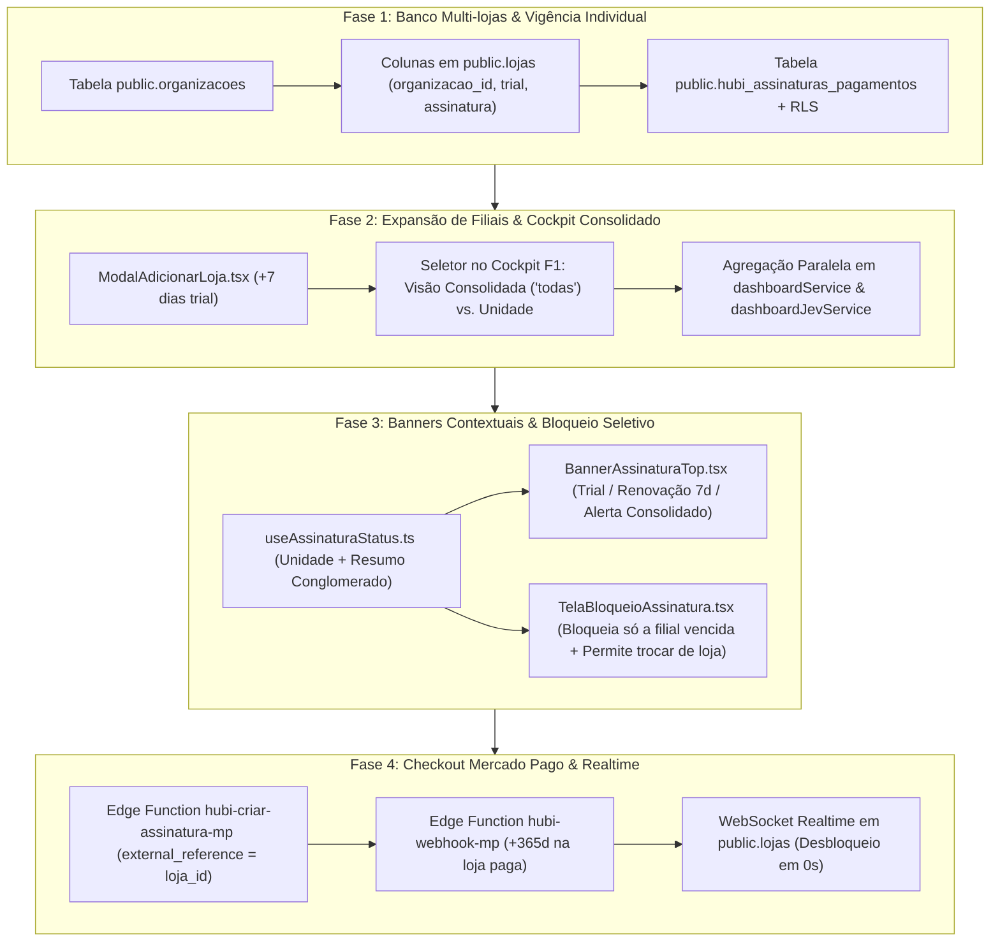

# 🏢 Plano de Implementação Arquitetural — Conglomerado Multi-Lojas, Ciclo de Assinatura Individual por Filial, Expansão de Unidades e Checkout Mercado Pago

> **Status:** ⏸️ Aguardando Validação e Aprovação Formal  
> **Data do Planejamento:** 16/10/2026  
> **Escopo:** Arquitetura de Conglomerado (`organizacoes`), Vigência e Monetização Independente por Loja (`R$ 49,90/mês` no plano anual de `R$ 598,80`), Expansão Self-Service de Filiais com Trial Individual de 7 Dias, Cockpit Executivo F1 Consolidado (`loja_id === 'todas'`) vs. Individual, e Checkout/Webhook Mercado Pago com Desbloqueio Realtime.  
> **Conformidade de Governança:** `supabase-rls-guard`, `anti-jsonb-linter`, `pii-leak-detector` e `diff-patch-only` (`AGENTS.md` / `GEMINI.md`).

---

## 1. Mapeamento de Arquivos (Diagnóstico do Repositório)

A análise cirúrgica das documentações (`DOCUMENTACAO_SISTEMA.md`, `MAPA_COMPONENTES.md`) e do código-fonte identificou a relação exata de novos arquivos a criar e arquivos existentes que receberão patches pontuais:

### 🆕 Novos Arquivos a Serem Criados

| Caminho do Arquivo | Camada | Responsabilidade Técnica |
| :--- | :--- | :--- |
| `supabase/migrations/20261016170000_conglomerado_multilojas_e_assinaturas_mp.sql` | Banco de Dados (PostgreSQL) | Criação de `public.organizacoes`, adição de `organizacao_id` e colunas de ciclo de assinatura em `public.lojas`, criação de `public.hubi_assinaturas_pagamentos`, função `public.usuario_pertence_organizacao()`, políticas RLS multi-tenant e script de backfill retrocompatível para lojas legadas. |
| `supabase/functions/hubi-criar-assinatura-mp/index.ts` | Backend / Edge Function | Geração server-side da Preferência de Checkout Pro do Mercado Pago (Anuidade de R$ 598,80 em até 12x de R$ 49,90 ou Pix) vinculada estritamente à unidade (`external_reference = loja_id`), usando `MP_PLATFORM_ACCESS_TOKEN` e registrando fatura pendente em `hubi_assinaturas_pagamentos`. |
| `supabase/functions/hubi-webhook-mp/index.ts` | Backend / Edge Function | Receptor público (`--no-verify-jwt`) de notificações `payment.created` / `payment.updated` do Mercado Pago. Valida autenticidade na API do MP, identifica a filial via `external_reference = loja_id` e estende `assinatura_fim_em` em `+365 dias` apenas para aquela loja, sem afetar as demais filiais do conglomerado. |
| `src/hooks/useAssinaturaStatus.ts` | Front-end (Hook) | Avaliador reativo do ciclo de vida da loja ativa (`TRIAL_ATIVO`, `ANUIDADE_ATIVA`, `ALERTA_RENOVACAO`, `BLOQUEADO`) + resumo consolidado de alertas de todas as filiais da organização (`lojasEmAlertaConsolidado`), gatilho de checkout MP e escuta WebSocket (`Supabase Realtime`) em `public.lojas`. |
| `src/components/assinatura/BannerAssinaturaTop.tsx` | Front-end (UI) | Banner superior responsivo (Desktop e Mobile) no `AppLayout.tsx` que exibe: (a) contagem regressiva do Trial de 7 dias da loja ativa, (b) alerta de renovação nos últimos 7 dias da anuidade da loja ativa, ou (c) resumo de filiais com vencimento próximo quando o gestor estiver na visão consolidada do Dashboard. |
| `src/components/assinatura/TelaBloqueioAssinatura.tsx` | Front-end (UI) | Tela/overlay de bloqueio seletivo por unidade quando a loja selecionada estiver vencida (`BLOQUEADO`). Permite regularizar a filial via Checkout Mercado Pago **ou alternar imediatamente no seletor para outra filial adimplente** do conglomerado, ou ainda adicionar uma nova filial. |
| `src/components/lojas/ModalAdicionarLoja.tsx` | Front-end (UI) | Modal ágil para o gestor do conglomerado expandir sua rede (`[ + Adicionar Loja ]`). Cria uma nova filial vinculada à mesma `organizacao_id`, inicializando seus próprios **7 dias de trial gratuito**, formas de pagamento/entrega padrão e vínculo do proprietário em `usuarios_loja`. |

### ✏️ Arquivos Existentes a Serem Alterados (via Patch Pontual)

| Arquivo | Símbolo / Trecho Alvo | Alteração Prevista |
| :--- | :--- | :--- |
| `src/types.ts` | `Loja` (linhas 228–294) | Inclusão da interface `Organizacao`, tipo `StatusAssinaturaLoja = 'trial' \| 'ativo' \| 'atrasado' \| 'bloqueado'`, interface `HubiAssinaturaPagamento`, e adição de `organizacao_id`, `status_assinatura`, `trial_fim_em`, `assinatura_fim_em` e `mp_preference_id` em `Loja`. |
| `src/contexts/AuthContext.tsx` | `AuthContextType` e `AuthProvider` | Exposição de `organizacao: Organizacao \| null`, `lojasDisponiveis: Loja[]` (filtradas pela organização/acesso do usuário), método `adicionarNovaFilial(dados)` (que cria a loja na `organizacao_id` atual com 7 dias de trial) e suporte à alternância fluida entre filiais (`selecionarLoja`). |
| `src/components/layout/AppLayout.tsx` | `AppLayout` (linhas 48–808) | Integração do seletor rápido de filiais no cabeçalho (com botão `[ + Adicionar Loja ]` para Owners/Admins), renderização de `<BannerAssinaturaTop />` no topo e bloqueio granular da área operacional (`<main>`) por `<TelaBloqueioAssinatura />` exclusivamente quando a filial ativa estiver com status `BLOQUEADO`. |
| `src/pages/DashboardCockpit.tsx` | `DashboardCockpit` (linhas 44–260) | Adição do seletor de escopo no topo do Cockpit F1: **`🏢 Visão Geral Consolidada (Todas as Lojas)`** (`escopoLojaId = 'todas'`, padrão inicial para Owners/Gestores com múltiplas lojas) vs. seleção individual de qualquer filial (`loja.id`), além do botão rápido `[ + Adicionar Loja ]`. |
| `src/services/dashboardService.ts` | `obterMetasLoja` e `obterMetricasCockpitFallback` | Suporte à agregação multi-lojas quando `lojaId === 'todas'`, iterando com `.eq('loja_id', id)` sobre cada filial ativa do conglomerado para somar faturamento, pedidos, CMV, despesas, lucro líquido e metas mensais proporcionais. |
| `src/services/dashboardJevService.ts` | `computarPayloadCompleto` e `gerarChaveCache` | Suporte ao parâmetro `lojaId: 'todas' \| string` e `lojasIdsConglomerado?: string[]`, executando consultas isoladas por `.eq('loja_id', id)` em paralelo (`Promise.all`) para consolidar indicadores, curvas ABC e decomposições de todas as lojas ativas da organização. |
| `DOCUMENTACAO_SISTEMA.md` e `MAPA_COMPONENTES.md` | Dicionário de Dados & Mapa | Documentação das tabelas `organizacoes` e `hubi_assinaturas_pagamentos`, novas colunas em `lojas`, Edge Functions e componentes de gestão multi-lojas. |

---

## 2. DDL SQL Proposta (Supabase PostgreSQL)

O script abaixo adere rigorosamente às regras **`supabase-rls-guard`** (RLS ativa com validação cruzada `auth.uid()` e funções `SECURITY DEFINER`) e **`anti-jsonb-linter`** (modelagem 100% relacional e tipada para organizações e pagamentos de assinaturas):

```sql
-- ==============================================================================
-- MIGRATION: 20261016170000_conglomerado_multilojas_e_assinaturas_mp.sql
-- Arquitetura de Conglomerado (organizacoes), Ciclo de Assinatura por Loja e MP
-- ==============================================================================

-- 1. TABELA public.organizacoes (Camada de Conglomerado / Holding do Proprietário)
CREATE TABLE IF NOT EXISTS public.organizacoes (
    id UUID PRIMARY KEY DEFAULT gen_random_uuid(),
    nome VARCHAR(150) NOT NULL,
    dono_usuario_id UUID NULL REFERENCES auth.users(id) ON DELETE SET NULL,
    email_principal VARCHAR(150) NULL,
    criado_em TIMESTAMPTZ NOT NULL DEFAULT NOW(),
    atualizado_em TIMESTAMPTZ NOT NULL DEFAULT NOW()
);

CREATE INDEX IF NOT EXISTS idx_organizacoes_dono_usuario_id
    ON public.organizacoes(dono_usuario_id);

DROP TRIGGER IF EXISTS trg_organizacoes_updated_at ON public.organizacoes;
CREATE TRIGGER trg_organizacoes_updated_at
    BEFORE UPDATE ON public.organizacoes
    FOR EACH ROW
    EXECUTE FUNCTION public.fn_atualizar_timestamp_modificacao();

-- 2. NOVAS COLUNAS NA TABELA public.lojas (Vínculo ao Conglomerado + Ciclo de Vida Individual)
ALTER TABLE public.lojas
    ADD COLUMN IF NOT EXISTS organizacao_id UUID NULL REFERENCES public.organizacoes(id) ON DELETE RESTRICT,
    ADD COLUMN IF NOT EXISTS status_assinatura VARCHAR(20) NOT NULL DEFAULT 'trial'
        CONSTRAINT chk_lojas_status_assinatura CHECK (status_assinatura IN ('trial', 'ativo', 'atrasado', 'bloqueado')),
    ADD COLUMN IF NOT EXISTS trial_fim_em TIMESTAMPTZ NOT NULL DEFAULT (NOW() + INTERVAL '7 days'),
    ADD COLUMN IF NOT EXISTS assinatura_fim_em TIMESTAMPTZ NULL,
    ADD COLUMN IF NOT EXISTS mp_preference_id TEXT NULL;

CREATE INDEX IF NOT EXISTS idx_lojas_organizacao_id ON public.lojas(organizacao_id);
CREATE INDEX IF NOT EXISTS idx_lojas_status_assinatura ON public.lojas(status_assinatura);

-- 3. MIGRAÇÃO RETROCOMPATÍVEL (AGRUPAMENTO AUTOMÁTICO DE LOJAS EXISTENTES EM ORGANIZAÇÕES)
-- Agrupa lojas existentes pelo usuario_auth_id do proprietário (ou email da loja),
-- criando uma Organização padrão para cada proprietário e atribuindo 7 dias de trial
-- para evitar qualquer bloqueio acidental pós-migração.
DO $$
DECLARE
    r_loja RECORD;
    v_owner_auth_id UUID;
    v_email_chave TEXT;
    v_org_id UUID;
BEGIN
    FOR r_loja IN
        SELECT l.id, l.nome_fantasia, LOWER(TRIM(l.email)) AS email_limpo
        FROM public.lojas l
        WHERE l.organizacao_id IS NULL
        ORDER BY l.criado_em ASC
    LOOP
        -- Localiza o usuario_auth_id do owner/admin da loja, se houver
        SELECT ul.usuario_auth_id
        INTO v_owner_auth_id
        FROM public.usuarios_loja ul
        WHERE ul.loja_id = r_loja.id
          AND ul.usuario_auth_id IS NOT NULL
        ORDER BY CASE WHEN ul.perfil = 'owner' THEN 0 WHEN ul.perfil = 'admin' THEN 1 ELSE 2 END,
                 ul.criado_em ASC
        LIMIT 1;

        v_email_chave := COALESCE(r_loja.email_limpo, 'sem-email-' || r_loja.id::text);
        v_org_id := NULL;

        -- Verifica se já criamos uma organização para o mesmo dono_usuario_id ou email_principal
        IF v_owner_auth_id IS NOT NULL THEN
            SELECT o.id INTO v_org_id
            FROM public.organizacoes o
            WHERE o.dono_usuario_id = v_owner_auth_id
            LIMIT 1;
        END IF;

        IF v_org_id IS NULL THEN
            SELECT o.id INTO v_org_id
            FROM public.organizacoes o
            WHERE LOWER(TRIM(o.email_principal)) = v_email_chave
            LIMIT 1;
        END IF;

        -- Se ainda não existir organização para este proprietário, cria uma nova
        IF v_org_id IS NULL THEN
            INSERT INTO public.organizacoes (nome, dono_usuario_id, email_principal)
            VALUES (
                'Grupo ' || COALESCE(r_loja.nome_fantasia, 'HUBI'),
                v_owner_auth_id,
                v_email_chave
            )
            RETURNING id INTO v_org_id;
        END IF;

        -- Vincula a loja à organização e garante janela segura de 7 dias se ainda sem assinatura
        UPDATE public.lojas
        SET
            organizacao_id = v_org_id,
            status_assinatura = COALESCE(status_assinatura, 'trial'),
            trial_fim_em = CASE
                WHEN trial_fim_em IS NULL OR trial_fim_em < NOW() THEN NOW() + INTERVAL '7 days'
                ELSE trial_fim_em
            END
        WHERE id = r_loja.id;
    END LOOP;
END $$;

-- 4. TRIGGER AUTOMÁTICA PARA NOVAS LOJAS (GARANTE ORGANIZAÇÃO E TRIAL DE 7 DIAS INDIVIDUAL)
CREATE OR REPLACE FUNCTION public.fn_antes_inserir_loja_conglomerado()
RETURNS TRIGGER
LANGUAGE plpgsql
SECURITY DEFINER
SET search_path = public
AS $$
DECLARE
    v_org_id UUID;
BEGIN
    -- Garante status_assinatura e trial_fim_em individuais para a nova unidade
    IF NEW.status_assinatura IS NULL THEN
        NEW.status_assinatura := 'trial';
    END IF;

    IF NEW.trial_fim_em IS NULL THEN
        NEW.trial_fim_em := NOW() + INTERVAL '7 days';
    END IF;

    -- Se organizacao_id não foi enviado explicitamente, tenta localizar a organização do usuário autenticado ou cria uma
    IF NEW.organizacao_id IS NULL THEN
        IF auth.uid() IS NOT NULL THEN
            SELECT id INTO v_org_id
            FROM public.organizacoes
            WHERE dono_usuario_id = auth.uid()
            ORDER BY criado_em ASC
            LIMIT 1;
        END IF;

        IF v_org_id IS NULL AND NEW.email IS NOT NULL THEN
            SELECT id INTO v_org_id
            FROM public.organizacoes
            WHERE LOWER(TRIM(email_principal)) = LOWER(TRIM(NEW.email))
            ORDER BY criado_em ASC
            LIMIT 1;
        END IF;

        IF v_org_id IS NULL THEN
            INSERT INTO public.organizacoes (nome, dono_usuario_id, email_principal)
            VALUES (
                'Grupo ' || COALESCE(NEW.nome_fantasia, 'HUBI'),
                auth.uid(),
                LOWER(TRIM(NEW.email))
            )
            RETURNING id INTO v_org_id;
        END IF;

        NEW.organizacao_id := v_org_id;
    END IF;

    RETURN NEW;
END;
$$;

DROP TRIGGER IF EXISTS trg_lojas_antes_inserir_conglomerado ON public.lojas;
CREATE TRIGGER trg_lojas_antes_inserir_conglomerado
    BEFORE INSERT ON public.lojas
    FOR EACH ROW
    EXECUTE FUNCTION public.fn_antes_inserir_loja_conglomerado();

-- 5. FUNÇÃO DE SEGURANÇA RLS PARA ORGANIZAÇÃO
CREATE OR REPLACE FUNCTION public.usuario_pertence_organizacao(p_organizacao_id UUID)
RETURNS BOOLEAN
LANGUAGE plpgsql
SECURITY DEFINER
SET search_path = public
AS $$
BEGIN
    IF auth.uid() IS NULL OR p_organizacao_id IS NULL THEN
        RETURN FALSE;
    END IF;

    RETURN EXISTS (
        SELECT 1
        FROM public.organizacoes o
        WHERE o.id = p_organizacao_id
          AND o.dono_usuario_id = auth.uid()
    ) OR EXISTS (
        SELECT 1
        FROM public.lojas l
        JOIN public.usuarios_loja ul ON ul.loja_id = l.id
        WHERE l.organizacao_id = p_organizacao_id
          AND ul.usuario_auth_id = auth.uid()
          AND ul.ativo = TRUE
    );
END;
$$;

-- RLS DA TABELA public.organizacoes
ALTER TABLE public.organizacoes ENABLE ROW LEVEL SECURITY;

DROP POLICY IF EXISTS "organizacoes_select_policy" ON public.organizacoes;
CREATE POLICY "organizacoes_select_policy"
    ON public.organizacoes
    FOR SELECT
    USING (auth.uid() IS NOT NULL AND public.usuario_pertence_organizacao(id));

DROP POLICY IF EXISTS "organizacoes_insert_policy" ON public.organizacoes;
CREATE POLICY "organizacoes_insert_policy"
    ON public.organizacoes
    FOR INSERT
    WITH CHECK (auth.uid() IS NOT NULL AND (dono_usuario_id IS NULL OR dono_usuario_id = auth.uid()));

DROP POLICY IF EXISTS "organizacoes_update_policy" ON public.organizacoes;
CREATE POLICY "organizacoes_update_policy"
    ON public.organizacoes
    FOR UPDATE
    USING (auth.uid() IS NOT NULL AND public.usuario_pertence_organizacao(id))
    WITH CHECK (auth.uid() IS NOT NULL AND public.usuario_pertence_organizacao(id));

DROP POLICY IF EXISTS "organizacoes_delete_policy" ON public.organizacoes;
CREATE POLICY "organizacoes_delete_policy"
    ON public.organizacoes
    FOR DELETE
    USING (auth.uid() IS NOT NULL AND dono_usuario_id = auth.uid());

-- 6. TABELA RELACIONAL public.hubi_assinaturas_pagamentos (HISTÓRICO DE ANUIDADES POR LOJA)
CREATE TABLE IF NOT EXISTS public.hubi_assinaturas_pagamentos (
    id UUID PRIMARY KEY DEFAULT gen_random_uuid(),
    loja_id UUID NOT NULL REFERENCES public.lojas(id) ON DELETE CASCADE,
    organizacao_id UUID NOT NULL REFERENCES public.organizacoes(id) ON DELETE CASCADE,
    mp_preference_id TEXT NOT NULL,
    mp_payment_id TEXT NULL,
    mp_collection_id TEXT NULL,
    status_pagamento VARCHAR(30) NOT NULL DEFAULT 'pendente'
        CONSTRAINT chk_hubi_assinaturas_status CHECK (
            status_pagamento IN ('pendente', 'approved', 'in_process', 'rejected', 'cancelled', 'refunded')
        ),
    meio_pagamento VARCHAR(50) NULL,          -- ex: 'pix', 'credit_card', 'debit_card'
    bandeira_metodo VARCHAR(50) NULL,         -- ex: 'visa', 'master', 'pix'
    valor_total NUMERIC(10, 2) NOT NULL DEFAULT 598.80,
    valor_mensal_referencia NUMERIC(10, 2) NOT NULL DEFAULT 49.90,
    parcelas INTEGER NOT NULL DEFAULT 1 CHECK (parcelas >= 1 AND parcelas <= 12),
    ciclo_meses INTEGER NOT NULL DEFAULT 12,
    periodo_inicio_em TIMESTAMPTZ NULL,
    periodo_fim_em TIMESTAMPTZ NULL,
    link_checkout TEXT NULL,
    aprovado_em TIMESTAMPTZ NULL,
    criado_em TIMESTAMPTZ NOT NULL DEFAULT NOW(),
    atualizado_em TIMESTAMPTZ NOT NULL DEFAULT NOW(),
    CONSTRAINT uq_hubi_assinaturas_mp_payment_id UNIQUE (mp_payment_id)
);

CREATE INDEX IF NOT EXISTS idx_hubi_assinaturas_loja_id
    ON public.hubi_assinaturas_pagamentos(loja_id);
CREATE INDEX IF NOT EXISTS idx_hubi_assinaturas_organizacao_id
    ON public.hubi_assinaturas_pagamentos(organizacao_id);
CREATE INDEX IF NOT EXISTS idx_hubi_assinaturas_mp_preference_id
    ON public.hubi_assinaturas_pagamentos(mp_preference_id);
CREATE INDEX IF NOT EXISTS idx_hubi_assinaturas_mp_payment_id
    ON public.hubi_assinaturas_pagamentos(mp_payment_id);

DROP TRIGGER IF EXISTS trg_hubi_assinaturas_pagamentos_updated_at ON public.hubi_assinaturas_pagamentos;
CREATE TRIGGER trg_hubi_assinaturas_pagamentos_updated_at
    BEFORE UPDATE ON public.hubi_assinaturas_pagamentos
    FOR EACH ROW
    EXECUTE FUNCTION public.fn_atualizar_timestamp_modificacao();

-- 7. BLINDAGEM RLS MULTI-TENANT EM public.hubi_assinaturas_pagamentos (SUPABASE-RLS-GUARD)
ALTER TABLE public.hubi_assinaturas_pagamentos ENABLE ROW LEVEL SECURITY;

DROP POLICY IF EXISTS "hubi_assinaturas_pagamentos_select_policy" ON public.hubi_assinaturas_pagamentos;
CREATE POLICY "hubi_assinaturas_pagamentos_select_policy"
    ON public.hubi_assinaturas_pagamentos
    FOR SELECT
    USING (auth.uid() IS NOT NULL AND public.usuario_pertence_loja(loja_id));

DROP POLICY IF EXISTS "hubi_assinaturas_pagamentos_insert_policy" ON public.hubi_assinaturas_pagamentos;
CREATE POLICY "hubi_assinaturas_pagamentos_insert_policy"
    ON public.hubi_assinaturas_pagamentos
    FOR INSERT
    WITH CHECK (auth.uid() IS NOT NULL AND public.usuario_pertence_loja(loja_id));

DROP POLICY IF EXISTS "hubi_assinaturas_pagamentos_update_policy" ON public.hubi_assinaturas_pagamentos;
CREATE POLICY "hubi_assinaturas_pagamentos_update_policy"
    ON public.hubi_assinaturas_pagamentos
    FOR UPDATE
    USING (auth.uid() IS NOT NULL AND public.usuario_pertence_loja(loja_id))
    WITH CHECK (auth.uid() IS NOT NULL AND public.usuario_pertence_loja(loja_id));

DROP POLICY IF EXISTS "hubi_assinaturas_pagamentos_delete_policy" ON public.hubi_assinaturas_pagamentos;
CREATE POLICY "hubi_assinaturas_pagamentos_delete_policy"
    ON public.hubi_assinaturas_pagamentos
    FOR DELETE
    USING (auth.uid() IS NOT NULL AND public.usuario_pertence_loja(loja_id));

-- 8. PUBLICAÇÃO SUPABASE REALTIME PARA DESBLOQUEIO INSTANTÂNEO DE UNIDADES
DO $$
BEGIN
    IF NOT EXISTS (
        SELECT 1
        FROM pg_publication_tables
        WHERE pubname = 'supabase_realtime'
          AND schemaname = 'public'
          AND tablename = 'lojas'
    ) THEN
        ALTER PUBLICATION supabase_realtime ADD TABLE public.lojas;
    END IF;
END $$;
```

---

## 3. Divisão em Fases Claras de Implementação



### 🔹 Fase 1: Modelagem Multi-lojas e Ciclo de Vida Independente por Loja no Banco
1. Criar a migration `supabase/migrations/20261016170000_conglomerado_multilojas_e_assinaturas_mp.sql` estabelecendo:
   - `public.organizacoes` como entidade guarda-chuva do conglomerado;
   - `organizacao_id`, `status_assinatura`, `trial_fim_em`, `assinatura_fim_em` e `mp_preference_id` em `public.lojas`;
   - `public.hubi_assinaturas_pagamentos` com chaves estrangeiras para `loja_id` e `organizacao_id`;
   - Agrupamento automático e seguro das lojas já existentes no banco em organizações padrão, preservando 7 dias de trial inicial.
2. Atualizar `src/types.ts` com as interfaces `Organizacao`, `HubiAssinaturaPagamento` e os novos campos em `Loja`.
3. Evoluir `src/contexts/AuthContext.tsx` para carregar a `organizacao` ativa, listar todas as `lojasDisponiveis` do conglomerado e expor a função `adicionarNovaFilial()`.

### 🔹 Fase 2: Fluxo UI de Adição de Novas Lojas e Agregação do Dashboard (Consolidado vs. Individual)
1. **Criação de Filiais (`src/components/lojas/ModalAdicionarLoja.tsx`)**:
   - Acessível via botão **`[ + Adicionar Loja ]`** no seletor de lojas do topo (`AppLayout.tsx` e `DashboardCockpit.tsx`).
   - Solicita Nome Fantasia da nova unidade, WhatsApp, Documento (CPF/CNPJ opcional) e Cidade/UF.
   - Insere a nova loja vinculada ao mesmo `organizacao_id` do proprietário, inicializando automaticamente:
     - `status_assinatura = 'trial'` e `trial_fim_em = NOW() + 7 dias`;
     - Vínculo do usuário proprietário (`perfil: 'owner'`) em `usuarios_loja`;
     - Formas de pagamento, entrega e categorias básicas da nova filial.
2. **Cockpit Executivo F1 Consolidado vs. Individual (`src/pages/DashboardCockpit.tsx`, `src/services/dashboardService.ts`, `src/services/dashboardJevService.ts`)**:
   - No `DashboardCockpit.tsx`, o estado `escopoLojaId` inicia por padrão como `'todas'` (Visão Geral Consolidada) quando o gestor possui acesso administrativo ao conglomerado, com um seletor no topo permitindo alternar instantaneamente entre:
     - **`🏢 Todas as Lojas (Consolidado)`** — soma as métricas de todas as lojas ativas (não bloqueadas) da organização;
     - **`🏪 [Nome da Filial A]`**, **`🏪 [Nome da Filial B]`** — filtra os indicadores, velocímetros F1 e gavetas analíticas exclusivamente para a unidade escolhida.
   - Em `dashboardService.ts` e `dashboardJevService.ts`, quando `lojaId === 'todas'`, o motor executa as consultas por loja em paralelo (`Promise.all` mantendo `.eq('loja_id', id)` em cada consulta individual para 100% de conformidade com `supabase-rls-guard`) e agrega matematicamente Faturamento, Volume de Pedidos, Ticket Médio Ponderado, CMV, Despesas, Lucro Líquido Real, Inadimplência, Saúde de Estoque e Metas Proporcionais.

### 🔹 Fase 3: Banners Contextuais (Trial / Renovação de 7 dias) e Bloqueio Granular por Loja
1. **Hook `src/hooks/useAssinaturaStatus.ts`**:
   - Calcula o estado individual de cada loja em `lojasDisponiveis`:
     - **`TRIAL_ATIVO`**: `status_assinatura === 'trial'` e `NOW() < trial_fim_em` (exibe contagem regressiva de 1 a 7 dias).
     - **`ANUIDADE_ATIVA`**: `status_assinatura === 'ativo'` e faltam **mais de 7 dias** para `assinatura_fim_em` (banner oculto).
     - **`ALERTA_RENOVACAO`**: `status_assinatura === 'ativo'` e faltam **7 dias ou menos** para `assinatura_fim_em` (exibe alerta de renovação anual preventiva).
     - **`BLOQUEADO`**: `trial_fim_em` ou `assinatura_fim_em` expirado sem renovação confirmada (`NOW() >= fim_vigencia`) ou `status_assinatura IN ('atrasado', 'bloqueado')`.
   - Calcula também `alertasConsolidados`: lista de filiais do conglomerado que estão em Trial, em Alerta de Renovação (≤ 7 dias) ou Vencidas, para exibição resumida quando o gestor estiver na Visão Consolidada do Dashboard.
2. **Banner Contextual (`src/components/assinatura/BannerAssinaturaTop.tsx`)**:
   - **Visão de Unidade em Trial:** *"Você está no período de teste da unidade **[Nome da Loja]**: restam **X dias**. Garanta o plano anual por apenas R$ 49,90/mês [Assinar Agora]"*.
   - **Visão de Unidade em Alerta de Renovação (≤ 7 dias):** *"A assinatura anual da unidade **[Nome da Loja]** vence em **X dias**. Renove agora para manter sua loja operando sem interrupções [Renovar Assinatura]"*.
   - **Visão Consolidada no Cockpit (quando houver filiais em alerta):** *"Atenção no Conglomerado: você possui X loja(s) em período de teste ou próximas do vencimento anual [Ver e Regularizar Unidades]"*.
3. **Bloqueio Operacional Seletivo (`src/components/assinatura/TelaBloqueioAssinatura.tsx`)**:
   - Se a loja ativa selecionada (`loja.id`) estiver no estado `BLOQUEADO`, o painel operacional daquela filial (PDV, Pedidos, Produtos, Finanças) é coberto pela `TelaBloqueioAssinatura`.
   - **Diferencial Multi-lojas:** A tela de bloqueio exibe:
     1. Botão principal **`[Assinar / Renovar Esta Loja por R$ 49,90/mês (Anual)]`** que leva ao Checkout Mercado Pago daquela unidade;
     2. **Seletor de Troca Rápida de Filial:** lista as demais lojas adimplentes do conglomerado para que o gestor possa alternar com 1 clique para a Loja A e continuar trabalhando normalmente enquanto decide sobre a Loja B;
     3. Botão **`[ + Adicionar Nova Loja ]`**.

### 🔹 Fase 4: Edge Function de Checkout Mercado Pago por Loja e Desbloqueio em Tempo Real
1. **Edge Function `supabase/functions/hubi-criar-assinatura-mp/index.ts`**:
   - Recebe `{ loja_id }` no payload autenticado.
   - Verifica se o usuário autenticado pertence àquela `loja_id`.
   - Invoca `POST https://api.mercadopago.com/checkout/preferences` com `MP_PLATFORM_ACCESS_TOKEN`:
     - `title`: `"Plano Anual HUBI (12 Meses) - Unidade: " + loja.nome_fantasia`
     - `unit_price`: `598.80` (com parcelamento configurado em até 12x no cartão, Pix à vista ou cartão de débito no Checkout Pro do Mercado Pago)
     - `external_reference`: `loja.id`
     - `notification_url`: `${SUPABASE_URL}/functions/v1/hubi-webhook-mp`
   - Grava `mp_preference_id` em `public.lojas` (`.eq('id', loja.id)`) e insere o registro auditável em `public.hubi_assinaturas_pagamentos` com `loja_id` e `organizacao_id`.
2. **Edge Function `supabase/functions/hubi-webhook-mp/index.ts`**:
   - Ao receber `payment.created` / `payment.updated`, consulta `GET https://api.mercadopago.com/v1/payments/{payment_id}` com `MP_PLATFORM_ACCESS_TOKEN`.
   - Quando `status === 'approved'`, identifica a filial exata por `external_reference` (`loja_id`).
   - Verifica idempotência em `public.hubi_assinaturas_pagamentos` (`mp_payment_id`).
   - Calcula o novo período de 365 dias **exclusivamente para a loja paga**:
     - `inicio_ciclo = GREATEST(COALESCE(loja.assinatura_fim_em, loja.trial_fim_em, NOW()), NOW())`
     - `fim_ciclo = inicio_ciclo + INTERVAL '365 days'`
   - Atualiza `public.lojas` (`status_assinatura = 'ativo'`, `assinatura_fim_em = fim_ciclo`) onde `id = loja_id`.
3. **Desbloqueio Instantâneo via WebSocket (`Supabase Realtime`)**:
   - O canal Realtime em `useAssinaturaStatus.ts` escuta `UPDATE` em `public.lojas` para as lojas do conglomerado.
   - Assim que o webhook atualiza a filial, o estado em `AuthContext` (`loja` e `lojasDisponiveis`) é atualizado em tempo real, removendo o bloqueio e ocultando o banner sem precisar recarregar a página.

---

## 4. Matriz de Riscos, Isolamento Operacional e Compatibilidade

| Dimensão Crítica | Risco Potencial | Estratégia de Mitigação e Garantia Arquitetural |
| :--- | :--- | :--- |
| **Isolamento de Estoque, Pedidos e Caixa entre Filiais** | Vazamento ou mistura de vendas, caixas ou saldos de estoque entre a Loja A e a Loja B do mesmo conglomerado. | **100% Isolado por `loja_id`:** Nenhum módulo operacional (PDV, `CartContext`, `caixaService`, `estoquePedidoService`, `PedidosLista`, `ProdutosEstoque`) usa `organizacao_id`. Todos permanecem estritamente vinculados ao `loja.id` ativo na sessão e protegidos por `public.usuario_pertence_loja(loja_id)`. Apenas o Cockpit Executivo F1 (`DashboardCockpit`) oferece a visão agregada de leitura quando selecionado `'todas'`. |
| **Inadimplência de Filial Isolada** | O vencimento da Loja B bloquear acidentalmente o PDV ou o Catálogo da Loja A. | **Vigência por Unidade (`lojas`):** Os campos `status_assinatura`, `trial_fim_em` e `assinatura_fim_em` residem na tabela `public.lojas` (e não em `organizacoes`). O bloqueio avalia estritamente a unidade ativa e oferece botão imediato para alternar para qualquer outra filial ativa. |
| **Lojas Antigas já em Produção (Legado)** | Lojas criadas antes da migração ficarem sem `organizacao_id` ou serem bloqueadas no deploy. | **Backfill Transacional na Migration:** O bloco `DO $$` na migration agrupa automaticamente todas as lojas existentes na sua respectiva `organizacao` e concede `NOW() + INTERVAL '7 days'` para qualquer loja sem `assinatura_fim_em`, garantindo zero interrupção. |
| **Renovação Antecipada (Últimos 7 Dias ou Durante Trial)** | O lojista renovar antes do vencimento e perder os dias restantes do ciclo atual. | **Soma Cumulativa (`GREATEST`):** O cálculo no webhook soma `+365 dias` sobre a maior data entre `NOW()` e a vigência atual (`assinatura_fim_em` ou `trial_fim_em`), preservando integralmente os dias restantes daquela filial. |
| **Falha Temporária de Rede / Offline no PDV** | Queda momentânea de internet bloquear um caixa em meio a uma venda. | **Fail-Safe Local:** O hook `useAssinaturaStatus` respeita os timestamps já sincronizados no objeto `loja` e nunca bloqueia por erro transitório de rede se a data de vigência da filial ainda for futura. |
| **Segurança de Credenciais e LGPD (`pii-leak-detector`)** | Exposição do `Access Token` mestre do Mercado Pago ou SQLSTATE no front-end. | **Server-Side Exclusivo:** O token mestre `MP_PLATFORM_ACCESS_TOKEN` vive exclusivamente nos Secrets das Edge Functions do Supabase. Erros retornam mensagens amigáveis em `pt-BR`. |
