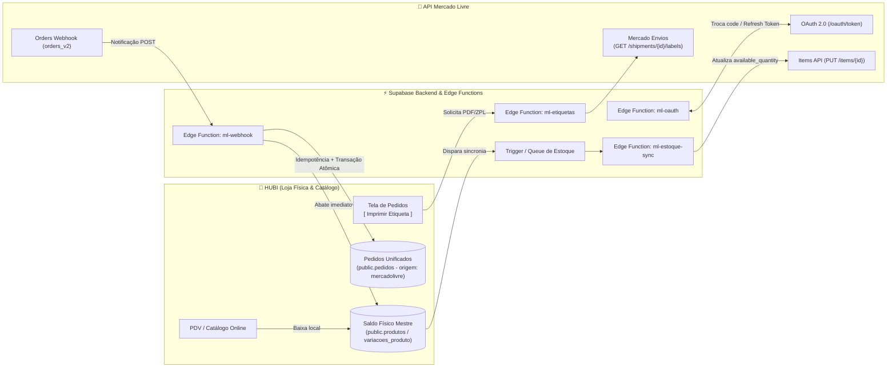

# 📦 PLANO DE IMPLEMENTAÇÃO PRAGMÁTICO — INTEGRAÇÃO NATIVA COM MERCADO LIVRE (ESTOQUE LOCAL & EXPEDIÇÃO)

> **Status:** ⏸️ Aguardando Validação e Aprovação Formal  
> **Data do Planejamento:** 17/10/2026  
> **Escopo:** Integração nativa e bidirecional entre o **HUBI** e a **API do Mercado Livre** (`api.mercadolibre.com`), com foco em **Estoque Físico Local Unificado**, **Conexão OAuth 2.0 Segura**, **Vínculo Rápido de Produtos via Contratos GDM** (`src/types/gdm.ts`) e **Expedição/Despacho Simplificado com Impressão de Etiquetas Mercado Envios** (PDF/ZPL).  
> **Conformidade de Governança:** `diff-patch-only`, `supabase-rls-guard`, `pii-leak-detector` e `anti-jsonb-linter` (`AGENTS.md` / `GEMINI.md`).

---

## 🧭 Visão Arquitetural do Fluxo Operacional



### Diretrizes de Governança Aplicadas
1. **`supabase-rls-guard`:** Todas as tabelas possuem `ENABLE ROW LEVEL SECURITY` e políticas `SELECT`, `INSERT`, `UPDATE` e `DELETE` blindadas por `public.usuario_pertence_loja(loja_id)` com verificação cruzada `auth.uid() IS NOT NULL`. Consultas no frontend sempre explicitam `.eq('loja_id', loja.id)`.
2. **`anti-jsonb-linter`:** Zero colunas `JSONB` para entidades operacionais (tokens, anúncios, saldos, fretes, códigos de rastreio ou eventos de webhook). Todos os atributos são modelados em colunas nativas e tipadas (`UUID`, `VARCHAR`, `BIGINT`, `NUMERIC`, `TIMESTAMPTZ`, `BOOLEAN`).
3. **`pii-leak-detector`:**
   - Credenciais OAuth (`access_token`, `refresh_token`) jamais trafegam para o navegador (`SELECT` bloqueado no frontend para colunas secretas ou encapsulado via View/RPC segura; mutações ocorrem exclusivamente nas Edge Functions com `SUPABASE_SERVICE_ROLE_KEY`).
   - Dados sensíveis do comprador vindos do Mercado Livre (CPF/CNPJ, telefone, coordenadas) são sanitizados antes de persistência e jamais expostos em `console.log` ou mensagens de erro.
4. **`diff-patch-only`:** Alterações em arquivos existentes do HUBI (`src/types.ts`, `src/types/gdm.ts`, `src/pages/OrdersScreen.tsx`, `src/pages/ProductsScreen.tsx`, `src/pages/SettingsScreen.tsx`) serão aplicadas exclusivamente via patches cirúrgicos (`replace_file_content`).

---

## 1. Modelagem de Dados Relacional (Supabase PostgreSQL)

### 1.1. Arquivo de Migration Proposto
- **Caminho:** `supabase/migrations/20261017140000_integracao_nativa_mercado_livre.sql`

```sql
-- ==============================================================================
-- MIGRATION: 20261017140000_integracao_nativa_mercado_livre.sql
-- Integração Nativa Mercado Livre: Contas OAuth, Anúncios Vinculados e Webhooks
-- Governança: supabase-rls-guard | anti-jsonb-linter | pii-leak-detector
-- ==============================================================================

-- 1. EXTENSÃO DO DOMÍNIO DE ORIGEM E COLUNAS DE EXPEDIÇÃO EM public.pedidos
ALTER TABLE public.pedidos
    ADD COLUMN IF NOT EXISTS ml_order_id BIGINT NULL,
    ADD COLUMN IF NOT EXISTS ml_pack_id BIGINT NULL,
    ADD COLUMN IF NOT EXISTS ml_shipment_id BIGINT NULL,
    ADD COLUMN IF NOT EXISTS ml_logistic_type VARCHAR(40) NULL,
    ADD COLUMN IF NOT EXISTS ml_etiqueta_impressa BOOLEAN NOT NULL DEFAULT FALSE,
    ADD COLUMN IF NOT EXISTS ml_etiqueta_impressa_em TIMESTAMPTZ NULL;

CREATE UNIQUE INDEX IF NOT EXISTS idx_pedidos_loja_ml_order_id
    ON public.pedidos(loja_id, ml_order_id)
    WHERE ml_order_id IS NOT NULL;

CREATE INDEX IF NOT EXISTS idx_pedidos_ml_shipment_id
    ON public.pedidos(loja_id, ml_shipment_id)
    WHERE ml_shipment_id IS NOT NULL;

-- 2. TABELA: public.marketplace_contas
-- Armazena o vínculo OAuth 2.0 da loja com o Mercado Livre (1 conta ML por loja)
CREATE TABLE IF NOT EXISTS public.marketplace_contas (
    id UUID PRIMARY KEY DEFAULT gen_random_uuid(),
    loja_id UUID NOT NULL REFERENCES public.lojas(id) ON DELETE CASCADE,
    provedor VARCHAR(30) NOT NULL DEFAULT 'mercadolivre'
        CONSTRAINT chk_marketplace_contas_provedor CHECK (provedor IN ('mercadolivre')),
    ml_user_id BIGINT NOT NULL,
    ml_nickname VARCHAR(120) NOT NULL,
    ml_site_id VARCHAR(10) NOT NULL DEFAULT 'MLB',
    access_token TEXT NOT NULL,
    refresh_token TEXT NOT NULL,
    token_expira_em TIMESTAMPTZ NOT NULL,
    escopos VARCHAR(255) NULL,
    status_conexao VARCHAR(25) NOT NULL DEFAULT 'conectado'
        CONSTRAINT chk_marketplace_contas_status CHECK (status_conexao IN ('conectado', 'expirado', 'erro_autenticacao', 'desconectado')),
    sincronizar_estoque_automatico BOOLEAN NOT NULL DEFAULT TRUE,
    importar_pedidos_automatico BOOLEAN NOT NULL DEFAULT TRUE,
    taxa_comissao_padrao_percentual NUMERIC(5,2) NOT NULL DEFAULT 16.00,
    taxa_fixa_padrao NUMERIC(10,2) NOT NULL DEFAULT 6.00,
    ultima_sincronizacao_em TIMESTAMPTZ NULL,
    ultimo_erro_mensagem VARCHAR(500) NULL,
    conectado_por_usuario_id UUID NULL REFERENCES auth.users(id) ON DELETE SET NULL,
    criado_em TIMESTAMPTZ NOT NULL DEFAULT NOW(),
    atualizado_em TIMESTAMPTZ NOT NULL DEFAULT NOW(),
    CONSTRAINT uq_marketplace_contas_loja_provedor UNIQUE (loja_id, provedor),
    CONSTRAINT uq_marketplace_contas_ml_user UNIQUE (ml_user_id)
);

CREATE INDEX IF NOT EXISTS idx_marketplace_contas_loja_id
    ON public.marketplace_contas(loja_id);

DROP TRIGGER IF EXISTS trg_marketplace_contas_updated_at ON public.marketplace_contas;
CREATE TRIGGER trg_marketplace_contas_updated_at
    BEFORE UPDATE ON public.marketplace_contas
    FOR EACH ROW
    EXECUTE FUNCTION public.fn_atualizar_timestamp_modificacao();

-- 3. TABELA: public.marketplace_anuncios
-- Relaciona produtos/variações locais do HUBI aos itens/variações do Mercado Livre (MLB...)
CREATE TABLE IF NOT EXISTS public.marketplace_anuncios (
    id UUID PRIMARY KEY DEFAULT gen_random_uuid(),
    loja_id UUID NOT NULL REFERENCES public.lojas(id) ON DELETE CASCADE,
    conta_id UUID NOT NULL REFERENCES public.marketplace_contas(id) ON DELETE CASCADE,
    produto_id UUID NOT NULL REFERENCES public.produtos(id) ON DELETE CASCADE,
    variacao_id UUID NULL REFERENCES public.variacoes_produto(id) ON DELETE CASCADE,
    ml_item_id VARCHAR(30) NOT NULL, -- Ex: MLB384920192
    ml_variation_id BIGINT NULL,     -- Preenchido quando o anúncio possui grade no ML
    ml_category_id VARCHAR(30) NULL, -- Ex: MLB1430
    ml_listing_type_id VARCHAR(30) NOT NULL DEFAULT 'gold_special'
        CONSTRAINT chk_marketplace_anuncios_listing_type CHECK (ml_listing_type_id IN ('gold_pro', 'gold_special', 'free')),
    titulo_anuncio VARCHAR(60) NOT NULL,
    preco_anuncio NUMERIC(12,2) NOT NULL CHECK (preco_anuncio >= 0),
    margem_sobrepreco_percentual NUMERIC(5,2) NOT NULL DEFAULT 0.00,
    estoque_ultimo_enviado INTEGER NOT NULL DEFAULT 0,
    status_anuncio VARCHAR(20) NOT NULL DEFAULT 'active'
        CONSTRAINT chk_marketplace_anuncios_status CHECK (status_anuncio IN ('active', 'paused', 'closed', 'under_review', 'erro_sincronia')),
    permalink VARCHAR(500) NULL,
    sincronizacao_ativa BOOLEAN NOT NULL DEFAULT TRUE,
    ultima_sincronizacao_estoque_em TIMESTAMPTZ NULL,
    ultimo_erro_sincronizacao VARCHAR(500) NULL,
    criado_em TIMESTAMPTZ NOT NULL DEFAULT NOW(),
    atualizado_em TIMESTAMPTZ NOT NULL DEFAULT NOW()
);

-- Índice único funcional para evitar duplicidade de anúncio e variação por loja
CREATE UNIQUE INDEX IF NOT EXISTS uq_marketplace_anuncios_item_var
    ON public.marketplace_anuncios(loja_id, ml_item_id, (COALESCE(ml_variation_id, 0)));

CREATE INDEX IF NOT EXISTS idx_marketplace_anuncios_loja_produto
    ON public.marketplace_anuncios(loja_id, produto_id, variacao_id);

CREATE INDEX IF NOT EXISTS idx_marketplace_anuncios_ml_item
    ON public.marketplace_anuncios(ml_item_id, ml_variation_id);

DROP TRIGGER IF EXISTS trg_marketplace_anuncios_updated_at ON public.marketplace_anuncios;
CREATE TRIGGER trg_marketplace_anuncios_updated_at
    BEFORE UPDATE ON public.marketplace_anuncios
    FOR EACH ROW
    EXECUTE FUNCTION public.fn_atualizar_timestamp_modificacao();

-- 4. TABELA: public.marketplace_pedidos_webhook
-- Log idempotente e estruturado de eventos recebidos do Mercado Livre (sem JSONB)
CREATE TABLE IF NOT EXISTS public.marketplace_pedidos_webhook (
    id UUID PRIMARY KEY DEFAULT gen_random_uuid(),
    loja_id UUID NOT NULL REFERENCES public.lojas(id) ON DELETE CASCADE,
    conta_id UUID NOT NULL REFERENCES public.marketplace_contas(id) ON DELETE CASCADE,
    ml_notification_id VARCHAR(80) NOT NULL,
    topico VARCHAR(40) NOT NULL
        CONSTRAINT chk_marketplace_webhook_topico CHECK (topico IN ('orders_v2', 'shipments', 'items')),
    recurso_uri VARCHAR(255) NOT NULL, -- Ex: /orders/2000004928192
    ml_resource_id BIGINT NOT NULL,    -- Ex: 2000004928192
    ml_user_id BIGINT NOT NULL,
    status_processamento VARCHAR(25) NOT NULL DEFAULT 'pendente'
        CONSTRAINT chk_marketplace_webhook_status CHECK (status_processamento IN ('pendente', 'processando', 'processado', 'ignorado', 'erro')),
    pedido_interno_id UUID NULL REFERENCES public.pedidos(id) ON DELETE SET NULL,
    tentativas INTEGER NOT NULL DEFAULT 1,
    mensagem_resultado VARCHAR(500) NULL,
    enviado_pelo_ml_em TIMESTAMPTZ NULL,
    processado_em TIMESTAMPTZ NULL,
    criado_em TIMESTAMPTZ NOT NULL DEFAULT NOW(),
    CONSTRAINT uq_marketplace_webhook_idempotencia UNIQUE (loja_id, topico, ml_resource_id, ml_notification_id)
);

CREATE INDEX IF NOT EXISTS idx_marketplace_webhook_loja_status
    ON public.marketplace_pedidos_webhook(loja_id, status_processamento, criado_em DESC);

-- ==============================================================================
-- 5. BLINDAGEM RLS MULTI-TENANT (supabase-rls-guard)
-- ==============================================================================

ALTER TABLE public.marketplace_contas ENABLE ROW LEVEL SECURITY;
ALTER TABLE public.marketplace_anuncios ENABLE ROW LEVEL SECURITY;
ALTER TABLE public.marketplace_pedidos_webhook ENABLE ROW LEVEL SECURITY;

-- Políticas para public.marketplace_contas
DROP POLICY IF EXISTS "marketplace_contas_select_loja" ON public.marketplace_contas;
CREATE POLICY "marketplace_contas_select_loja" ON public.marketplace_contas
    FOR SELECT TO authenticated
    USING (auth.uid() IS NOT NULL AND public.usuario_pertence_loja(loja_id));

DROP POLICY IF EXISTS "marketplace_contas_insert_loja" ON public.marketplace_contas;
CREATE POLICY "marketplace_contas_insert_loja" ON public.marketplace_contas
    FOR INSERT TO authenticated
    WITH CHECK (auth.uid() IS NOT NULL AND public.usuario_pertence_loja(loja_id));

DROP POLICY IF EXISTS "marketplace_contas_update_loja" ON public.marketplace_contas;
CREATE POLICY "marketplace_contas_update_loja" ON public.marketplace_contas
    FOR UPDATE TO authenticated
    USING (auth.uid() IS NOT NULL AND public.usuario_pertence_loja(loja_id))
    WITH CHECK (auth.uid() IS NOT NULL AND public.usuario_pertence_loja(loja_id));

DROP POLICY IF EXISTS "marketplace_contas_delete_loja" ON public.marketplace_contas;
CREATE POLICY "marketplace_contas_delete_loja" ON public.marketplace_contas
    FOR DELETE TO authenticated
    USING (auth.uid() IS NOT NULL AND public.usuario_pertence_loja(loja_id));

-- Políticas para public.marketplace_anuncios
DROP POLICY IF EXISTS "marketplace_anuncios_select_loja" ON public.marketplace_anuncios;
CREATE POLICY "marketplace_anuncios_select_loja" ON public.marketplace_anuncios
    FOR SELECT TO authenticated
    USING (auth.uid() IS NOT NULL AND public.usuario_pertence_loja(loja_id));

DROP POLICY IF EXISTS "marketplace_anuncios_insert_loja" ON public.marketplace_anuncios;
CREATE POLICY "marketplace_anuncios_insert_loja" ON public.marketplace_anuncios
    FOR INSERT TO authenticated
    WITH CHECK (auth.uid() IS NOT NULL AND public.usuario_pertence_loja(loja_id));

DROP POLICY IF EXISTS "marketplace_anuncios_update_loja" ON public.marketplace_anuncios;
CREATE POLICY "marketplace_anuncios_update_loja" ON public.marketplace_anuncios
    FOR UPDATE TO authenticated
    USING (auth.uid() IS NOT NULL AND public.usuario_pertence_loja(loja_id))
    WITH CHECK (auth.uid() IS NOT NULL AND public.usuario_pertence_loja(loja_id));

DROP POLICY IF EXISTS "marketplace_anuncios_delete_loja" ON public.marketplace_anuncios;
CREATE POLICY "marketplace_anuncios_delete_loja" ON public.marketplace_anuncios
    FOR DELETE TO authenticated
    USING (auth.uid() IS NOT NULL AND public.usuario_pertence_loja(loja_id));

-- Políticas para public.marketplace_pedidos_webhook
DROP POLICY IF EXISTS "marketplace_webhook_select_loja" ON public.marketplace_pedidos_webhook;
CREATE POLICY "marketplace_webhook_select_loja" ON public.marketplace_pedidos_webhook
    FOR SELECT TO authenticated
    USING (auth.uid() IS NOT NULL AND public.usuario_pertence_loja(loja_id));

DROP POLICY IF EXISTS "marketplace_webhook_insert_loja" ON public.marketplace_pedidos_webhook;
CREATE POLICY "marketplace_webhook_insert_loja" ON public.marketplace_pedidos_webhook
    FOR INSERT TO authenticated
    WITH CHECK (auth.uid() IS NOT NULL AND public.usuario_pertence_loja(loja_id));

DROP POLICY IF EXISTS "marketplace_webhook_update_loja" ON public.marketplace_pedidos_webhook;
CREATE POLICY "marketplace_webhook_update_loja" ON public.marketplace_pedidos_webhook
    FOR UPDATE TO authenticated
    USING (auth.uid() IS NOT NULL AND public.usuario_pertence_loja(loja_id))
    WITH CHECK (auth.uid() IS NOT NULL AND public.usuario_pertence_loja(loja_id));

DROP POLICY IF EXISTS "marketplace_webhook_delete_loja" ON public.marketplace_pedidos_webhook;
CREATE POLICY "marketplace_webhook_delete_loja" ON public.marketplace_pedidos_webhook
    FOR DELETE TO authenticated
    USING (auth.uid() IS NOT NULL AND public.usuario_pertence_loja(loja_id));

-- ==============================================================================
-- 6. PROTEÇÃO DE SEGREDOS (pii-leak-detector)
-- Revoga leitura direta das colunas access_token e refresh_token pelo role authenticated
-- ==============================================================================
REVOKE SELECT (access_token, refresh_token) ON public.marketplace_contas FROM authenticated, anon;

-- ==============================================================================
-- 7. RPC ATÔMICA PARA PROCESSAMENTO DE PEDIDO MERCADO LIVRE E BAIXA DE ESTOQUE
-- ==============================================================================
CREATE OR REPLACE FUNCTION public.processar_pedido_mercado_livre_atomico(
    p_loja_id UUID,
    p_ml_order_id BIGINT,
    p_ml_pack_id BIGINT,
    p_ml_shipment_id BIGINT,
    p_ml_logistic_type VARCHAR(40),
    p_cliente_nome VARCHAR(150),
    p_subtotal NUMERIC(12,2),
    p_valor_frete NUMERIC(12,2),
    p_valor_total NUMERIC(12,2),
    p_produto_id UUID,
    p_variacao_id UUID,
    p_quantidade INTEGER,
    p_preco_unitario NUMERIC(12,2)
)
RETURNS UUID
LANGUAGE plpgsql
SECURITY DEFINER
SET search_path = public
AS $$
DECLARE
    v_pedido_existente_id UUID;
    v_novo_pedido_id UUID;
    v_numero_pedido INTEGER;
BEGIN
    -- 1. Trava de Idempotência: se o ml_order_id já foi importado nesta loja, retorna o ID existente
    SELECT id INTO v_pedido_existente_id
    FROM public.pedidos
    WHERE loja_id = p_loja_id AND ml_order_id = p_ml_order_id
    FOR UPDATE;

    IF v_pedido_existente_id IS NOT NULL THEN
        RETURN v_pedido_existente_id;
    END IF;

    -- 2. Calcula próximo número sequencial do pedido na loja
    SELECT COALESCE(MAX(numero_pedido), 0) + 1 INTO v_numero_pedido
    FROM public.pedidos
    WHERE loja_id = p_loja_id;

    -- 3. Insere o cabeçalho em public.pedidos com origem 'mercadolivre'
    INSERT INTO public.pedidos (
        loja_id,
        numero_pedido,
        origem,
        tabela_preco_aplicada,
        status,
        status_pagamento,
        estoque_baixado,
        subtotal,
        valor_desconto,
        valor_frete,
        valor_total,
        valor_pago,
        saldo_devedor,
        fiado_quitado,
        cliente_nome_avulso,
        observacoes,
        data_venda,
        ml_order_id,
        ml_pack_id,
        ml_shipment_id,
        ml_logistic_type
    ) VALUES (
        p_loja_id,
        v_numero_pedido,
        'mercadolivre',
        'varejo',
        'aguardando_envio',
        'pago',
        TRUE,
        p_subtotal,
        0,
        p_valor_frete,
        p_valor_total,
        p_valor_total,
        0,
        TRUE,
        p_cliente_nome,
        'Pedido importado automaticamente via Mercado Livre (#' || p_ml_order_id::TEXT || ')',
        NOW(),
        p_ml_order_id,
        p_ml_pack_id,
        p_ml_shipment_id,
        p_ml_logistic_type
    )
    RETURNING id INTO v_novo_pedido_id;

    -- 4. Busca nome do produto e rótulo da variação para preencher colunas NOT NULL de itens_pedido
    DECLARE
        v_nome_prod VARCHAR;
        v_rotulo_var VARCHAR;
    BEGIN
        SELECT nome INTO v_nome_prod FROM public.produtos WHERE id = p_produto_id;
        IF p_variacao_id IS NOT NULL THEN
            SELECT combinacao_nome INTO v_rotulo_var FROM public.variacoes_produto WHERE id = p_variacao_id;
        END IF;

        INSERT INTO public.itens_pedido (
            loja_id,
            pedido_id,
            produto_id,
            variacao_id,
            nome_produto,
            rotulo_variacao,
            quantidade,
            preco_venda_unitario,
            subtotal
        ) VALUES (
            p_loja_id,
            v_novo_pedido_id,
            p_produto_id,
            p_variacao_id,
            COALESCE(v_nome_prod, 'Produto Mercado Livre'),
            v_rotulo_var,
            p_quantidade,
            p_preco_unitario,
            ROUND(p_quantidade * p_preco_unitario, 2)
        );
    END;

    -- 5. Abate imediatamente o saldo físico local (com ROW LOCK FOR UPDATE)
    IF p_variacao_id IS NOT NULL THEN
        UPDATE public.variacoes_produto
        SET quantidade_estoque = GREATEST(0, COALESCE(quantidade_estoque, 0) - p_quantidade)
        WHERE id = p_variacao_id AND loja_id = p_loja_id;
    END IF;

    UPDATE public.produtos
    SET quantidade_estoque = GREATEST(0, COALESCE(quantidade_estoque, 0) - p_quantidade)
    WHERE id = p_produto_id AND loja_id = p_loja_id;

    RETURN v_novo_pedido_id;
END;
$$;
```

---

## 2. Arquitetura das Edge Functions (Supabase Deno Runtime)

Todas as Edge Functions compartilham um utilitário interno `supabase/functions/_shared/mlClient.ts` para renovação transparente de token e sanitização de erros em `pt-BR`.

### 2.1. Módulo Compartilhado e `ml-oauth` (`supabase/functions/ml-oauth/index.ts`)
- **Responsabilidade:** Gerenciar o ciclo completo de OAuth 2.0 do Mercado Livre:
  1. **`GET /ml-oauth?action=authorize_url&loja_id={uuid}`:** Valida se `auth.uid()` pertence à `loja_id`, assina um `state` HMAC (`loja_id:timestamp:hmac`) e devolve a URL oficial de autorização (`https://auth.mercadolivre.com.br/authorization?response_type=code&client_id=...&redirect_uri=...&state=...`).
  2. **`POST /ml-oauth` (Callback de troca de `code`):** Recebe o `code` e `state`, valida a assinatura HMAC, realiza `POST https://api.mercadolibre.com/oauth/token` (`grant_type=authorization_code`), busca os dados básicos da conta (`GET /users/me` para obter `nickname` e `site_id`) e realiza `UPSERT` em `public.marketplace_contas`.
  3. **Helper `obterAccessTokenValido(supabaseAdmin, lojaId)`:** Antes de qualquer chamada às APIs do Mercado Livre (`items`, `orders`, `shipments`), verifica se `token_expira_em <= NOW() + INTERVAL '5 minutes'`. Caso positivo, executa `POST /oauth/token` com `grant_type=refresh_token`, persiste o novo par `access_token` / `refresh_token` no banco e retorna o token atualizado.
- **Variáveis de Ambiente Necessárias (Supabase Secrets):**
  - `ML_APP_ID`: ID do aplicativo registrado no DevCenter do Mercado Livre.
  - `ML_CLIENT_SECRET`: Chave secreta do aplicativo no Mercado Livre.
  - `ML_REDIRECT_URI`: URL de retorno configurada no DevCenter.
  - `ML_STATE_HMAC_SECRET`: Segredo para assinar o parâmetro `state` anti-CSRF.

### 2.2. Sincronizador de Estoque Local -> Mercado Livre (`supabase/functions/ml-estoque-sync/index.ts`)
- **Responsabilidade:** Manter o Mercado Livre espelhado no saldo físico do HUBI e gerenciar o vínculo/publicação de anúncios.
- **Modos de Operação:**
  1. **`action = 'sync_inventory'` (Disparado após venda no PDV, venda no Catálogo Online ou ajuste manual de estoque):**
     - Consulta `public.marketplace_anuncios` filtrando por `.eq('loja_id', loja_id).eq('produto_id', produto_id).eq('sincronizacao_ativa', true)`.
     - Lê o `estoque_atual` de `public.produtos` (ou `public.variacoes_produto` quando `variacao_id IS NOT NULL`).
     - Executa `PUT https://api.mercadolibre.com/items/{ml_item_id}`:
       - Sem variação: `{"available_quantity": saldoAtual}`.
       - Com variação: `{"variations": [{"id": ml_variation_id, "available_quantity": saldoAtual}]}`.
     - Atualiza `estoque_ultimo_enviado` e `ultima_sincronizacao_estoque_em` em `public.marketplace_anuncios`.
  2. **`action = 'link_existing'` (Vincular anúncio existente por código `MLB...`):**
     - Consulta `GET https://api.mercadolibre.com/items/{ml_item_id}`, valida se pertence ao `ml_user_id` da loja, grava em `public.marketplace_anuncios` e sincroniza imediatamente o saldo físico do HUBI.
  3. **`action = 'create_listing'` (Publicar novo anúncio a partir do contrato GDM):**
     - Recebe o payload normalizado pelo contrato GDM, calcula o preço com a margem/comissão configurada e envia `POST https://api.mercadolibre.com/items`, salvando o `ml_item_id` e `permalink` retornados.

### 2.3. Receptor de Pedidos (`supabase/functions/ml-webhook/index.ts`)
- **Configuração:** Endpoint público (`--no-verify-jwt`) registrado no painel de notificações do Mercado Livre para os tópicos `orders_v2` e `shipments`.
- **Fluxo de Execução Idempotente:**
  1. Recebe o payload de notificação do Mercado Livre (`_id`, `topic`, `resource`, `user_id`, `sent`).
  2. Localiza a loja correspondente em `public.marketplace_contas` pelo `ml_user_id = user_id`. Se não existir ou estiver desconectada, retorna `200 OK` (evita retentativas infinitas).
  3. Registra o evento em `public.marketplace_pedidos_webhook` com `ON CONFLICT (loja_id, topico, ml_resource_id, ml_notification_id) DO NOTHING`. Se já estiver `processado`, retorna `200 OK` imediatamente.
  4. Quando `topic === 'orders_v2'`:
     - Obtém o `access_token` válido via `obterAccessTokenValido()`.
     - Consulta `GET https://api.mercadolibre.com/orders/{order_id}`.
     - Verifica se `status === 'paid'`.
     - Para cada item em `order_items`, localiza o produto/variação vinculado em `public.marketplace_anuncios` (`ml_item_id` / `ml_variation_id`).
     - Sanitiza o nome do comprador (`buyer.first_name` + inicial do sobrenome ou `buyer.nickname`, sem gravar CPF/telefone brutos em logs — conformidade `pii-leak-detector`).
     - Invoca a RPC `public.processar_pedido_mercado_livre_atomico(...)` que cria o pedido em `public.pedidos` (`origem = 'mercadolivre'`, `status = 'aguardando_envio'`) e **abate imediatamente o saldo físico local** na mesma transação.
     - Marca o registro em `public.marketplace_pedidos_webhook` como `processado`.

### 2.4. Emissor de Etiquetas de Postagem (`supabase/functions/ml-etiquetas/index.ts`)
- **Responsabilidade:** Entregar ao lojista a etiqueta oficial do Mercado Envios (Agência / Coleta / Flex) pronta para impressão térmica (ZPL2/PDF) ou A4 (PDF).
- **Fluxo de Execução:**
  1. Autentica o usuário (`auth.uid()`) e verifica permissão na `loja_id` via `public.usuario_pertence_loja(loja_id)`.
  2. Busca o pedido em `public.pedidos` filtrando estritamente por `.eq('loja_id', loja_id).eq('id', pedido_id)` e valida a presença de `ml_shipment_id`.
  3. Verifica o status da remessa em `GET https://api.mercadolibre.com/shipments/{ml_shipment_id}` (deve estar `ready_to_ship` e `substatus: 'ready_to_print'` ou `'printed'`). Caso ainda esteja `handling`, retorna mensagem amigável em `pt-BR`: *"A etiqueta deste pedido ainda está sendo liberada pelo Mercado Envios. Tente novamente em alguns instantes."*
  4. Requisita a etiqueta oficial em `GET https://api.mercadolibre.com/shipment_labels?shipment_ids={ml_shipment_id}&response_type={pdf|zpl2}` com `Authorization: Bearer {access_token}`.
  5. Atualiza `ml_etiqueta_impressa = true` e `ml_etiqueta_impressa_em = NOW()` em `public.pedidos`.
  6. Devolve o binário (`application/pdf` ou `text/plain` para ZPL) diretamente para abertura/impressão imediata na aba do navegador ou impressora térmica do HUBI.

---

## 3. Contratos GDM e Patches Cirúrgicos no Frontend (`diff-patch-only`)

### 3.1. Normalização GDM para Mercado Livre (`src/types/gdm.ts`)
Extensão do arquivo `src/types/gdm.ts` com contratos canônicos para tradução bidirecional entre `GdmProdutoCanonico` e a estrutura de `Items` do Mercado Livre:

```diff
diff --git a/src/types/gdm.ts b/src/types/gdm.ts
--- a/src/types/gdm.ts
+++ b/src/types/gdm.ts
@@ -54,3 +54,32 @@ export interface GdmResultadoSincronizacao {
   erros: string[];
   tempoExecucaoMs: number;
 }
+
+export type MlListingTypeId = 'gold_pro' | 'gold_special' | 'free';
+
+export interface GdmAtributoMercadoLivre {
+  id: string; // Ex: 'BRAND', 'MODEL', 'GTIN'
+  value_name: string;
+}
+
+export interface GdmAnuncioMercadoLivreCanonico {
+  produto_id: string;
+  variacao_id?: string | null;
+  ml_item_id?: string | null;
+  ml_variation_id?: number | null;
+  titulo_anuncio: string; // Limite estrito de 60 caracteres da API ML
+  categoria_ml_id: string; // Ex: 'MLB1430'
+  tipo_anuncio: MlListingTypeId;
+  preco_base_hubi: number;
+  margem_sobrepreco_percentual: number;
+  preco_final_ml: number;
+  estoque_fisico_disponivel: number;
+  codigo_barras_ean?: string | null;
+  fotos_urls: string[];
+  atributos_ml: GdmAtributoMercadoLivre[];
+}
```

### 3.2. Inclusão da Origem `'mercadolivre'` e Campos de Expedição (`src/types.ts`)
Patch pontual em `src/types.ts`:

```diff
diff --git a/src/types.ts b/src/types.ts
--- a/src/types.ts
+++ b/src/types.ts
@@ -20,1 +20,1 @@
-export type OrigemVenda = 'pdv_mobile' | 'pdv_desktop' | 'catalogo_online';
+export type OrigemVenda = 'pdv_mobile' | 'pdv_desktop' | 'catalogo_online' | 'mercadolivre';
@@ -649,3 +649,9 @@ export interface Pedido {
   motivo_cancelamento?: string | null;
   criado_em?: string;
+  ml_order_id?: number | null;
+  ml_pack_id?: number | null;
+  ml_shipment_id?: number | null;
+  ml_logistic_type?: string | null;
+  ml_etiqueta_impressa?: boolean;
+  ml_etiqueta_impressa_em?: string | null;
 }
```

### 3.3. Mapa de Novos Serviços e Componentes Frontend

| Caminho do Arquivo | Camada | Responsabilidade Técnica |
| :--- | :--- | :--- |
| `src/services/mercadoLivreService.ts` | Serviço Frontend | Consultas multi-tenant (sempre com `.eq('loja_id', lojaId)`) para status da conta em `marketplace_contas`, listagem/vínculo em `marketplace_anuncios`, disparo de sincronização de estoque e download do PDF/ZPL via `supabase.functions.invoke('ml-etiquetas')`. |
| `src/utils/gdmMercadoLivreMapper.ts` | Tradutor GDM | Função pura `converterProdutoHubiParaGdmMl()` que trunca o título em 60 caracteres, aplica a margem de comissão sobre `preco_venda_sugerido`, extrai `GTIN`/`EAN` do `codigo_barras` e monta as variações compatíveis com a API do Mercado Livre. |
| `src/components/mercadolivre/CardConexaoMercadoLivre.tsx` | UI (Configurações) | Card em Configurações com status da conta (`Conectado como @nickname` ou `Desconectado`), botão `[ Conectar com Mercado Livre ]`, toggle de sincronização automática de estoque e configuração de margem padrão. |
| `src/components/mercadolivre/ModalVincularAnuncioMl.tsx` | UI (Produtos) | Modal rápido acionado na tela de Produtos para: (A) Vincular a um ID existente (`MLB...`) ou (B) Publicar novo anúncio no Mercado Livre com calculadora de preço/comissão em tempo real. |
| `src/pages/OrdersScreen.tsx` *(Patch)* | UI (Pedidos) | Badge visual amarelo/esmeralda `Mercado Livre` nos pedidos com `origem === 'mercadolivre'` e botão de ação direta `[ 🖨️ Imprimir Etiqueta ]` (com indicador de etiqueta já impressa). |

---

## 4. Plano de Execução Sequencial e Critérios de Homologação (Sandbox ML)

### 🚀 Fase 1: Banco de Dados Relacional e Autenticação OAuth 2.0
1. **Passos de Implementação:**
   - Aplicar a migration `20261017140000_integracao_nativa_mercado_livre.sql` criando `marketplace_contas`, `marketplace_anuncios`, `marketplace_pedidos_webhook`, políticas RLS e a RPC `processar_pedido_mercado_livre_atomico`.
   - Implementar `_shared/mlClient.ts` e a Edge Function `ml-oauth`.
   - Criar `src/services/mercadoLivreService.ts` e inserir `<CardConexaoMercadoLivre />` na tela de Configurações.
2. **Critérios de Teste em Sandbox (Usuários de Teste do Mercado Livre — `TETE...`):**
   - Gerar 2 usuários de teste no DevCenter do Mercado Livre (`POST /users/test_user` com `site_id: "MLB"`): um **Vendedor (`SELLER`)** e um **Comprador (`BUYER`)**.
   - Clicar em `[ Conectar com Mercado Livre ]` no HUBI autenticado com o usuário de teste `SELLER`, autorizar o aplicativo e validar se `public.marketplace_contas` registrou `ml_user_id`, `ml_nickname` e `status_conexao = 'conectado'`.
   - Executar um `SELECT` no frontend com o client autenticado e comprovar que `access_token` e `refresh_token` **não** são retornados (proteção `REVOKE SELECT`).
   - Forçar `token_expira_em = NOW() - INTERVAL '10 minutes'` no banco e acionar uma chamada de verificação para atestar a renovação automática via `refresh_token`.

---

### 🔄 Fase 2: Vínculo GDM e Sincronização de Estoque Local -> Mercado Livre
1. **Passos de Implementação:**
   - Aplicar os patches em `src/types/gdm.ts` e `src/types.ts`.
   - Criar `src/utils/gdmMercadoLivreMapper.ts` e a Edge Function `ml-estoque-sync`.
   - Integrar `<ModalVincularAnuncioMl />` na listagem de produtos do HUBI.
   - Conectar o gatilho pós-venda do PDV (`PosCheckout.tsx`) e do Catálogo Online para invocar `ml-estoque-sync` de forma assíncrona (não bloqueante para o operador de caixa) sempre que um produto possuir anúncio ativo vinculado.
2. **Critérios de Teste em Sandbox:**
   - Vincular um produto local do HUBI (com `estoque_atual = 10`) a um anúncio de teste `MLB...` da conta `SELLER`.
   - Realizar uma venda de `2 unidades` no PDV do HUBI -> confirmar que o saldo local cai para `8` e que `GET https://api.mercadolibre.com/items/{MLB...}` reflete `available_quantity: 8` em menos de 3 segundos.

---

### 📦 Fase 3: Recebimento de Pedidos (`orders_v2`) e Impressão de Etiquetas Mercado Envios
1. **Passos de Implementação:**
   - Implementar a Edge Function idempotente `ml-webhook` (`--no-verify-jwt`) e a Edge Function `ml-etiquetas`.
   - Aplicar patch pontual em `src/pages/OrdersScreen.tsx` para exibir o filtro/badge `Mercado Livre` e o botão `[ 🖨️ Imprimir Etiqueta ]` nos pedidos que possuírem `origem === 'mercadolivre'` e `ml_shipment_id`.
2. **Critérios de Teste em Sandbox:**
   - Com o usuário de teste `BUYER`, efetuar uma compra de `3 unidades` no anúncio de teste do `SELLER`.
   - Verificar em `public.marketplace_pedidos_webhook` o recebimento da notificação `orders_v2` com status `processado`.
   - Reenviar o mesmo payload de webhook 3 vezes seguidas via `curl` e comprovar que a chave única de idempotência + RPC atômica impedem duplicação do pedido e impedem baixa tripla de estoque.
   - Confirmar que o saldo físico no HUBI caiu automaticamente de `8` para `5` e que o pedido aparece em `OrdersScreen.tsx` com status `Aguardando Envio` e badge `Mercado Livre`.
   - Clicar em `[ 🖨️ Imprimir Etiqueta ]`, validar o download/abertura do PDF (ou ZPL2) oficial do Mercado Envios e confirmar a marcação `ml_etiqueta_impressa = true` no pedido.
